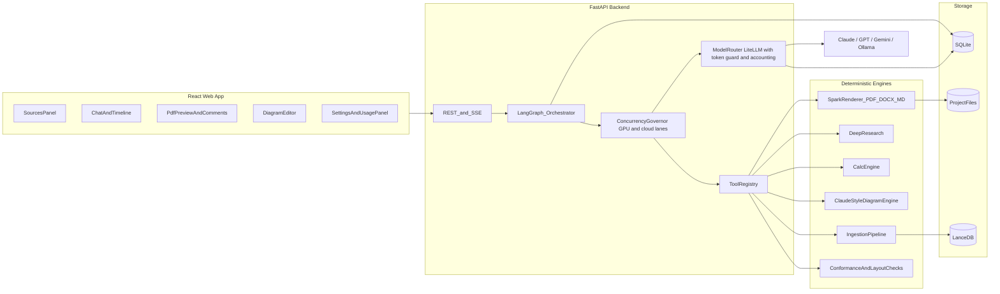
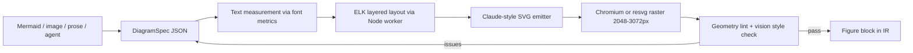
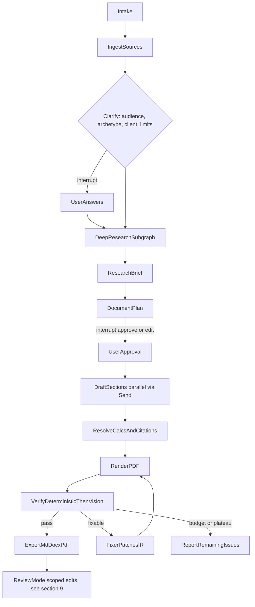
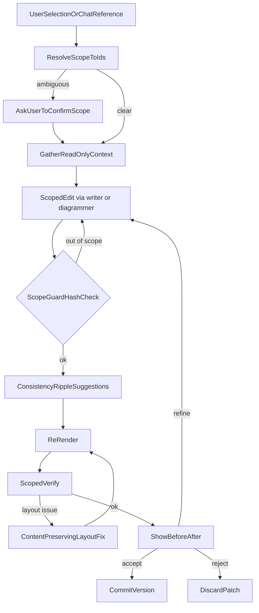
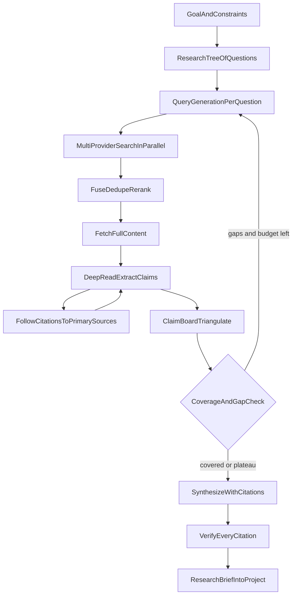

# Spark Doc Agent: Build Plan

Working name: **Spark Doc Agent**.

- **A personal local tool.** Each person runs their own copy on their own machine (a web app on `127.0.0.1`). Their own settings panel shows their usage, documents, logs, and API configuration. There are no team managers or shared server.
- **Two model profiles.** `dev` runs on local Ollama models because there are no API keys yet. `claude` and `openai` are the real-use profiles.
- **Team features later** (Phase 13). The storage layer keeps clean interfaces so adding them later doesn't require a rewrite.

---

## 0. Where we start (evidence from the repo and the reference PDF)

**Current pipeline:** [create_doc.py](create_doc.py) calls [spark_docs/parser.py](spark_docs/parser.py) (markdown to a list of block dicts), then [spark_docs/sections.py](spark_docs/sections.py) (company intro/outro plus renumbering), then [spark_docs/pdf.py](spark_docs/pdf.py) (ReportLab) or [spark_docs/docx_export.py](spark_docs/docx_export.py). Mermaid fences go through `npx mmdc` in [spark_docs/mermaid.py](spark_docs/mermaid.py) with a purple/grey theme. Tokens are in [spark_docs/theme.py](spark_docs/theme.py). There is no agent, no IR, no verification, no git repo, and no tests.

**Golden reference:** `sample pdfs/ADICC_Proposal_updated (1).pdf` (34 pages). I measured it with PyMuPDF `get_text("dict")` and `get_drawings()`. That measurement script becomes a permanent tool (`measure_pdf`) used both to extract the spec and to check conformance.

**Measured mismatches in the current renderer.** These are the root causes of "doesn't match exactly":

- Body text in the reference is **justified, 10pt Arial #3B3B3B with about 11.5pt leading**. The code uses left-aligned text with 14pt leading.
- Boxes (callouts, confidential box, contact banner) are **452pt wide (x 60 to 512)**, not the full 475pt text width. Card grids are 458pt (two 222pt cards with a 14pt gutter).
- Card body text is **9.5pt #555555**. The code uses #3B3B3B.
- Contact banner: header is **10pt** bold white, the contact line is **9pt #AABBDD** with `"   |   "` separators, there is **no address line**, and the box is 452x45. The phone number in the reference (and in the Asset Reliability sample) is **+971 56 956 8061**. The code has +971 58 958 8081.
- **Why Choose Us** has **no kicker and no number**: a grey rule at y=72, a 14pt title, 2x3 cards, then the contact banner. It is the **last page, after the Addendum**. The code gives it a numbered kicker and a 26pt title.
- The Who We Are list uses **plain lines with no bullet glyphs** at a 16.5pt pitch. The code draws bullets.
- The second and later `##` in a section (for example "Our Solution Areas" or "Summary of Recommendations") is **14pt**, not 26pt. General `###` subheads are **13pt** ("Commercial Framework", "Data and System Access"). The code uses 11pt.
- Bullets sit at **+14pt** and their text at **+28pt** from the margin. The code puts the bullet at +2 and the text at +14.
- Missing components: **How We Move Forward step cards**, **Project Roadmap table**, **Commercial table with TOTAL row**, **KPI blocks**, **Addendum cover**. Past renders approximated these with `:::cards`, which is why they "never look right".
- Diagrams: the reference diagrams are **Claude.ai visualizer PNGs** (2048px wide JPEG, placed at 475pt or 432pt). Their fills sample exactly to Claude's ramp 50-stops: gray `#F1EFE8`, teal `#E1F5EE`, purple `#EEEDFE`, blue `#E6F1FB`, amber `#FAEEDA`. Mermaid output looks nothing like them (see `assets/diagrams/5a244628939ea7e5.png`).

**Past user feedback to encode as rules:** diagrams were too small, too big, stretched, blurry, or cut off; tables were pushed to the next page; images and hyperlinks went missing; "document not proposal"; remove dashes; no "for clients" wording in client docs; page limits (for example a 3 page maximum); exact product naming ("ADICC takeoff platform"); intro and outro on or off per document type.

**Environment:** Windows, project path contains a space (`d:\doc creator`), Python 3.14, Node 24, Ollama 0.34 (`qwen2.5-coder:7b`; `gemma4:31b-cloud` is remote), RTX A2000 8GB. Not installed: git, Graphviz, LibreOffice, ffmpeg, Tesseract.

---

## 1. Target architecture



## 1.5 Speed targets (the tool must feel instant)

- Render: 34-page proposal PDF in under 1s (measured: 0.18s warm, 0.72s cold); DOCX under 0.5s (0.34s).
- Diagrams: layout through a persistent ELK worker plus spec-hash caches (no per-diagram Node or Chromium startup).
- Images: binary streams (no ASCII85), JPEG passthrough, trimmed-image cache. PDF size matches the reference (1.91 MB vs 1.93 MB).
- Review-mode edits re-render the whole PDF because it is cheap; only the edited scope is regenerated by the LLM.
- Agent runs: prompt caching, small work units, parallel subagents on API profiles, and streaming so the preview updates while work continues.

## 2. Non-negotiable design principles

- **LLMs decide content and structure. Code decides pixels.** The agent never writes PDF or DOCX directly. It emits a typed **Document IR** made of template components, and a deterministic renderer draws it. Fixes are patches to the IR.
- **One source of truth for the look:** the theme pack `themes/spark/` (tokens measured from ADICC, component variants, diagram style). The PDF, DOCX, diagram, and chart renderers all read it (see 3.6).
- **Every number is computed, every fact is cited, every brand fact comes from the brand pack.** The writer model never types a computed number. It references `{{calc:id}}` placeholders that the renderer fills.
- **Verify by measuring before judging by vision.** Deterministic checks (positions, fonts, colors, overflow, missing assets) run first. Vision critique is a second opinion, and every issue it raises must include a location.
- **Bounded loops.** Each run has an iteration cap, a no-improvement stop, a token and cost budget, and a clear escalation to the user.
- **Backward compatible.** `py create_doc.py file.md` and the Cursor skill keep working and become thin clients of the new renderer.

---

## 3. Template fidelity layer (Phase 2, the highest-impact work)

### 3.1 Measured template spec (seed values for tokens.yaml)

```yaml
page: { size: A4, margin_left: 60, text_right: 535, box_right: 512, card_right: 518 }
color:
  navy: "#1A1A2E"
  navy_deep: "#0D1B3E"       # data table header, contact banner
  slate: "#1E293B"           # commercial table header and total row
  purple: "#6B4EFF"
  purple_rule: "#6C3FE0"     # cover rule, roadmap durations
  body: "#3B3B3B"
  body_alt: "#434343"        # KPI and responsibilities lists
  card_body: "#555555"
  subtitle: "#444444"
  subtle: "#64748B"          # cover note text, roadmap header
  note: "#888888"            # addendum cover note
  rule: "#C8C8C8"
  box_border: "#CCCCCC"
  grid: "#E8EAEE"
  callout_bg: "#E5EAF1"
  step_bg: "#EEF2F8"
  roadmap_bg: "#EEF4FB"
  kpi_border: "#E2E8F0"
  table_alt: "#F5F7FA"
  cover_box: "#F8F7FE"
  banner_text: "#AABBDD"
type:
  body:        { size: 10, leading: 11.5, align: justify, space_after: 8.5 }
  kicker:      { size: 8, bold: true, color: purple, top_y: 60, rule_y: 86 }
  page_title:  { size: 26, bold: true, color: navy, top_y: 95 }
  sub_title:   { size: 14, bold: true }   # 2nd+ H2, module titles, Why Choose Us
  h3:          { size: 13, bold: true }
  box_title:   { size: 11, bold: true }   # columns, callouts, step titles
  card_title:  { size: 10, bold: true }
  card_body:   { size: 9.5, color: card_body, leading: 11 }
  table_head:  { size: 9, bold: true, color: "#FFFFFF", bg: navy_deep }
  table_body:  { size: 9, color: body }
```

Component geometry (measured):

- **Cover:** logo 78x24 at (62, 62). `PROPOSAL` 9pt purple, top at 113. Title 36pt navy, top at 139. Subtitle 18pt #444444, top at 186. Purple 1pt rule at y=228 (x 60 to 535). Meta lines at 249/265/280: bold navy label, #3B3B3B value. Confidential box y 312 to 364, fill #F8F7FE, 1pt #CCCCCC border, 9pt italic #64748B text, 10pt inset.
- **Addendum cover:** no logo. `ADDENDUM A` 9pt purple at 60. Title 36pt at 87. Subtitle 18pt at 134. **Grey** rule at 176. Meta lines at 197/212/228. White note box with #CCCCCC border, 9pt italic #888888 text.
- **Section start:** always a new page. Kicker `NN  UPPERCASE` in 8pt purple at 60, grey 1pt rule at 86, 26pt page title at 95.
- **Columns** (Challenge/Opportunity): text inset 6pt, right column at x=300, second title purple, left-aligned (not justified).
- **Callout:** 452 wide, #E5EAF1, 11pt title, about 11pt side and 9pt top padding, 18pt gap between stacked callouts.
- **Cards 2xN:** 222 wide, 14pt gutter, 16pt row gap, **equal heights per row**, 10pt title plus 9.5pt #555555 body, 9pt inset.
- **Step cards (How We Move Forward):** 4 across, about 106 wide, 13pt gutter, #EEF2F8, **centered**. Number 20pt bold purple on its own line, title 11pt navy (wraps), body 9.5pt #555555. All cards the height of the tallest. Adapt to 3 to 5 steps.
- **Data table:** #0D1B3E header, 9pt; rows alternate #FFFFFF/#F5F7FA; #E8EAEE grid; optional bold label column; header repeats on split.
- **Commercial table:** columns 152/220/98, #1E293B header and **TOTAL** row, 10pt text. Assumptions bullets `•` 9pt at x=74, text 10pt #434343 at x=88.
- **Roadmap table:** columns 348/120, every cell #EEF4FB, white 1pt grid, header 13pt bold #64748B, body 11pt #000000, duration 10pt bold #6C3FE0.
- **KPI block:** "KPIs" 20pt bold #0D1B3E, module label 13pt bold #434343, `●` bullets with 11pt #434343 text, boxes #EEF4FB with #E2E8F0 border.
- **Figure:** raster at least 2048px wide, placed at 475pt (x 62 to 537) or 432pt inset (82 to 514).
- **Contact banner:** 452x45, #0D1B3E, 32pt below the previous block.
- **Why Choose Us page:** unnumbered, grey rule at y=72, 14pt title at 87, 2x3 cards, contact banner.

### 3.2 Document archetypes (so the agent "knows where to put what")

`brand/spark/archetypes/*.yaml` lists the ordered slots, required or optional status, expected component per slot, default page budget, `doc_type` label, confidentiality text, and the default for the **Include Spark content** switch (see 3.5). Slots marked `spark_content` (the company intro, Why Choose Us, and contact banners) appear only when that switch is on.

- **proposal** (the ADICC pattern, in order):
  - Cover
  - 01 Executive Summary: "Proposal Overview", then Challenge/Opportunity columns, then Our Approach and The Outcome callouts
  - 02 About Spark Technologies: Who We Are (paragraph, plain line list, closing line), then Our Solution Areas (2x2 cards)
  - 03 Solution Overview: "Our Assessment" with one 14pt heading per module (benchmark paragraph, then our solution paragraph), then a Summary of Recommendations table (Module / What Client Wants to Solve / Our Approach)
  - 04 Scope of Work: per module, a description, a bold `Scope includes:` label, bullets, a Claude-style diagram, and an AI Use Case table; then a Unified Platform diagram
  - 05 Client Responsibilities (13pt subheads plus lists)
  - 06 Implementation Timeline and KPIs (Roadmap table, KPI blocks)
  - 07 Commercial Proposal (intro, 13pt "Commercial Framework", commercial table with TOTAL, assumptions)
  - 08 Conclusion: **The Path Forward**, three justified prose paragraphs (1: restate the needs and our assessment verdict; 2: "works with what you already have", no infrastructure change needed to begin; 3: we are ready, and the concrete first step is a scoping session, agreeing KPIs, and aligning the timeline)
  - 09 Next Steps and Sign-off: **How We Move Forward** step cards (default: 01 Proposal Review, 02 Technical Discovery, 03 Contract Execution, 04 Project Kickoff), then the contact banner
  - Addendum A cover, then A1 Purpose and Scope, A2 Architecture (principles table plus a full-page diagram), A3 Technology Stack (A3.x tables), A4 AI Pipeline (diagram plus "Step N" paragraphs), A5 Security (A5.x, RBAC table, deployment options), A6 Risks table, A7 Technical Conclusion
  - Why Choose Us plus the contact banner
- **technical_document / requirements_document** (Condor style): `DOCUMENTATION` kicker and no "proposal" wording; Overview, Our Assessment, Scope, How It Works, Data and Access Needed, The Path Forward, How We Move Forward. Spark content defaults to on for client documents.
- **internal_report** (Wall Segmentation style): Spark content defaults to off (no intro, outro, or contact banner); methods, results, and a references list with live links.
- **client_guide** (Trial Guide style): strict page budget, audience-aware wording lint, at most one flowchart unless asked.
- **questionnaire**, **plan_of_action**, and **addendum_technical** (the A1 to A7 pattern as its own document).

### 3.3 Renderer work

- Move the existing flowables onto tokens. Add the components listed above as classes in [spark_docs/pdf.py](spark_docs/pdf.py), or split them into a `components/` package.
- Heading rules: the first H2 after a kicker renders 26pt and later H2s render 14pt. Headings get `keepWithNext`. Paragraphs get `allowWidows=0` and `allowOrphans=0`.
- Pagination: add `CondPageBreak` before figures. Tables use `repeatRows=1`, keep at least 3 rows on each side of a split, and split within rows (ReportLab 4 or later). Images are never split. A diagram gets its own page when it is taller than 60% of the body; it may shrink to 85% before being moved. There are no blank pages and no heading left at the bottom of a page.
- **Layout map:** an `afterFlowable` hook records `block_id -> (page, bbox)` for each block. It also records line fragments with character offsets, table cells, cards and steps, and diagram node boxes. The verifier and Review mode selection (section 9) both depend on it. Also add PDF bookmarks, an outline, and metadata.
- Glyph safety: check every character against the font cmap with fontTools before render (no missing-glyph boxes). Provide fallbacks for symbols (`✓ ✗ → ≥ ± ² ●`). Arabic needs `arabic-reshaper` plus `python-bidi` and an Arabic-capable font. Use "AED" as text rather than the new dirham glyph.
- Fonts: Arial from Windows for local use. On Linux servers, use **Liberation Sans**, which has the same metrics.
- Hyperlinks: support markdown links, bare URLs, `<url>` autolinks, reference-style links, footnotes, and internal `#anchor` links (these become PDF internal links). Check links during verification.
- Images: resolve paths with `%20` and spaces, URLs (cached), and data URIs; convert SVG, WebP, and HEIC; apply EXIF rotation; convert CMYK to RGB; flatten alpha on white. A missing image is a **hard verify failure**, never a silent "Image not found" line.

### 3.4 Conformance checker plus golden reproduction

- `measure_pdf(pdf) -> spans, drawings, images per page`. `check_conformance(render, tokens)` compares kicker, title, and rule positions within ±1pt, and exact sizes, fonts, and fills.
- Transcribe the ADICC proposal into Spark markdown or IR (`tests/golden/adicc.md`). Render it, compare it with the reference by measurement, and run SSIM on the page PNGs (target at least 0.97 on text pages). This is the regression gate for the whole template.

### 3.5 "Include Spark content" toggle

One switch controls whether Spark company material appears in a document. Client documents turn it on; internal documents leave it off.

**What the switch controls.** Each part has its own sub-toggle under "Advanced". The master switch sets all of them, and a sub-toggle can override it.

- **Company intro:** "About Spark Technologies" (Who We Are plus Our Solution Areas), inserted right after section 01.
- **Company outro:** the Why Choose Us page (unnumbered, 2x3 cards), placed last, after any addendum.
- **Contact banners:** one after How We Move Forward (or after the last section if that section is absent), and one on the Why Choose Us page.
- **Client-facing sign-off:** the How We Move Forward step cards. Default: on when the master switch is on. The archetype can change this default.

The cover (logo, "Prepared by Spark Technologies") and the confidentiality notice stay in every document. When the switch is off, the notice uses the internal wording.

**Defaults.** The archetype sets the starting value, and the user can always change it:

- On for `proposal`, `technical_document` (client), and `client_guide`.
- Off for `internal_report`, `questionnaire` (internal), and `plan_of_action` (internal).
- In research mode, the agent asks "Is this document for a client or for internal use?" and sets the switch from the answer.

**How it works.**

- Toggling is a **deterministic IR transform** with no LLM call and no regeneration of the rest of the document. Blocks come from the brand pack boilerplate and are marked `origin: spark_content`. Sections are renumbered (the logic in [spark_docs/sections.py](spark_docs/sections.py) carries over), and the document re-renders instantly.
- Boilerplate is parameterised: `{{client}}` (for example "All data remains within {{client}}'s infrastructure"). The Why Choose Us industry variant (construction, oil and gas, fleet, generic) is picked from the client's industry and can be changed in the UI.
- Dedupe: if the source markdown already contains Who We Are or Why Choose Us content, the agent detects it and offers to use the canonical brand version or keep the user's version. Content is never inserted twice.
- Back compatibility:
  - New frontmatter key `include_spark_content: true|false` acts as the master switch.
  - The existing `include_company_intro` and `include_company_outro` keys remain as sub-toggle overrides.
  - New CLI flags `--spark-content` and `--no-spark-content`. The existing `--company-intro` and `--company-outro` flags still work.

**Verification (hard checks).**

- Switch on:
  - The intro sits right after section 01, Why Choose Us is the last page, and the contact banners are in place.
  - Every company fact and contact detail matches `facts.yaml`.
  - `{{client}}` has been replaced everywhere.
- Switch off:
  - No block with `origin: spark_content` remains, and there is no contact banner.
  - No leftover references to removed sections (for example "see Why Choose Us").
  - Section numbering is continuous.

### 3.6 Themes: Spark is the core, ADICC is its sample, new styles later

**Recommendation:** support new styles, but in two steps. Build the seams now, because that is cheap. Build the "create a new style" feature after the Spark template is pixel-perfect.

- **Now (Phase 2):**
  - Nothing visual is hard-coded. Every renderer (PDF, DOCX, diagrams, charts) reads a **theme pack**. The ADICC measurements become the `spark` theme, not special-case code.
  - Components have a `variant` field (for example step cards as `cards` or `timeline`).
  - Style overrides can apply at the block, section, or document level.
- **Later (Phase 12):** a "new style" flow.
  1. Extract a theme from a reference: `measure_pdf` for PDFs; vision plus pixel color sampling for screenshots.
  2. Render a **specimen document** that shows every component in the new style, so the user can review it.
  3. Save it as a theme pack, either `extends: spark` (a small variation) or standalone, with its own exemplars and golden test.
- **Why not now:** the Spark template doesn't match yet. Spreading effort across several styles early is the likeliest way to end up with several themes that are each "almost right". The conformance checker from 3.4 is also exactly what makes a new theme trustworthy, so it has to exist first.
- **Brand lock:** Spark documents use only the `spark` theme and its approved variants unless the user unlocks that for a document. Themes are versioned.

```
themes/spark/
  theme.yaml        # name, version, extends, fonts, page templates
  tokens.yaml       # measured values from 3.1
  components.yaml   # allowed variants per component, e.g. steps: [cards, timeline]
  diagram.yaml      # Claude ramps, node and edge style, diagram font
  exemplars/        # reference crops per component, used by visual verification (section 8)
  golden/           # spec plus reference pages for the conformance test
```

`brand/spark/` keeps the **content** (facts, boilerplate, archetypes, voice). `themes/spark/` keeps the **look**.

---

## 4. Claude-style diagram engine (Phase 3, the second highest-impact work)

**Why earlier attempts failed:** Mermaid's layout and theme can't reproduce Claude's look, and hand-placed ReportLab boxes had no real layout engine or text measurement. Claude.ai builds its diagrams as hand-authored SVG that follows a strict design system. We reproduce that system deterministically.

### 4.1 Claude visual language (seed values; confirm against the ADICC crops)

- Color ramps (stops 50/100/200/400/600/800/900). The sampled 50-stops match.
  - purple `#EEEDFE #CECBF6 #AFA9EC #7F77DD #534AB7 #3C3489 #26215C`
  - teal `#E1F5EE #9FE1CB #5DCAA5 #1D9E75 #0F6E56 #085041 #04342C`
  - blue `#E6F1FB #B5D4F4 #85B7EB #378ADD #185FA5 #0C447C #042C53`
  - gray `#F1EFE8 #D3D1C7 #B4B2A9 #888780 #5F5E5A #444441 #2C2C2A`
  - amber `#FAEEDA #FAC775 #EF9F27 #BA7517 #854F0B #633806 #412402`
  - coral `#FAECE7 #F5C4B3 #F0997B #D85A30 #993C1D #712B13 #4A1B0C`
  - green `#EAF3DE #C0DD97 #97C459 #639922 #3B6D11 #27500A #173404`
  - red `#FCEBEB #F7C1C1 #F09595 #E24B4A #A32D2D #791F1F #501313`
  - pink `#FBEAF0 #F4C0D1 #ED93B1 #D4537E #993556 #72243E #4B1528`
- Nodes: fill uses stop 50; stroke uses stop 600 at about 0.75 to 1px; corner radius 6 to 8; title 14px at weight 500 in stop 800; subtitle 12px in stop 600; centered text. Single-line nodes are about 44px tall, two-line nodes about 56px.
- Canvas: 680px viewBox width, white background, generous whitespace. Group labels ("Inputs", "Processing pipeline", "Outputs") are 12 to 13px gray above their columns. Wide gray "band" nodes span columns (for example a team collaboration layer).
- Edges: colored by the source node's category, about 1.5px, with an arrowhead; optional dashed style; 12px gray labels on a white halo.
- Legend row at the bottom: small rounded squares (50 fill, 600 stroke) with 12px labels, listing only the categories in use.
- Color carries meaning. Default mapping, taken from ADICC: blue for ingestion and inputs, purple for AI processing, teal for cost, output, and results, gray for platform and neutral, amber for human or manual steps, coral or red for risk, green for approval. Use at most 3 to 4 ramps per diagram.
- Font: Claude's own sans is proprietary. Calibrate open (OFL) candidates such as Inter, Source Sans 3, Open Sans, and Noto Sans against the ADICC crops by SSIM, and bundle the winner.

### 4.2 Pipeline



- `DiagramSpec` (Pydantic): `kind` (pipeline, architecture, layered, swimlane, timeline, sequence, decision, hub, comparison, cycle), `direction`, `groups` and `lanes`, `nodes{id,title,subtitle,category,shape}`, `edges{from,to,label,style}`, `legend`, `caption`, `placement` (inline, full width, or full page).
- Layout: **elkjs** (layered algorithm with orthogonal routing and compound nodes) in a persistent Node worker. This replaces the slow per-diagram `npx` launch. Node sizes come from real font metrics (fontTools or PIL `getlength`), with title wrapping at about 180px. This removes text overflow.
- Rasterize with **Playwright Chromium**, the same engine Claude.ai renders in, with **resvg** as the fast path. Output a PNG at least 2048px wide to match the reference. An optional vector path through svglib can be evaluated later.
- **Mermaid import:** parse the flowchart subset (through mermaid's parser in the Node worker, or a Python subset parser) into a DiagramSpec. The LLM assigns categories, so existing markdown files get Claude-style diagrams automatically.
- **Image-to-diagram:** a vision model extracts nodes and edges from an uploaded diagram image into a spec. After re-rendering, a check confirms the node and edge counts match the original.
- Diagram QA: text fits inside nodes with at least 8px padding; no overlapping nodes or edge labels; edges don't pass through nodes; the effective font is at least 7pt at print size; the aspect ratio fits the placement. If a diagram is too tall, **re-layout** it (switch between TB and LR, or split it). This is only possible because we keep the spec, not a flat PNG.
- Calibration set: crops from ADICC pages 6, 8, 14, 24, and 27. Re-create each one as a spec and compare the two side by side.
- Charts: Vega-Lite through `vl-convert`, or matplotlib, with the same palette and font, rendered to SVG then PNG.

---

## 5. Document IR and formats (Phase 4)

```python
class Block(BaseModel):  # discriminated union on `type`
    id: str; type: Literal["para","heading","bullets","plain_list","columns","callout",
        "cards","steps","table","commercial_table","roadmap","kpis","figure","diagram",
        "contact","code","quote","pagebreak"]
class Section(BaseModel):
    id: str; kicker: str; title: str; blocks: list[Block]; page_budget: float | None
    source_refs: list[str] = []
class Part(BaseModel):
    kind: Literal["main","addendum"]; cover: Cover | AddendumCover | None; sections: list[Section]
class Doc(BaseModel):
    meta: DocMeta  # archetype, doc_type, title, subtitle, prepared_for/by, date, flags, style
    parts: list[Part]; closing: WhyChooseUs | None
    calcs: dict[str, CalcRecord]; citations: dict[str, Citation]; assets: dict[str, Asset]
```

- Inline text uses a restricted markdown subset: bold, italic, code, links, citation markers `[^S12]`, and `{{calc:id}}`.
- Every block carries `id`, `rev`, `origin` (agent, user, spark_content, or import), `edited_by`, `locked`, `variant`, and `style_overrides` (theme token overrides, valid only inside that block or section; see 3.6 and 9.10). Paragraphs keep sentence anchors. The document is stored as an append-only patch log, which provides versions, undo/redo, and the hash checks used by the scope guard (section 9).
- **Markdown round trip:** Spark markdown (frontmatter plus `:::columns|callout|cards|steps|roadmap|commercial|kpis|diagram|figure|addendum|contact`) converts to IR and back. A test checks that the IR is unchanged after a round trip. The current parser becomes the MD-to-IR adapter. Plain GFM export is also available, with diagrams exported as image links.
- **DOCX:** rebuild on a **reference .docx with named styles** (Spark Kicker with a bottom border, Spark Title, Body Justified with exact 11.5pt line spacing, and so on) so the file stays editable in Word. Cards and step cards are fixed-width tables with shading. Header rows repeat (`w:tblHeader`), rows can't split (`cantSplit`), and the file includes bookmarks and hyperlinks. For verification, convert DOCX to PDF through Word COM (`docx2pdf`) or LibreOffice headless, then run the same lints. DOCX is component-accurate, not pixel-identical, and should be labeled that way.
- **PDF:** ReportLab `multiBuild`, with page templates for cover, inner, addendum cover, and closing.

---

## 6. Agent system (Phase 6)

### 6.1 Stack decisions

- **Orchestration: LangGraph.** It provides a `StateGraph`, a SQLite checkpointer, `interrupt()` for human approval, `Send` fan-out for parallel sections and research, and streamed events. It fits a resumable plan, draft, verify flow with humans in the loop.
- **Models: LiteLLM SDK** behind our own `ModelRouter`. It covers Anthropic, OpenAI, Gemini, and Ollama (`ollama_chat/`), normalizes tool calls, tracks cost, and handles fallbacks. Structured output uses JSON schema or forced tool calls, validated with Pydantic, with up to two repair retries followed by a fallback model. Ollama `format=<json schema>` enables constrained decoding for local models.
- PydanticAI was considered. LangGraph's built-in checkpoints and human-in-the-loop support tipped the decision.

### 6.2 Model profiles and roles (`config/models.yaml`, editable in the settings panel)

```yaml
active_profile: dev            # switch to claude or openai once API keys are added
profiles:
  dev:                         # no API keys: everything on local Ollama
    planner: ollama_chat/qwen3:8b          # pull an instruct model; qwen2.5-coder is for code
    writer: ollama_chat/qwen3:8b
    researcher: ollama_chat/qwen3:8b
    extractor: ollama_chat/qwen2.5:7b
    critic_vision: ollama_chat/qwen2.5vl:7b
    diagrammer: ollama_chat/qwen3:8b
    embedder: ollama/bge-m3
  claude:
    planner: anthropic/claude-opus-latest
    writer: anthropic/claude-sonnet-latest
    researcher: anthropic/claude-sonnet-latest
    extractor: anthropic/claude-haiku-latest
    critic_vision: anthropic/claude-sonnet-latest
    diagrammer: anthropic/claude-sonnet-latest
    embedder: ollama/bge-m3                # Anthropic has no embeddings API; local embeddings are fine
  openai:
    planner: openai/gpt-latest
    writer: openai/gpt-latest
    researcher: openai/gpt-latest
    extractor: openai/gpt-mini-latest
    critic_vision: openai/gpt-latest
    diagrammer: openai/gpt-latest
    embedder: openai/text-embedding-3-small
fallbacks: { claude: openai, openai: claude }   # used only if both keys exist
budgets: { per_run_usd: 3.0, max_verify_iterations: 4 }
privacy: { local_only: false }   # true = no cloud calls for this project
```

- This file only seeds the defaults. Day to day, the profile, roles, keys, lanes, and budgets are changed in the **settings panel** (section 13) and stored in the local database.
- **Developing without API keys:**
  - Phases 1 to 5 need **no LLM at all**: renderer, template fidelity, diagram engine, IR, and brand pack. These are the biggest quality wins, so development can go a long way on local models alone.
  - Agent logic is built and tested against a **FakeLLM with recorded responses** (record/replay cassettes), so tests are repeatable and don't depend on model quality. Ollama is used for live smoke tests.
  - Don't tune prompts to the 7B model. Its weak points (long structured IR, vision critique) will look like agent bugs even though Claude or GPT would handle them. In the `dev` profile, the agent works in smaller units and leans harder on deterministic checks.
  - When keys arrive, switch the profile, run the full eval suite on the target model, and tune prompts there. A small API test budget early is worthwhile, especially to validate the vision critic, where local and API models differ the most.
  - Ollama cloud models (such as the `gemma4:31b-cloud` already installed) can stand in for harder dev tests, but they send data off the machine, so never use them with confidential client files.
- The critic should use a different model family or prompt from the writer, to reduce self-agreement.
- Use provider-native features when available, with portable fallbacks: Anthropic prompt caching, citations, web search and fetch tools, and native PDF input; OpenAI strict structured outputs and web search; Gemini native audio and video.
- On 8GB of VRAM, run local models at 7 to 8B, Q4: `qwen2.5vl:7b` for vision, `bge-m3` for embeddings (multilingual, including Arabic), and `faster-whisper` for speech-to-text.

### 6.3 Workflow graph



- **Smart Convert** (the first agent milestone) enters the same graph at `plan`: take any markdown file (such as WALL_SEGMENTATION_REPORT.md), classify its archetype, map content into slots and components, convert Mermaid to Claude style, fix images and links, set the cover fields and today's date, then render and verify.
- **Slot mapping:** structured `SlotAssignment` output. Problem language maps to the Challenge column, approach to a callout, phases to steps or the roadmap, pricing to the commercial table, and closing text to The Path Forward prose. The assignment is validated against the archetype and shown to the user in the plan.
- **Section drafting:** retrieve an evidence pack (top-k chunks plus source cards), then use the brief, plan, voice guide, brand facts, and component catalog. Budget about 450 words per page (a full text page holds about 700). Output IR blocks only.

### 6.4 Context engineering

- Put the stable prefix (system prompt, voice guide, brand pack, component catalog, archetype) behind prompt caching so the verify loop stays cheap.
- Inject the **current date and time** (from local time zone settings) into every call, not just at session start. Add a `now()` tool and a rule: "your training data may be outdated; verify anything time-sensitive with web tools."
- Project memory: brief, decisions, glossary (enforced product names), client facts, and style overrides.
- Treat source and web text as **untrusted data**: wrap it in delimiters, never follow instructions found inside it, and gate side-effect tools (image spend, web) behind the approved plan.
- Version prompts in `backend/prompts/` and cover them with eval tests. Use low temperature for the planner and critic.

### 6.5 Subagents and parallel execution

**Subagents are queued work items, not simultaneous processes.** A Deep research run may have 30 questions, but it never runs 30 subagents at once. A small **worker pool** pulls items from a queue, and everything else waits. A subagent is an async task that mostly waits on the network, holding a small context, not a separate program or a loaded model. Crashes come from unbounded fan-out, so fan-out is always bounded.

**What gets queued:**

- Research: one work item per question.
- Ingestion: one per file.
- Drafting: one per section, after the plan fixes the shared glossary, terms, and numbers.
- Diagrams: one per diagram.
- Verification: one per section for the visual comparison.

**Default hard caps** (all editable in the settings panel; tuned for this laptop):

- **Workers:**
  - Active subagents: 4 in total for a run (research, drafting, or verification workers).
  - Cloud LLM calls in flight: 4 per provider, further limited by that provider's rate limits.
- **Fetching:**
  - Web fetches: 8 in total, and at most 2 per domain.
  - Headless browser pages (Playwright or Crawl4AI): 2. Each Chromium page can use 100 to 300 MB of RAM, which makes this the biggest RAM risk.
- **Local work:**
  - CPU-heavy work (render, parse, OCR, measurement): 2.
  - GPU lane (dev profile): 1.

**Keeping the machine healthy:**

- **Backpressure:** new work is taken only when a slot frees up. Fetched pages are streamed to the disk cache, not held in memory, and only the extracted passages travel between steps.
- **Memory watchdog:** checks RAM with `psutil`. Above 75% it stops starting new work. Above 85% it closes idle browser pages and drops in-memory caches. Above 92% it pauses the run and checkpoints it, never crashes it. The same thresholds apply to GPU memory in dev.
- **Adaptive concurrency:** each lane backs off by half on 429s, timeouts, or slow responses, and adds one slot back after a streak of successes.
- **Fault isolation:** every work item has a timeout and its own error handling. One failed item is retried, moved to a fallback, or marked failed. It never takes down the run or the app.
- **Low-resource mode:** on a weaker machine, or when the user chooses it, all caps drop to 1 or 2. Runs take longer but behave the same.

**The subagent contract:**

- **Input:** a focused brief, scoped context, a tool allowlist, a token and cost budget, and a deadline.
- **Output:** a structured result plus a short summary, so the orchestrator's context stays small.
- A subagent can only write to its assigned scope (the scope guard from section 9). The orchestrator merges patches.
- One failed subagent is retried or moved to a fallback model without failing the run.
- After parallel drafting, a **harmonize pass** checks terminology, tone, and numbers across sections.

**Concurrency governor** (a scheduler with resource lanes; every task declares its lane from role, model, and provider):

- **GPU lane (local models):** capacity 1 by default. This covers the local LLM, local vision, local embeddings, and faster-whisper, because they all share the same 8GB of VRAM.
  - Tasks queue one at a time.
  - Tasks are **grouped by model** so Ollama doesn't keep swapping models in and out (use `OLLAMA_MAX_LOADED_MODELS=1` and a sensible `keep_alive`).
  - Capacity only rises if the VRAM math in 6.6 says a second slot fits.
- **Cloud lanes (one per provider):** configurable concurrency plus token buckets for requests per minute and tokens per minute. They honor `retry-after` on 429 and 529 responses, and have a per-provider circuit breaker that routes to the fallback model when a provider keeps failing.
- **CPU and browser lanes:** rendering, measuring, Playwright rasterizing, and parsing, sized to the core count.

**Rules, matching "parallel, but not when a local model is running":**

- **All roles local (the `dev` profile):** the run is sequential.
- **All roles cloud (the `claude` or `openai` profile, the normal case in real use):** parallel up to the lane limits.
- **Mixed:** local tasks queue on the GPU lane while cloud tasks keep running in parallel. A setting, "run fully sequential while a local model is active", forces everything onto one lane.
- Parallelism is also capped by the run's remaining budget, so fan-out can't burst past a spending limit.

### 6.6 Token budgets, local KV cache, and cut-off recovery

**Model registry.** Each model records:

- context window and maximum output;
- feature support: tools, JSON schema, vision, prompt cache, PDF;
- pricing, tokenizer, and KV parameters.

Defaults come from LiteLLM's model map (`litellm.model_cost`) plus local overrides. Ollama values come from `/api/show`.

**Counting tokens before every call:**

- `tiktoken` (o200k) for OpenAI, the Anthropic `count_tokens` endpoint, and the model's own tokenizer for local models. A characters-divided-by-3.5 estimate is the last-resort fallback.
- Pre-flight rule: `input + max_output <= context_window - 5% margin`. If a call won't fit, compress the context in priority order rather than fail:
  1. Keep the system and task instructions.
  2. Keep the target content.
  3. Keep the brief.
  4. Trim evidence (lowest ranked first).
  5. Replace old chat history with a rolling summary.
- Long sources go through map-reduce summaries, never one giant prompt.

**Local models (Ollama) specifics.** These matter mainly in the `dev` profile, but they are required, or local development will silently produce bad results:

- **Always set `num_ctx` per request.** Ollama silently truncates a prompt longer than its context size, which is the most common hidden failure with local models. Also always set `num_predict` (the maximum output).
- KV cache memory is `2 x layers x kv_heads x head_dim x bytes_per_value x num_ctx x parallel_slots`.
  - Example: qwen2.5 7B has 28 layers, 4 KV heads, and head dimension 128. That is about 56 KB per token at fp16, so 16k context is about 0.9 GB and 32k is about 1.8 GB, on top of 4.7 GB of weights.
  - On the 8GB A2000, default to 16k. Allow 32k only with `OLLAMA_FLASH_ATTENTION=1` and `OLLAMA_KV_CACHE_TYPE=q8_0`, which roughly halves KV memory.
  - `OLLAMA_NUM_PARALLEL` multiplies KV memory, so leave it at 1.
- Pick `num_ctx` automatically from the model's metadata and the free VRAM (read through `pynvml` and Ollama's `/api/ps`), and show the chosen value in the settings panel.
- Put the stable prefix first so Ollama and llama.cpp can reuse the KV cache across calls.
- Local 7B models can fall into repetition loops. Use a `repeat_penalty` and an n-gram repetition detector that stops the stream.

**Keeping outputs small:**

- Work is split into small units (one section or block per call), so outputs rarely approach the limit.
- `max_output` is sized per task from the page budget plus a margin.
- Reasoning and thinking tokens count toward output limits on Anthropic and OpenAI, so budget them.

**Detecting a cut-off:**

- The provider reports it: `finish_reason: length` (OpenAI and LiteLLM), `stop_reason: max_tokens` (Anthropic), `done_reason: length` (Ollama), `MAX_TOKENS` (Gemini).
- The stream ends without its final event.
- JSON fails to validate.
- A watchdog sees no tokens for N seconds.
- The repetition detector fires.

**Recovery ladder:**

1. **Text:** make a continuation call with the partial output as a prefill (Anthropic) or as the previous assistant turn. Stitch at the last complete sentence and remove any overlap.
2. **Structured output:** salvage the completed items with partial JSON parsing (pydantic's `jiter` supports partial mode), then request only the missing items.
3. Retry once with a higher `max_output` if the model allows it.
4. Split the task (for example one section becomes two halves).
5. Fall back to a model with a larger output limit.
6. Mark the task failed and escalate.

A truncated section is **never rendered silently**. Verification also has a truncation hard check: text ending mid-word, unclosed lists, dangling "the following:".

**Crashes, network drops, and cancels:**

- Retries use exponential backoff with jitter.
- Every LLM call and paid tool call carries an idempotency key, so a retried image generation is not charged twice.
- Partial streamed output is saved every few hundred tokens.
- LangGraph checkpoints after every node, so a crash or restart resumes from the last finished step.
- The UI reconnects to the SSE stream with `Last-Event-ID` and replays missed events.
- Cancelling is cooperative, and partial results are kept.

---

## 7. Tools

- **calc** (the math guarantee):
  - `calc.eval(expr)` uses a SymPy safe parser (no `eval`). Money uses `Decimal` with ROUND_HALF_UP.
  - `calc.python(code)` runs in a sandboxed subprocess: no network, timeout and memory limits, allowlisted modules (math, statistics, decimal, fractions, numpy, pandas, sympy, pint, numpy-financial).
  - Every result is stored as a `CalcRecord{inputs+source refs, formula, code, result, units}` and **re-verified by a second method**.
  - Table integrity: TOTAL equals the sum of rows, percentages sum to 100, roadmap week ranges are ordered and don't overlap, units are consistent, magnitudes are sane. Business-day math uses the UAE Saturday/Sunday weekend.
  - The **numeric claim audit** flags any number in the draft that isn't traced to a source, calc record, user input, or brand fact.
- **web_search, web_fetch, academic_search, and deep_research:** the full deep research engine is described in **11.2**. In short: multi-provider search fused and reranked, full-page reading, following citations to primary sources, claim triangulation, iterative gap-filling, and a hard citation check.
- **sources.search / sources.read:** hybrid BM25 plus vector search over ingested files, returning anchors (source, page, bbox or timestamp).
- **diagram.create / diagram.from_mermaid / diagram.from_image**, and **chart.create**.
- **render / inspect_render / screenshot_pages / measure_pdf / check_conformance.**
- **brand.lookup, now, ask_user(question, options), convert_units.**
- **image.generate:** provider interface for OpenAI image models, Gemini/Imagen, Stability, Flux (through BFL, fal, or Replicate), and local ComfyUI.
  - Disabled until configured. Planned and budgeted before use.
  - Brand style presets (navy and purple, flat, white background). Stores the prompt, seed, provider, cost, and license.
  - **Never** used for the Spark logo, client logos, or text-heavy diagrams; those go to the diagram engine.
- Optional: expose render, diagram, and verify as an **MCP server** so Cursor or Claude Desktop can call them.

---

## 8. Verification loop (the "make, verify, adjust" core)

**Hard checks (deterministic; all must pass):**

- The IR schema is valid. Archetype slots are present and in order. Numbering is sequential (including A1, A2 for the addendum).
- Template conformance against tokens: kicker, rule, title, box widths, fonts, sizes, and colors.
- Layout: nothing overflows or overlaps (via the layout map); images stay inside the frame; no blank pages; no heading at a page bottom; split tables repeat their header and have no one-row fragments; diagrams are at least the minimum legible size.
- No raw markdown leaks into the PDF text (`**`, `:::`, `{.accent}`, `|---|`, `![`). No missing images. Links are valid and reachable. No missing glyphs.
- Every number is traced and every calc check passes. Brand facts and contact details match the pack.
- Lexicon: `doc_type` wording ("document" vs "proposal"), banned phrases, dash policy, audience wording, and glossary names.
- The page budget is met.

**Soft checks (LLM or vision scored, 0 to 100 with a rubric):**

- Visual balance and whitespace, diagram style match (few-shot with ADICC crops), component choice, writing quality for the audience, brief coverage, and claim support.
- Each issue must include `{page, block_id, bbox, severity, fix_type}`.

**Fixing and stopping:**

- Try fixes in order: deterministic auto-fix (shrink, move, or split a table; re-layout a diagram; convert overflowing cards to a list), then an LLM patch of one block, then regeneration of one section, then escalation to the user.
- Keep the best-scoring version. Track issue history so a fix can't reintroduce an earlier problem. Stop at the iteration cap, when the score plateaus (less than δ improvement), or when the budget runs out, and report what's left.

### 8.1 Section-by-section visual comparison

After every render, the layout map is used to crop every section and component. Each crop is compared with the theme exemplar of the same component: cover, section start, columns, callout, cards, step cards, roadmap, commercial table, KPIs, Why Choose Us, contact banner, and figures.

- The comparison combines three signals:
  1. **Measurement diff:** spans and drawings against the tokens. This is exact.
  2. **Structural similarity:** SSIM or a perceptual hash on normalised crops. It compares layout, not the words.
  3. **Vision judge:** gets the pair side by side with a rubric (same padding, alignment, colors, hierarchy?) and must return issues with bboxes.
- A section counts as **mismatched** when any measured value is out of tolerance, or when two of the three signals agree that it looks different.

### 8.2 Fixing mismatched sections directly

The verifier doesn't just report. For each mismatched section it applies a fix immediately, **only to that section** (the section 9 scope guard applies here too), then re-renders and re-checks it. Fixes are tried in this order:

1. **Declarative fix** to the IR or style layer. Examples: switch to the right component or variant (cards used for steps become StepCards), remove a wrong style override, correct a spacing override, re-lay out a diagram.
2. **Content-preserving layout fix:** page breaks, figure scale, table split points.
3. **LLM re-slot** of that section's content into the right components.
4. **Sandboxed custom component** (8.3).
5. **Escalate** to the user with the side-by-side crops.

### 8.3 Sandboxed code execution: where it helps, where it doesn't

**Yes, but for specific jobs, not as the main fix path.** Letting the agent change the renderer's code during a run would make output unpredictable and could break other documents silently.

- **Used for:**
  - Calculations and data analysis (section 7).
  - Ad hoc measurement scripts the agent writes: cropping, color sampling, comparing.
  - **Custom components.** When a requested design can't be expressed with any existing variant, the agent writes an isolated ReportLab flowable or SVG snippet in the sandbox. The snippet is rendered on its own, measured, and vision-checked, then used for that one block only. It is stored with the document as `custom_component` with a code hash. If the same custom component keeps being needed, it's proposed as a new built-in variant for a developer to review and add with tests.
- **Never:** the agent does not modify core renderer or theme files during a user run.
- **Sandbox limits:** separate process with no network, time and memory limits, read-only access to themes and fonts, write access only to a temp folder, and an import allowlist (reportlab, PIL, numpy, pymupdf, SVG libraries). Use Docker or WSL when available, otherwise Windows Job Objects.

---

## 9. Review mode: scoped edits on the finished document

Once a document is created, it opens in the preview. The user points at a section, some lines, a table, or a diagram (or names it in chat) and says what to change. The agent changes **only that part**. Everything else stays byte-identical, and code enforces this, not the prompt.

### 9.1 What the user can select

- **Section:** click its kicker or title, or pick it in the outline tree.
- **Block:** click a paragraph, list, callout, card grid, step cards, table, or figure.
- **Lines or a text range:** drag-select text in the preview (the pdf.js text layer).
- **Sub-items:** one card, one step card, one list item, or a table row, column, or cell.
- **Diagram:** click a figure to open it in the diagram editor, then select the whole diagram or specific nodes and edges.
- **Region:** drag a rectangle on a page to select every block it touches. The selection is confirmed before editing.
- **By name in chat:** for example "shorten the second paragraph of The Path Forward" or "make the Module 2 diagram left to right". A scope resolver maps the phrase to block IDs using the outline plus a small LLM call, highlights the result in the preview, and asks with options if the phrase could mean more than one place.

### 9.2 How a selection maps to the IR

- The renderer records a finer **layout map** per render version (`render/layout.json`):
  - block bboxes;
  - paragraph and list-item line fragments with character offsets;
  - table cell bboxes;
  - card and step bboxes;
  - diagram node bboxes (ELK coordinates scaled to page coordinates).
- **Text-range mapping:**
  1. Take the selected string, its page, and its bbox.
  2. Find candidate blocks by bbox overlap.
  3. Fuzzy-match the string in the block's source text, normalising whitespace, justified spacing, soft hyphens, and smart quotes.
  4. Record the character offsets and snap them to word boundaries, with an option to extend to whole sentences.
- Paragraphs keep **sentence anchors** (stable sub-IDs), so "these two lines" becomes "sentences s3 to s4 of block b42".

### 9.3 The edit contract

```python
class EditScope(BaseModel):
    kind: Literal["section","block","text_range","items","table_cells","diagram","diagram_nodes","region"]
    ids: list[str]; start: int | None = None; end: int | None = None
class EditRequest(BaseModel):
    scope: EditScope; instruction: str
    intent: Literal["rewrite","shorten","expand","fit_page","tone","fix_facts","refresh_research",
                    "recompute","convert_component","regenerate_diagram","tweak_diagram",
                    "replace_image","generate_image","insert_after","delete","translate","restyle"]
    attachments: list[ImageRef] = []   # screenshots or reference designs (see 9.10)
    apply_to: Literal["block","section","all_of_type","save_as_variant"] = "block"
    variants: int = 1   # 1 to 3 alternatives to pick from
```

- The agent receives the **writable target** and **read-only context**, kept clearly separate in the prompt. The context is the section title, the blocks before and after, the brief, the voice guide, the glossary, and that section's evidence.
- It returns a patch **limited to the target paths**: a replacement string for a text range, new block JSON for a block, or a DiagramSpec patch for a diagram.
- **Scope guard:** after patching, every block outside the scope must hash-equal its previous version. A patch that touches anything else is rejected, the edit is retried once, and a second failure is reported. Text-range edits leave the rest of the paragraph byte-identical.
- Allowed side effects, always shown to the user: section renumbering after an insert or delete, updated results for calcs whose inputs changed, and new pagination.

### 9.4 Consistency ripple (keeping "only this part" safe)

- After a scoped edit, a consistency check looks for places that now disagree. Examples: a roadmap week range vs the total duration in The Path Forward, a renamed module still appearing in tables, a changed price vs the TOTAL row, or a changed number quoted in another section.
- These come back as **suggestions, not edits**, for example "3 other places mention Week 1-2. Update them too?" Each one the user approves becomes its own scoped edit.

### 9.5 Diagram edits

- Diagrams are stored as specs, so a remake edits the spec, not pixels: rename, add or remove nodes, change categories or colors, flip direction, split in two, or change the diagram type.
- **Tweak** keeps the layout stable: the previous node order and positions go to ELK as semi-interactive constraints, so unchanged nodes stay where they were. **Remake** starts a fresh layout.
- Node-level selection limits changes to those nodes and their edges.
- The diagram QA and vision style check run on the new version, and a before/after view is shown.

### 9.6 Preview, accept, undo

- Before/after view:
  - a redline diff for text;
  - side-by-side page images for layout;
  - side-by-side diagrams.
- Changed pages are highlighted by page-image hash, including pages whose content only moved because pagination shifted.
- The user can **accept**, **reject**, or **refine** ("shorter", "try again", "more formal"). With `variants > 1`, the user picks from up to three alternatives.
- Every accepted edit becomes a new version in an append-only patch log, with undo/redo, per-block history, and restore of any earlier version.
- The whole PDF re-renders after an edit (seconds with ReportLab; unchanged diagrams come from the spec-hash cache). Only the target is regenerated by the LLM.

### 9.7 Scoped verification

- Hard checks run on the edited scope, plus the global layout checks, because an edit can push a table into a split or leave a heading at a page bottom.
- Layout problems caused by the edit are fixed only with deterministic, content-preserving fixers: moving page breaks, scaling figures, choosing table split points. They may not rewrite content outside the scope.
- Soft (vision and LLM) checks run only on the pages that changed.

### 9.8 Locks and manual edits

- Any block or section can be **locked** ("don't touch"). Every agent run respects locks, including global verify fixers and full-document regeneration.
- Users can type directly into a block through an inline editor that works on the IR, not the PDF. Manual edits are marked `edited_by: user`. The agent won't rewrite them unless the user asks it to.
- While an edit runs, its scope is locked. Edits to other scopes can run in parallel.

### 9.9 Edit subgraph



- **Cheap by design:** the stable prompt prefix is cached and the target is small, so a typical paragraph edit is a single small model call.
- **Usable without the UI:** `py create_doc.py edit <doc> --block b42 --instruction "shorten to 60 words"` plus an API endpoint. The edit engine can be built and tested before the web app exists.
- **Later:** re-import a DOCX edited in Word. Its named styles map back to IR blocks, and the differences become a patch.

### 9.10 Styling edits with screenshots

A style edit is a scoped edit where the target is the **look**, not the words. It uses the same selections as 9.1, plus attachments: one or more images and a prompt. The images can be a design the user likes, a screenshot of our own preview with markings, or a photo of a printed page.

**Understanding the image:**

- A vision model turns the image into a structured `StyleIntent`:
  - layout: columns, items per row, alignment, numbering style, icons, timeline vs cards;
  - shape: corner radius, borders;
  - emphasis: which elements are bold or colored;
  - spacing: tight or airy;
  - typography: relative sizes.
- **Colors are measured, not guessed.** K-means pixel sampling on the image, snapped to the nearest theme color when brand lock is on. Kept exact if the user unlocks it.
- **Screenshots of our own preview** (for example with a red circle) are located by template matching against the rendered page images (OpenCV `matchTemplate`). That gives the exact region and block IDs, and the markings are read as the target.

**Turning intent into changes,** in this order (the agent explains which it chose):

1. Switch to an existing component variant.
2. Scoped token overrides, for example this section's callout background or card gutter.
3. A new declarative variant built from layout primitives (grid, stack, card, badge, rule, icon).
4. A sandboxed custom component (8.3).

**How far the change applies** (asked up front): this block only, this section, every block of this type in the document, or "save as a variant in the theme" for future documents.

**Brand guard:** if the request breaks the brand (off-palette colors, a different font), the agent says so and offers the closest on-brand version. The user can unlock brand lock for that document.

**Verification:**

- Render, crop the changed region, and ask a vision judge whether it now matches the user's reference in intent. The normal hard checks also run.
- Every other section must still pass conformance. Style overrides are exempt from conformance only inside their own scope.

**Other targets:** the same image input works for diagrams ("make this diagram look like this", mapped to the diagram style fields), tables, and cards.

---

## 10. Learning memory (self-healing, per user)

The goal is that a mistake fixed once for a user is not made again. This follows the same idea as Hermes Agent's learning loop: persistent memory plus skills written from experience and refined as they're used.

### 10.1 What is remembered

- **Preferences:** stated or inferred rules. Examples: "no em dashes", "internal documents never include Spark content", "call it the ADICC takeoff platform", "client guides are at most 3 pages".
- **Lessons (a mistake and its fix):** recorded automatically when any of these happens:
  - the verifier finds an issue and a fix makes it pass;
  - the user rejects or corrects something in Review mode;
  - the user edits a block by hand after the agent wrote it.
- Each lesson stores:
  - the context: archetype, section type, component, and model;
  - what went wrong and the fix that worked;
  - evidence: before/after and issue IDs;
  - its scope: user, client, project, or global;
  - confidence, hit count, and last used date.
- **Skills (procedures):** when the same kind of fix succeeds several times, it's distilled into a reusable recipe, stored as a versioned markdown skill file the agent can load. Example: "5-phase roadmap: use RoadmapTable with durations in weeks, never cards".
- **Client facts:** names, systems, and preferences per client. Example: "AAAH: P6 is read-only, no write-back".

### 10.2 How it's used

- Before planning, drafting, verifying, or editing, the agent retrieves lessons matching the archetype, section type, component, and client (metadata filter plus embedding search). It injects the top few as a short "watch out for" checklist, within a budget so memory never floods the context.
- **Promotion to rules (the real self-healing):** a lesson that keeps firing becomes a deterministic lint rule or auto-fixer in that user's rule set, such as a lexicon entry, a glossary term, or a layout rule. Code checks don't forget and don't depend on the model reading its prompt.

### 10.3 Governance

- **Trusted signals only:** learn from the user's actions and verified outcomes, never from source documents or web pages. This prevents memory poisoning through prompt injection.
- **Activation:** new lessons start as candidates. They become active after confirmation, either a verified fix or the user accepting a "remember this?" prompt.
- **Memory panel:** the user can view, edit, disable, or delete any memory.
- **Conflicts:** the narrower scope wins (project over client over user over global), and newer beats older. Unused lessons decay and expire.
- **Local and personal:** memory lives in each person's own tool. Sharing lessons across people comes with team features later (Phase 13).
- **Measurement:** track the repeat-mistake rate per issue type across runs, and retire lessons that show no measurable benefit.
- **Storage:** memory tables in SQLite, embeddings in the vector store, skills as versioned markdown files.

---

## 11. Research mode and ingestion (Phase 8)

### 11.1 File ingestion

- Upload types: PDF, TXT/MD, DOCX, PPTX, CSV/XLSX, images, audio, video, and URLs.
  - **PDF:** PyMuPDF with `pymupdf4llm` (markdown) and `find_tables`. Scanned pages go to RapidOCR (ONNX) or vision-model OCR. Docling is an optional high-quality path for complex layouts (heavier, needs torch).
  - **DOCX:** python-docx or mammoth to markdown, keeping headings, tables, and images.
  - **CSV/XLSX:** pandas and openpyxl. Store them as **structured tables** with a profile (schema and statistics) instead of dumping them into context; the calc and data tools query them.
  - **Images:** vision caption plus OCR plus EXIF. Diagrams are also converted to a DiagramSpec. Images can be reused as figures.
  - **Audio:** faster-whisper on the local GPU (large-v3-turbo, int8_float16) or an API transcriber. Diarization is optional.
  - **Video:** `imageio-ffmpeg` (a bundled ffmpeg binary, no system install) to extract audio and transcribe it, PySceneDetect keyframes with vision captions, and a time-aligned summary. Gemini native video is an option.
- Normalized `SourceDocument` with anchors, structure-aware chunks (about 800 tokens), embeddings, a BM25 index, and an LLM **source card** (key facts, numbers, dates, entities, open questions).
- Safety: size and page limits, zip-bomb guards, no macros, and detection of hidden text in PDFs.

### 11.2 Deep web research engine

**Goal:** research at least as good as the deep research modes in ChatGPT and Claude, with every claim traceable to a fetched page that actually says it.

**Depth modes.** The user picks one, or the agent proposes one based on the question. Before any Standard or Deep run, the agent shows an estimated cost and duration and enforces a budget on searches, fetches, tokens, and time.

- **Quick:** 1 round, about 5 to 10 queries, 10 to 20 sources, 1 to 3 minutes. For simple facts.
- **Standard:** 2 to 3 rounds, 30 to 60 sources, 5 to 10 minutes.
- **Deep:** 4 to 6 rounds, 60 to 200 sources, 15 to 45 minutes, with a live progress view. Questions go into a queue that a pool of up to 4 research workers works through (the caps in 6.5), so a big run takes longer but never overloads the machine.



1. **Research tree.**
   - The planner turns the goal into a tree of questions.
   - Each leaf states:
     - what evidence would answer it (official figures, regulation text, vendor docs, papers, news);
     - how fresh the evidence must be (for example "last 12 months");
     - geography and language (for example UAE, in English and Arabic);
     - when the leaf counts as answered.
   - The user can edit the tree before a Deep run.
2. **Query generation:** 3 to 6 queries per leaf.
   - Keyword and natural-language phrasings, synonyms, and entity expansions.
   - Search operators: `site:`, `filetype:pdf`, and date ranges.
   - Arabic queries for UAE and GCC sources when relevant.
   - **Disconfirming queries** that look for evidence against the current best answer.
   - The current year from `now()` when recency matters.
   - **Query sanitizer:** on confidential projects, client names, internal project names, and figures are stripped from queries, because queries go to third-party search providers.
3. **Search across strong sources,** merged with reciprocal rank fusion (see **11.2.1** for the full source list):
   - **Google results first,** through a SERP API, because Google's index is the strongest for business, government, and regional (UAE) content.
   - **An independent second index** (Brave) and **semantic search** (Exa), which catch pages Google ranks low.
   - **Specialised data sources** for statistics, filings, papers, patents, regulations, and news.
   - **Provider-native researchers,** when keys exist: Claude's web search and fetch tools, OpenAI's web search and deep research models, and Gemini's Google Search grounding. Their answers are **leads, not facts**. Every citation they return is fetched and verified by our pipeline.
4. **Fuse, dedupe, rerank:**
   - Canonicalize URLs by stripping tracking parameters and resolving redirects.
   - Remove near-duplicates with MinHash on page content.
   - Rerank against the question with a cross-encoder: `bge-reranker-v2-m3` locally, or the Cohere or Voyage rerank APIs.
5. **Fetch full content,** never just search snippets:
   - httpx plus trafilatura for articles.
   - Crawl4AI or Playwright for JavaScript-heavy pages.
   - PyMuPDF for PDFs, keeping tables.
   - Jina Reader or Firecrawl as optional hosted fallbacks.
   - Wayback Machine fallback for dead links.
   - Paywalls and logins are detected, skipped, and recorded as skipped.
   - Per-domain rate limits, robots.txt respected, and a cache keyed by URL, ETag, and content hash, with the fetch date stored.
6. **Deep reading.**
   - Pages are chunked, and the relevant passages are picked with embeddings plus the reranker.
   - An extractor model pulls **atomic claims**. Each claim records:
     - the exact quote;
     - numbers with units and currency;
     - the date the fact refers to, and the publication date;
     - the entities involved;
     - the URL with a passage anchor.
7. **Follow citations to primary sources.** When a page cites a report, regulation, dataset, or paper, the engine follows the link 1 to 2 hops and prefers the original. A news article restating a government figure gets replaced by the government page.
8. **Source quality scoring:**
   - **Tier 1 (primary):** official and government sites, regulators, standards bodies, company filings, peer-reviewed papers, vendor documentation.
   - **Tier 2:** reputable news, analysts, industry bodies.
   - **Tier 3:** blogs, forums, marketing pages. Content-farm and AI-spam heuristics push these down further.
   - **Other signals:** author, date, citations, and agreement with other sources.
   - **Freshness weighting by topic:** prices and model versions go stale fast; standards go stale slowly.
   - **User controls:** pin or ban domains, add URLs, and mark sources as trusted.
9. **Claim board: triangulate and resolve conflicts.**
   - A key claim needs 2 or more independent sources (different owners), or 1 tier-1 source.
   - Numbers are normalized (units, currency, year) before comparing.
   - Contradictions are shown with both sides and their dates.
   - Resolution order: prefer tier 1, then the most recent, then the majority. Anything unresolved is flagged, never guessed.
10. **Coverage and gap check** after each round.
    - Each leaf is scored answered, partial, or open, with a confidence level.
    - A gap analyst writes follow-up queries for the weak leaves.
    - The loop stops when coverage passes the threshold, when the budget runs out, or when a round adds fewer than N new claims.
11. **Synthesis:** a structured research report with:
    - a citation on every sentence, and confidence labels;
    - "as of <date>" for time-sensitive facts;
    - a "could not verify" list;
    - a bibliography with access dates.
12. **Citation verification (hard check):**
    - Every quote must fuzzy-match the fetched text. There are no invented quotes or URLs; the target hallucinated-URL rate is zero.
    - A separate judge model checks that the quote actually **supports** the sentence it's attached to, meaning entailment, not just shared words.
    - Sentences that fail are rewritten to match the evidence, or removed.
13. **Into the project.**
    - The report, claims, and fetched pages become project sources with anchors, so drafting cites them just like uploaded files.
    - Review mode's `refresh_research` re-runs research for a single section.
    - When a document is re-exported after N days, its time-sensitive claims are re-checked.

#### 11.2.1 Search providers and data sources

Every source is a **connector plugin** with `search(query, filters)` and `fetch(id)`. Each connector declares capability flags, cost per call, rate limits, a default trust tier, and whether it needs a key. The settings panel lists connectors with enable toggles, keys, and test buttons.

**Google-quality web search** (the primary route):

- **SERP APIs that return real Google results:** Serper.dev (fast and inexpensive, a common choice for agents) or SerpAPI (broader coverage: Google web, News, Scholar, Patents, Maps, Trends, plus Bing and others). Recommended default: Serper for everyday queries, and SerpAPI when Scholar, Patents, or News verticals are needed. DataForSEO and Bright Data are alternatives at higher volume.
- **Gemini "Grounding with Google Search":** Google's official route. With a Gemini key, it returns grounded answers with source links. It's useful as an extra researcher even when Claude or GPT does the writing. Its terms include display requirements for search suggestions, so check them.
- **Google Programmable Search (Custom Search JSON API):** officially supported but limited, and Google has been restricting whole-web search in it. Check its current status before relying on it.
- **Not an option:** the Bing Search APIs were retired by Microsoft in 2025.

**Independent and semantic search** (a second opinion on the web):

- **Brave Search API:** its own independent index.
- **Exa:** neural search, good for "find pages like this" and for finding company or product pages.
- **Tavily:** an agent-oriented search API with extracted content.
- **SearXNG** (self-hosted) or `ddgs` (DuckDuckGo): free, used in dev and as a fallback.

**Specialised data sources** (usually better than any search engine for their topic):

- **Statistics and economics:** UAE FCSC and Bayanat, Dubai Statistics Center, Statistics Centre Abu Dhabi, Dubai Pulse open data, World Bank, IMF, OECD, and UN data APIs, and the Central Bank of the UAE for exchange rates (feeds the calc engine with dated rates).
- **Companies and markets:** company websites and investor pages, DFM and ADX disclosures for UAE-listed companies, and SEC EDGAR for US filings. Crunchbase is an optional paid source.
- **Government, regulation, and standards:** per-project allowlists (for example UAE federal and emirate portals, Dubai Municipality, the Abu Dhabi Department of Municipalities and Transport, DLD and RERA), and publishers' pages for standards such as FIDIC. Paid standards are cited, never copied.
- **Academic and technical:**
  - Papers: Google Scholar (via SerpAPI), Semantic Scholar, OpenAlex, Crossref, arXiv, PubMed, and CORE.
  - Unpaywall, to find legal free PDFs by DOI.
  - GitHub, the Hugging Face Hub API, and official product documentation.
- **News:**
  - Google News via a SERP API.
  - GDELT, a free global news index, for tracking a topic over time.
  - Always with date filters.
- **Patents:** Google Patents via SerpAPI.
- **Entities:** Wikipedia and Wikidata APIs for quick facts. These are treated as leads, verified against a primary source.

**Routing:** the research tree tags each question with the source types it needs. For example, "UAE construction output 2025" routes to FCSC, SCAD, and Google; "latest segmentation models" routes to arXiv, Semantic Scholar, and GitHub; "competitor pricing" routes to Google, Exa, and company pages. Questions only go to the connectors that fit, which improves quality and keeps costs down.

**Recommended starting setup for real use:**

- **Search:** Serper (Google) plus Brave, plus the free academic and statistics APIs.
- **Grounding:** Gemini Google Search grounding, if a Gemini key is available.
- **Optional:** SerpAPI (Scholar, Patents, News) and Exa, added when a project needs them.

**Model roles inside research:**

- **Strong model:** research tree, gap analysis, and synthesis.
- **Cheap model:** claim extraction (it runs on hundreds of pages).
- **Separately prompted model:** the support-check judge, kept apart from the writer.

**Research UI** (inside the research chat):

- A live research tree with progress per question.
- A source list with quality badges.
- A claims board showing contradictions.
- Steering controls, for example "focus more on UAE regulation" or "ignore vendor blogs".
- The user approves the brief before planning starts.

**Safety:**

- Web pages are untrusted data, and any instructions inside them are ignored.
- During research, tools are allowlisted: no form submissions, no logins, no downloading executables.
- Confidential queries are sanitized as in step 2.

**Developing without API keys:** the pipeline is identical in dev, and only result quality differs.

- **Search:** SearXNG (self-hosted in Docker or WSL) or the free `ddgs` DuckDuckGo library, plus the free academic APIs.
- **Processing:** local fetching and extraction, the local reranker, and local embeddings.
- **Testing real providers:** Brave, Tavily, and Exa offer free or trial tiers (check current limits).

### 11.3 Research flow

- A research chat where the agent asks clarifying questions with structured options (audience, depth mode, geography, freshness, trusted domains).
- It combines uploaded files (11.1) and web research (11.2) into a **Research Brief**: findings with citations, assumptions, risks, gaps, and contradictions.
- The user approves the brief. The agent then produces the **Document Plan** for approval, and after that the build.

---

## 12. Web app (Phase 9)

- **Backend:** FastAPI.
  - Routes: projects, chunked uploads, sources, runs (start, resume, cancel), **SSE event stream** (tokens, tool calls, status, cost), human-in-the-loop endpoints (approve plan, answer question), IR get and patch, render preview (PDF plus page PNGs), exports, and settings (keys, models, providers, budgets).
  - Jobs run in-process (an asyncio runner with LangGraph checkpoints). No Redis or separate worker is needed for a local tool.
- **Frontend:** React, Vite, TypeScript, Tailwind, shadcn/ui, TanStack Query, and Zustand.
  - Left: project and sources dropzone with previews.
  - Center: chat, agent activity timeline, plan approval card, and question forms.
  - Right: pdf.js preview with thumbnails and the **Review mode** tools from section 9:
    - selecting a section, block, text, sub-item, diagram, or region;
    - a floating "ask to change" box that accepts pasted or dropped screenshots (9.10) and asks how far a style change should apply;
    - the before/after diff with accept, reject, and refine;
    - version history and lock toggles.
  - **Memory panel** (section 10): preferences, lessons, skills, and client facts, each with view, edit, disable, and delete. It also shows "remember this?" prompts after corrections.
  - Theme picker (only once Phase 12 lands) with brand lock status.
  - Also: an IR outline tree, a diagram editor (spec YAML with live SVG), and mode tabs (Research, Plan, Write, Review) with export buttons.
  - **Include Spark content** switch in the new-project wizard (asked as "client or internal"), on the plan approval card, and in the preview toolbar. Changing it re-renders instantly with no agent run. An "Advanced" popover holds the sub-toggles (intro, Why Choose Us, contact banners, How We Move Forward) and the Why Choose Us industry variant. The export dialog shows the current state so nobody sends an internal-only version to a client by mistake.

## 13. Settings and usage panel (personal traceability)

Each person's tool has its own panel, covering only that person: their usage, documents, logs, and configuration. Nobody manages anyone else's tool. Everything is recorded from the very first agent call, because usage history can't be filled in later.

### 13.1 What gets recorded (the local data model)

- `projects`, `documents`, `document_versions`, `exports`.
- A single implicit `user` row. Every record carries a `user_id`, so team features can be added later without migrating history.
- `runs` and `run_events`: every graph node, subagent, tool call, retry, truncation recovery, and verification report, with timings.
- `llm_calls`, one row per call. It records:
  - project, run, and role;
  - provider and model;
  - input, cached-input, output, and reasoning tokens;
  - cost, latency, and `finish_reason`;
  - lane and retry count;
  - for local calls, GPU seconds (cost is zero, but usage is still tracked).
- `tool_calls`, including paid calls such as search and image generation, with their costs.
- `settings`, `budgets`, `memories`, and an append-only local `activity_log`. API keys are not stored in the database; they go in the Windows Credential Manager (see 13.2).

### 13.2 Panel pages

- **Overview:** my tokens and cost today, this week, and this month, broken down by project, model, and provider. Also running jobs, error rate, verification pass rate, and average fix iterations per document.
- **My documents:** every document I've generated.
  - Filters: client, archetype, date, and Spark-content state.
  - Open, download any export, and see the version history.
  - Jump to the exact run that produced it.
- **Runs and logs:** a full run timeline covering nodes, subagents, tool calls, and LLM calls (with tokens and cost), verification reports, errors, retries, and cut-off recoveries. It supports search, filters, and CSV export.
- **Usage and budgets:**
  - Charts per project and model.
  - A monthly budget and a per-run budget, with warnings at 80% and 100% and an optional hard stop.
  - CSV export for comparing with provider invoices. Costs shown are estimates from token counts.
- **Models and API settings:**
  - **Profile switch:** `dev` (Ollama), `claude`, or `openai`.
  - **Keys:** add or rotate API keys for Anthropic, OpenAI, and optional web search and image generation providers.
    - Stored in the **Windows Credential Manager** through the `keyring` library, never in plain files or the database.
    - Masked after saving and never sent back to the browser.
    - Each has a "test connection" button.
  - **Model catalog:** context window, output limit, and pricing, auto-filled from LiteLLM's map, with manual overrides.
  - **Roles:** the mapping from role to model within the active profile, with optional per-project overrides.
  - **Limits:** concurrency and rate limits per lane, and the fallback order.
  - **Local models (dev):** Ollama URL, `num_ctx` policy, KV cache type, `keep_alive`, and the currently loaded models with their VRAM use.
- **Privacy:**
  - Prompt and response logging level: full, redacted, or metadata only.
  - Log retention period.
  - `local_only` defaults per client.
- **Brand and theme:** edit `facts.yaml`, boilerplate, and archetypes. Every change is versioned.
- **Memory:** the Memory panel from section 10.
- **System health:** GPU VRAM, Ollama status, provider reachability, recent errors, and disk usage of the workspace.
- **Activity log:** settings and key changes, exports, brand-lock unlocks, memory edits, and deleted projects.

### 13.3 How the recording is wired

- Structured JSON logs (structlog) with rotation, each line carrying `run_id` and `project_id`.
- Optional OpenTelemetry spans to a local Arize Phoenix for deep debugging during development.
- The panel reads our own SQLite tables, so it needs nothing else running.
- Token and cost rows are written by the `ModelRouter` itself, so no call path can skip them.

## 14. Production readiness (for a local tool)

"Production level" here means a local tool that installs cleanly, never loses work, protects keys and client files, and behaves predictably.

- **Install and run:**
  - One command installs everything (`uv`-based): Python dependencies, the Node diagram worker dependencies, and Playwright's Chromium, downloaded on first run. Ollama is optional and used only for the `dev` profile.
  - `spark-doc serve` starts the backend and opens the app at `http://127.0.0.1:<port>`. A desktop shortcut can do the same.
  - A first-run check validates Python, Node, fonts, Chromium, the GPU and Ollama (if dev), and API keys, then shows clear fixes for anything missing.
- **Storage:**
  - SQLite in WAL mode, with `workspace/projects/<id>/` files and LanceDB, all behind repository interfaces.
  - Alembic migrations from the first table. Migrations run automatically on start, with a backup taken first.
- **Configuration:** `pydantic-settings` (dev and test profiles), versioned prompts, themes, and archetypes.
- **Jobs:** in-process with LangGraph checkpoints. On shutdown or a crash, runs resume from the last finished step when the app starts again.
- **Security:**
  - Bind to `127.0.0.1` only; CORS is limited to the app's own origin.
  - An optional app password.
  - Keys live in the Windows Credential Manager and are never logged.
  - Uploads get file-type sniffing and size limits.
  - A per-project `local_only` switch, and zero-data-retention settings where the providers offer them.
  - The sandbox follows 8.3.
  - Dependency scanning with pip-audit and npm audit.
- **Reliability:** circuit breakers and fallbacks (6.5), cut-off recovery and resume (6.6), and a scheduled workspace backup (SQLite snapshot plus files) with restore. A full project can be exported and imported as a zip.
- **Updates:** versioned releases with a changelog. Migrations and theme or archetype version bumps are applied on update.
- **CI:** GitHub Actions running lint, types, unit tests (FakeLLM cassettes), golden visual tests, and an eval smoke test on every change.
- **Data deletion:** deleting a project removes its files, vectors, memories, and logs.

### 14.1 Team features (later, Phase 13)

Not part of the current build. The design only keeps these from being blocked:

- multi-user sign-in (SSO) and roles;
- a team admin view;
- shared brand facts and shared memory with approval;
- a shared server (Postgres, Redis workers, S3/MinIO, Docker Compose, HTTPS);
- central monitoring.

## 15. Testing and evals

- Unit tests: parser, IR, calc, tokens, and markdown round trip.
- **Golden visual tests:** ADICC reproduction (measurement plus SSIM), plus snapshot renders of every file in `input/` (no errors, no missing images, links clickable through PyMuPDF `get_links()`, stable page counts).
- Diagram property tests: random graphs must produce no overlaps or overflows.
- Agent evals:
  - Archetype and slot mapping for the existing input files.
  - A math set of 100 or more tasks (target 100% with tools).
  - Research:
    - A curated question set with known answers, including UAE and construction topics, measuring claim recall and accuracy.
    - Citation precision (quote match plus support) and the hallucinated-URL rate, with a target of zero.
    - Source diversity and tier mix, and the freshness of time-sensitive claims.
    - Blind comparison against ChatGPT and Claude deep research on the same questions, judged on accuracy and coverage.
  - End-to-end brief-to-document runs judged by a rubric.
  - Scoped edits:
    - The scope guard is never violated.
    - Text outside the selected range stays byte-identical.
    - An LLM judge scores whether the instruction was followed.
    - Diagram tweaks keep unchanged nodes in place within tolerance.
  - **Seeded-defect tests for the verifier:** inject known style bugs into a golden document (wrong padding, wrong color, cards used instead of step cards, a clipped diagram). The verifier must catch and fix each one within scope.
  - Style edits: a vision-judged similarity score against the attached reference, brand compliance, and no conformance regressions outside the scope.
  - Memory:
    - The repeat-mistake rate drops across a scripted series of runs.
    - Instructions planted in source files never become memories (poisoning test).
- **Resilience and fault injection.** Scenarios:
  - kill the worker mid-run;
  - drop the SSE stream;
  - force `max_tokens` cut-offs;
  - trigger 429 storms;
  - fill VRAM.

  Required outcomes:
  - Runs resume or recover.
  - Nothing is charged twice.
  - No truncated section is ever rendered.
  - Two GPU tasks never run at once.
- **Accounting accuracy:** recorded token counts match provider-reported usage within 1%.
- **Load test on this laptop:** a Deep research run plus a full document build at the same time.
  - Peak RAM stays under the watchdog's 75% threshold.
  - The browser page count never exceeds its cap, and no crash or out-of-memory error occurs.
  - A forced low-memory condition pauses and checkpoints the run instead of crashing.
  - Cost and latency tracked per commit.

---

## 16. Phased roadmap and acceptance criteria

1. **Foundations:** `git init`; `uv` with a **Python 3.12 venv** (3.14 wheels for torch, ctranslate2, and lancedb are a risk); ruff, pyright, pytest; snapshot current outputs; structlog, `pydantic-settings`, Alembic, and the schema for the `runs`, `run_events`, `llm_calls`, `tool_calls`, and `activity_log` tables, so usage is recorded from the very first agent call. Also a FakeLLM with record/replay cassettes, so agent code can be tested without API keys.
2. **Template fidelity:** `measure_pdf`, the `themes/spark/` theme pack seams (tokens, component variants, style overrides), all the fixes in section 0, new components, pagination rules, the layout map, the conformance checker, and the **Include Spark content** switch (frontmatter, CLI, deterministic IR transform). Done when the ADICC golden reproduction passes with the switch on, and the same document with the switch off has no Spark blocks and continuous numbering.
3. **Diagram engine:** spec, ELK worker, metrics, emitter, raster, QA, Mermaid import, and calibration. Done when every Mermaid diagram in `input/` renders in Claude style, with none cut off, stretched, or blurry, and a side-by-side review against the ADICC crops passes.
4. **IR and formats:** IR, markdown round trip, DOCX template rebuild, markdown export.
5. **Brand pack:** facts, boilerplate (Who We Are, Solution Areas, Why Choose Us variants by industry, Path Forward and Move Forward patterns), archetypes, voice and lexicon (UK spelling, matching "specialising" and "mobilisation" in the reference), and exemplar crops.
6. **Agent core plus Smart Convert:**
   - ModelRouter with the model registry, token pre-flight and compression, the Ollama `num_ctx` and KV policy, the cut-off recovery ladder, and token and cost accounting.
   - The concurrency governor (GPU, cloud, CPU, and browser lanes) with parallel subagents.
   - Tools, and the LangGraph plan, draft, verify graph.
   - Done (development milestone) when WALL_SEGMENTATION_REPORT.md and the Condor and Trial Guide inputs convert with zero hard-check failures in the `dev` profile (sequential, no silent truncation) and in cassette replay.
   - Done (real-use milestone, once keys exist) when the same inputs pass on the `claude` or `openai` profile with parallel subagents, and prompts have been tuned on that model.
7. **Verify loop, scoped edits, and memory capture:**
   - Deterministic checks, vision critic, fixer, and stop rules.
   - **Section-by-section visual comparison with direct fixes** (8.1 and 8.2) and the sandbox for custom components (8.3).
   - The Review mode backend: scope resolver, edit contract, scope guard, consistency ripple, diagram tweak and remake, **screenshot style edits**, patch-log versions, locks, and the `create_doc.py edit` command.
   - Capture and retrieval of lessons and preferences.
   - Done when 100 scripted edits never change anything outside their scope, and the seeded-defect suite is caught and fixed.
8. **Research mode:**
   - Ingestion for all file types, the index, the brief, and clarifying questions.
   - The **deep research engine** from 11.2: depth modes, research tree, multi-provider search with fusion and reranking, full-content fetching, citation following, claim board, gap loop, citation verification, research UI, and query sanitizing.
   - Done when the research eval set meets its targets: zero hallucinated URLs, citation support precision of at least 95%, and results at least on par with ChatGPT and Claude deep research in blind comparison.
9. **Web app and personal settings panel:**
   - FastAPI, SSE, and the React UI, including the Review mode selection tools, screenshot attachments, before/after diff, version history, inline editing, and the Memory panel.
   - The **settings and usage panel** (section 13) covers my usage and budgets, my documents, runs and logs, the model profile switch, API keys (Windows Credential Manager), the model catalog and roles, lanes, dev Ollama settings, privacy, brand, system health, and the activity log.
10. **Image generation and charts.**
11. **Production hardening for the local tool** (section 14):
    - One-command install and a first-run check.
    - Automatic migrations with a backup first, and a scheduled workspace backup with restore.
    - Project export and import.
    - Localhost-only security.
    - CI and dependency scanning.
    - Fault-injection tests.
    - Distilling skills from memory and promoting lessons to rules.
12. **New styles (later):** theme extraction from a reference PDF or screenshots, specimen document review, `extends` inheritance, and a golden test per theme. Start only after Phase 2's ADICC reproduction passes.
13. **Team features (later):** the items in 14.1, starting only when a shared setup is actually needed.

---

## 17. Double-check list (verify during the build)

- The Spark phone number: the reference shows **+971 56 956 8061** and the code shows +971 58 958 8081. Confirm which is current. Confirm the address line in the banner (the reference omits it).
- Naming: "Spark Technologies" in client documents vs "Spark AI" in internal titles.
- Dash policy: the reference uses em dashes ("Module 1 — Estimation"), but you asked for no dashes in content. Make this a per-project style setting and confirm the default.
- UK vs US spelling (the reference is UK).
- Claude ramp stops other than the sampled 50-stops, stroke widths, arrowhead shape, and the substitute font: calibrate by pixel and SSIM against the crops.
- ReportLab 5.x API changes, Arial licensing on servers (use Liberation Sans), and path quoting for `d:\doc creator` in subprocesses and the Node worker.
- Local model limits: 7B models are weak at long IR and vision critique. Local runs are for development only, so judge agent quality on the real API model. Don't tune prompts to the 7B. The installed `qwen2.5-coder:7b` is a coding model, so pull an instruct model (for example `qwen3:8b`) and `qwen2.5vl:7b` for dev.
- Ollama gotchas:
  - It silently truncates prompts longer than `num_ctx`, so always set it and pre-count.
  - `OLLAMA_NUM_PARALLEL` multiplies KV memory.
  - Switching models evicts the loaded one, so group tasks by model.
  - Confirm the real VRAM numbers with `/api/ps` on the A2000.
- Reasoning tokens count toward output limits (Anthropic and OpenAI). LiteLLM's price and limit map can be out of date, so allow overrides and reconcile estimated costs against provider invoices monthly.
- Loop oscillation, vision false positives (require a bbox), and runaway cost (budgets).
- Confidential data sent to cloud APIs (per-project local-only switch). Copyright on fetched content (short quotes plus citations).
- Search providers:
  - Google access is only through SERP APIs or Gemini grounding, never by scraping Google directly (blocked and against its terms).
  - Confirm the current status of Google's Custom Search API before using it. The Bing Search APIs are retired.
  - Check each one's terms on caching and storing results.
  - Free tiers and prices change, so confirm them before relying on a tier.
  - Queries leak intent to the provider, which is why the confidential sanitizer exists.
  - Deep mode can use hundreds of pages' worth of tokens, so check that the extractor runs on the cheap model and the cost estimate shown before a run is accurate.

## 18. Repo layout

```
doc creator/
  create_doc.py                 # kept; thin CLI over the renderer
  spark_docs/                   # renderer package (components, pdf, docx, md, layout map)
  themes/spark/                 # the look: theme.yaml, tokens.yaml, components.yaml, diagram.yaml, exemplars/, golden/
  brand/spark/                  # the content: facts.yaml, boilerplate/, archetypes/, voice + lexicon.yaml
  memory/skills/                # versioned skill files distilled from lessons (DB holds lessons and preferences)
  diagrams/                     # spec, emitter, qa (python) + node_worker/ (elkjs, mermaid parser, playwright)
  backend/app/                  # api/, graph/, agents/, tools/, ingestion/, research/, calc/, verify/, storage/
  backend/prompts/              # versioned prompts
  frontend/                     # React app
  config/                       # models.yaml, providers.yaml
  tests/                        # unit/, golden/ (adicc.md + reference crops), visual/, evals/
  sample pdfs/                  # golden reference (unchanged)
```
