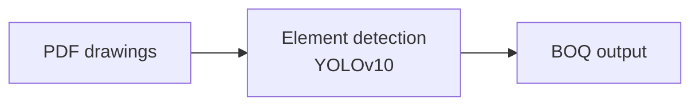

# Spark Documents

The template is measured from `sample pdfs/ADICC_Proposal_updated (1).pdf`. The renderer reproduces it
to within a point: 98.5% of the reference's text lines break identically, most pages within 1pt.
All geometry lives in `themes/spark/tokens.yaml`. Do not hand-build PDFs; write Spark markdown and render.

## Render

```bash
py create_doc.py path/to/file.md                 # PDF to output/<title>.pdf
py create_doc.py path/to/file.md --format both   # PDF + DOCX
py create_doc.py path/to/file.md --spark-content # client doc: add Who We Are, Why Choose Us, contact banner
py create_doc.py path/to/file.md --no-spark-content  # internal doc: strip company sections and banners
py -m spark_agent convert path/to/file.md            # plan structure with the local model, copy source text verbatim
py -m spark_agent convert path/to/file.md --no-llm   # heading-based plan, no model
```

## Document pattern (ADICC proposal)

Cover, then `# 01 About Spark Technologies` (added by `--spark-content`), `# 02 Executive Summary`,
`# 03 Solution Overview`, `# 04 Scope of Work`, `# 05 Client Responsibilities`,
`# 06 Implementation Timeline & KPIs`, `# 07 Commercial Proposal`, `# 08 Conclusion` (The Path Forward,
three paragraphs), `# 09 Next Steps & Sign-off` (How We Move Forward steps + contact), optional
`:::addendum` with `# A1 ...` sections, then `# 10 Why Spark Technologies` (added by `--spark-content`).
Technical documents use `doc_type: DOCUMENTATION` and never say "proposal".

## Headings

| Markdown | Renders as |
| --- | --- |
| `# 01 Executive Summary` | new page, purple kicker `01  EXECUTIVE SUMMARY`, grey rule |
| `## Proposal Overview` right after `#` | 26pt page title |
| `## Summary of Recommendations` | 14pt section title (any later `##`) |
| `### Module 1 — Estimation` | 14pt module title |
| `### Data and System Access` | 13pt subhead (`{.accent}` = purple) |
| `#### A3.1 Frontend` | 11pt subhead (e.g. above a table) |
| `## KPIs {.ruled .large}` | grey rule + 20pt title (continuation page) |
| `## Why Choose Us {.compact}` | 14pt title right under a kicker |

`**Scope includes:**` alone on a line becomes a bold label that sits tight above its list.

## Blocks

```markdown
:::columns          two columns; second title is purple (Challenge / Opportunity)
:::callout          shaded box with ### title (Our Approach, The Outcome)
:::cards            2-column shaded cards, ### title + text (Solution Areas, Why Choose Us)
:::steps            How We Move Forward: numbered, centred cards (3 to 5 steps)
:::tight            paragraphs 16.5pt apart (Who We Are lines, "Step 1 — ..." lists)
:::large            11pt #434343 lists (client responsibilities)
:::kpis             tinted KPI box: ### Module + - bullets
:::table widths=120,131,200 bold_first      navy-header table with fixed column widths
:::roadmap          | Deliverables | Duration | tinted timeline table
:::commercial       | Solution | Description | Investment | with a final TOTAL row
:::contact          navy "To proceed, please contact us" banner
:::addendum         label:, title:, subtitle:, prepared_for:, prepared_by:, date:, note:
<!-- pagebreak -->  explicit page break
{width=432}   figure (near-white margins are trimmed automatically)
```

Tables, callouts, cards, steps and figures never split across pages if they fit on one page.

## Diagrams (Claude style)

Mermaid flowcharts render in Claude's visual language: DejaVu Sans, pastel ramp fills, colored arrows,
auto legend, ELK layout. Long linear chains wrap into rows automatically. Use classes to set colors:



Categories: `input/ingest` blue, `ai/process` purple, `output/cost` teal, `platform` gray,
`validation/human` amber, `risk` coral, `approval` green. For full control use a ```diagram block
with YAML: `direction`, `nodes` (id, title, subtitle, category, shape, group), `edges` (from, to, label,
dashed), `groups`, `legend`.

## Check a render

```bash
py -m spark_docs.measure out.pdf --pages 1-3          # fonts, sizes, colors, baselines, boxes
py -m spark_docs.conformance "sample pdfs/ADICC_Proposal_updated (1).pdf" out.pdf --out report/
py -m pytest                                           # golden ADICC reproduction + unit tests
```
