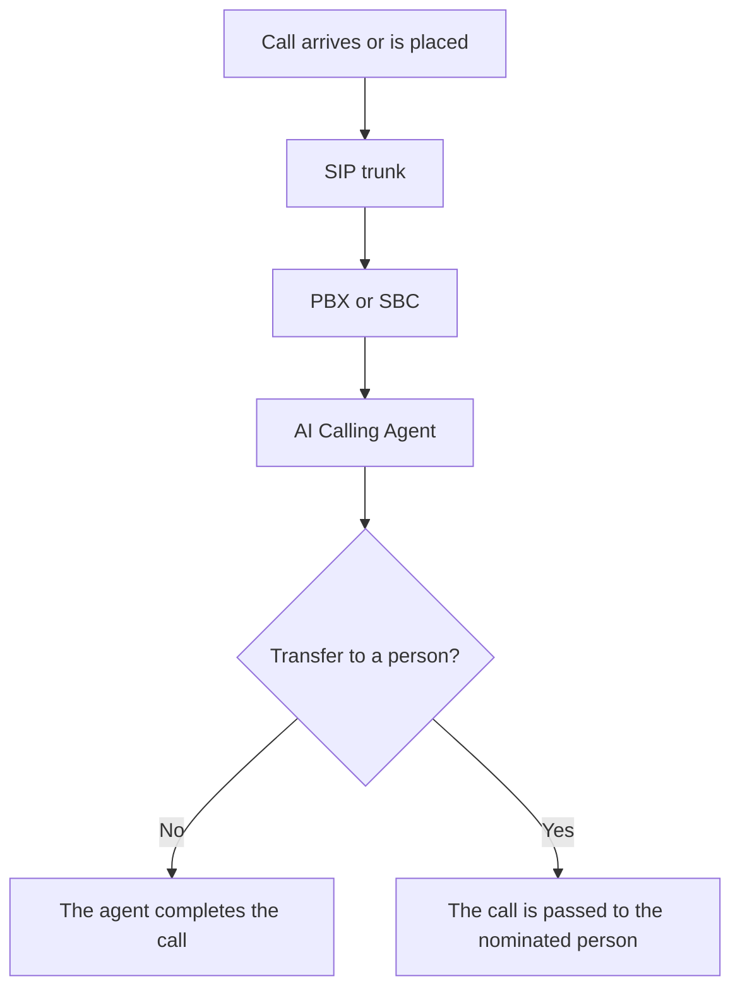

# 01 Purpose

## What this document covers

This document lists what the client provides before Spark Technologies deploys the AI Calling Agent. It applies to any organisation. No company specific detail is assumed.

The list covers the server, the telephone system, the network, the access needed to install the system, and the business information used to configure the agent.

:::callout
### How deployment starts
Spark Technologies installs the system on the client's server, connects it to the client's telephone system, configures the agent, and tests live calls. Work starts once the items in this document are available.
:::

| Area | The client provides |
| --- | --- |
| Server | A dedicated Linux server to the specification in this document |
| Telephony | A PBX or SBC that can route calls to and from the agent |
| SIP | Trunk address, sign in details, numbers, and call capacity |
| Network | A static address, a path to the telephone system, and the firewall rules below |
| Agent | Purpose, languages, call flow, and the rules for transferring to a person |

# 02 Server

## Dedicated host

The client provides one dedicated server for the AI Calling Agent. The server is for this system.

:::callout
### Operating system
Linux is required. Ubuntu 22.04 LTS, 64 bit, is the version Spark Technologies installs on. Windows Server is not supported.
:::

| Component | Requirement |
| --- | --- |
| Processor | At least 8 cores |
| Memory | At least 32 GB |
| Graphics | An NVIDIA GPU with at least 16 GB of video memory. 24 GB or more for production use |
| Storage | An SSD of at least 500 GB |

The server must be able to run continuously. It needs stable power, a stable network connection, and remote access so Spark Technologies can deploy the system and maintain it.

# 03 Telephony

## PBX and the SIP trunk

The telephone system already in place must be able to work with the agent.

**The PBX or SBC must provide:**

- SIP trunk support
- SIP routing
- Call forwarding and call routing
- Calls in both directions between the telephone system and the agent

**The client also provides:**

| Item | Detail |
| --- | --- |
| Equipment | Make, model, and role of the PBX or SBC |
| Access | An administrator login |
| Routing | How calls are routed today, including the numbers the agent will answer or dial |

### SIP trunk

| Detail | What to provide |
| --- | --- |
| Server | SIP server address |
| Port | SIP port |
| Transport | UDP, TCP, or TLS |
| Sign in | Username and password, where the trunk uses them |
| Numbers | The telephone numbers assigned to the agent |
| Capacity | How many calls may be active at the same time |
| Codecs | The voice codecs the trunk supports |

# 04 Network

## Address, firewall, and ports

| Requirement | Detail |
| --- | --- |
| Address | A static IP address for the AI Calling Server |
| Path | Network connectivity between that server and the telephone system |
| Firewall | Permission for the traffic in the table below, in both directions |

| Traffic | Port | Purpose |
| --- | --- | --- |
| SIP | 5060 | Call setup. The transport is the one named for the trunk: UDP, TCP, or TLS |
| Voice | The RTP ports agreed for this deployment | The audio of the call |

The RTP range is taken from the PBX and the trunk. It is opened on the firewall before testing. No other ports are assumed.

# 05 Access and software

## What the installation needs

The server must allow Spark Technologies to install the following. The client does not need to install them in advance.

- Docker
- Docker Compose
- The system packages the installer requires
- The AI processing components
- The voice processing components
- The database service
- The application services

| Access | Why it is needed |
| --- | --- |
| Server administrator, including root | To install and run the system |
| PBX or SBC administrator | To point calls at the agent |
| SIP configuration | To register the trunk and confirm numbers, codecs, and capacity |
| Network or firewall support | To open SIP and RTP between the server and the telephone system |
| API credentials, where a system is connected | Only if the agent must read or update another system during a call |

# 06 Agent configuration

## Business information

| Item | What to provide |
| --- | --- |
| Purpose | What the agent is for |
| Call handling | Which calls it answers, which calls it places, and what it must not do |
| Conversation | The flow of a normal call, from greeting to ending |
| Languages | Each language the agent must speak |
| Knowledge | FAQs and the business facts the agent is allowed to use |
| Transfer | When a call must go to a person, who receives it, and in which hours |
| Rules | Any business rule the agent must follow |

# 07 Testing

## Acceptance checks

Testing covers the connection, the voice path, the conversation, and the routing. A client contact joins the test and confirms the result.

| Check | What is confirmed |
| --- | --- |
| SIP | The agent registers and the trunk stays up |
| Calls | An incoming call reaches the agent, and an outgoing call leaves on the trunk |
| Voice | Speech is clear in both directions |
| Conversation | The agent follows the agreed flow, language, and business rules |
| Routing | A transfer reaches the nominated person, and other routes match the agreed rules |

# 08 Readiness

## Checklist

| # | Requirement | Status |
| --- | --- | --- |
| 1 | Dedicated server to the specification above | Pending |
| 2 | Server administrator access | Pending |
| 3 | SIP trunk details | Pending |
| 4 | PBX or SBC details and administrator access | Pending |
| 5 | Static IP address and network path | Pending |
| 6 | Firewall rules for SIP and RTP | Pending |
| 7 | Agent purpose, flow, languages, and transfer rules | Pending |
| 8 | Approval to run the acceptance tests | Pending |

# 09 How we move forward

## Next steps

:::steps
### 01 Confirm the server
The client confirms the Linux server, the graphics card, and remote access.

### 02 Share telephony and network
The client sends the SIP details, PBX access, the static address, and the firewall path.

### 03 Configure the agent
Spark Technologies installs the system and applies the call flow, languages, and transfer rules.

### 04 Test and go live
The checks in this document are run with the client, and the agent takes calls once those checks pass.
:::

:::contact
:::
