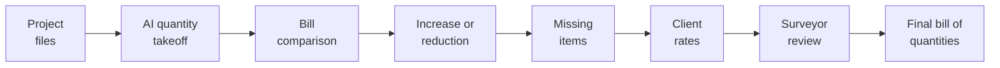

# 01 About Spark Technologies

## Who We Are

We are a Dubai-based Full Spectrum AI technology company specialising in enterprise-grade AI solutions for the construction, infrastructure, and industrial sectors.

:::tight
Headquartered in Dubai, UAE

10+ years in software development and technology delivery

1.5+ years focused exclusively on Enterprise AI solutions

Deep expertise in UAE regulatory environments, FIDIC contracts, and GCC construction operations

We combine advanced AI engineering with practical domain knowledge to solve high-impact, real-world problems across the full construction project lifecycle.
:::

## Our Solution Areas

:::cards
### SME Outcome as a Service
AI training, consultation, automation, and custom development for SMEs looking to turn AI into measurable business outcomes.

### Enterprise Solutions
Advanced AI and deep learning solutions for enterprise operations, inspections, prediction, automation, and secure system integration.

### Custom AI App Development
Custom AI apps for enterprises, internal workflow automation, AI-powered document systems, CRM and operations apps.

### In-House AI Products
Ready-to-deploy AI products built for specific industry verticals. Spark Hire, Leadsreach, CircleVoice, and Funnel Flow.
:::

# 02 Objective

## AI bill of quantities

This proof of concept demonstrates an AI-based bill of quantities workflow. The workflow reads project drawings, specifications, and the consultant bill of quantities, measures the selected trades, compares those measurements with the consultant bill, identifies discrepancies and missing items, applies the client’s rates, and produces the final bill in the consultant’s existing format.

The demonstration uses three or four separate projects, so the same measurement rules are shown on more than one job.

# 03 Scope of Work

## What the fifteen days cover

### AI quantity takeoff

**Concrete and reinforced concrete.** Quantity takeoff for the structural elements present on the supplied drawings, such as footings and foundations, columns, beams, slabs, structural walls, and stairs.

**Reinforcement.** Demonstrated only where the project includes reinforcement drawings, a bar bending schedule, or both. A schedule will not be assumed where none was issued.

**Plaster and finishes.** Quantity takeoff for internal and external wall plaster, and for ceiling plaster where the architectural drawings and finishes information support it, using the agreed measurement rules.

### Consultant bill compared with the AI quantity

The consultant bill is the baseline. Both increases and reductions are shown.

**For each item the workflow shows:**

- Consultant quantity
- AI calculated quantity
- Difference, as an increase or a reduction
- Status

### Missing items, rates, and the final bill

An item found in the drawings or specifications and absent from the consultant bill is flagged as a missing or additional item. Where the drawings support a measurement, the quantity is calculated and shown.

The client may provide an internal rate sheet. Available rates are matched to bill items, and the amount is quantity multiplied by unit rate. A rate that cannot be matched with confidence is flagged for review.

The consultant’s bill structure is the target output. Reviewed quantities, rates, amounts, and missing or additional items are written into that structure. The export is Excel.

### Traceability and quantity surveyor review

Where practical, each AI quantity cites the drawing or page, the element or location, and the calculation reference. The quantity surveyor can accept, modify, or reject a quantity before the bill is finalised.

# 04 Example Comparison

## How a difference is shown

The figures below are an illustration of the comparison layout, not a result from a Constech project.

:::table widths=100,95,85,80,101 bold_first
| Bill item | Consultant quantity | AI quantity | Difference | Status |
| --- | --- | --- | --- | --- |
| Concrete | 100 m³ | 120 m³ | +20 m³ | Increased |
| Plaster | 500 m² | 470 m² | −30 m² | Reduced |
| Missing item | — | 45 m² | +45 m² | Missing from the bill |
:::

# 05 Projects Required

## Three or four separate jobs

Please provide **three or four separate projects**.

A single building, or several floors of the same building, is not sufficient. The demonstration needs the same rules to hold on more than one job. Where the portfolio allows it, the set should differ in building type or drawing style. Useful variety includes a simple frame, a basement or podium, a typical upper floor, and one set produced by another office.

Each project is one coordinated issue. The bill, the drawings, the specification, and the schedules for that project must belong to the same revision. A bill from one issue and drawings from another will produce differences that are not measurement errors.

Please name one level with us before the files are issued. The request is for that level, not the full sheet archive of the building.

**For each project, please include:**

- The structural sheets for the agreed level, plus the foundation or basement sheets when that is the concrete being measured
- The details those sheets refer to
- The architectural floor plan of the same level, for plaster
- The finishes-schedule rows that apply to that level
- The bill of quantities pages for the concrete and plaster items on that level

# 06 Files Required

## What to send for every project

No additional markup of the drawings is required. Room coloring, wall tracing, and opening-by-opening annotation are not part of this request. Door and window deductions follow the drawings and the written measurement rule.

:::table widths=78,150,100,123 bold_first
| Priority | File | Preferred format | Purpose |
| --- | --- | --- | --- |
| Required | Consultant bill of quantities | Excel | Baseline quantities and the output template |
| Required | Drawing index | Excel or PDF | Identifies plans, details, and notes |
| Required | Architectural drawings for the agreed level | PDF, and DWG if available | Plaster and architectural measurement |
| Required | Structural drawings for the agreed level | PDF, and DWG if available | Concrete quantity takeoff |
| Required | Structural detail drawings referenced by those sheets | PDF or DWG | Dimensions and element sizes |
| Required for reinforcement | Reinforcement drawings | PDF or DWG | Reinforcement calculation, where this trade is included |
| If available | Bar bending schedule | Excel or PDF | Reinforcement quantities and a check against the drawings |
| Required | Project specifications for concrete and plaster | PDF | Materials and measurement requirements |
| Required for plaster | Finishes schedule | Excel or PDF | Plaster types and where they apply |
| Required | Internal rate sheet | Excel | Rates applied to bill items |
| Required | Verified sample calculation for concrete | Excel or PDF | Ground truth for the concrete measurement |
| Required | Verified sample calculation for plaster | Excel or PDF | Ground truth for the plaster measurement |
| Highly recommended | Existing quantity takeoff or calculation sheet | Excel | A check against the quantity surveyor’s own measurement |
:::

# 07 Drawing Conditions

## Please confirm these for every project

:::large
- **Revision.** Drawing numbers, revision, and date match the bill of quantities.
- **Scale.** Each plan carries a scale, or a scale schedule is provided for that revision.
- **Units.** Metres, millimetres, and the bill units (m, m², m³) are stated.
- **Measurement rules.** One written rule, applied to every project. Please state whether concrete is measured net of openings, and whether plaster is measured to the wall face and deducts doors and windows. The rule should be in the specification or in a short note issued with the files.
- **Index.** The drawing index marks which sheets are plans, which are details, and which are general notes.
:::

Reinforcement is included only on projects that supply reinforcement drawings, a bar bending schedule, or both.

# 08 Boundary of the Work

## Included, and left outside

:::columns
### In this proof of concept

AI quantity takeoff for concrete, reinforced concrete, and plaster. Comparison with the consultant bill. Increases, reductions, and missing items. Application of client rates. Quantity surveyor review. A final Excel bill in the consultant’s format, produced for each issued project.

### Outside this proof of concept

Full multi-trade estimation. Drawing-revision and variation management. Procurement, billing, and ERP or accounting integration. Other construction AI modules.
:::

# 09 Conclusion

## The Path Forward

Constech has set a clear requirement for an AI bill of quantities. Spark Technologies has set this proof of concept against that requirement: measure concrete, reinforced concrete, and plaster from the issued drawings, compare the result with the consultant bill, and write the final bill in the consultant’s existing format.

The work uses the files Constech already holds. Drawings, specifications, the consultant bill, and the rate sheet stay in their current form. No extra drawing markup, and no change to the consultant’s bill structure, is required to begin.

Spark Technologies is ready to begin once the project files are issued. The next step is to confirm the projects, the level, and the measurement rules, and to start the fifteen-day proof of concept.

# 10 Next Steps & Sign-off

## How We Move Forward

:::steps
### Scope Review

Constech reviews this scope and raises any questions before the files are issued.

### File Issue

Send three or four separate projects, each from one revision, for the agreed level only.

### Rule Check

Confirm the measurement rules, the units, and that the bill and drawings are the same issue.

### Demonstration

Spark Technologies runs the takeoff, the comparison, and the Excel bill for review.
:::

:::contact
:::
