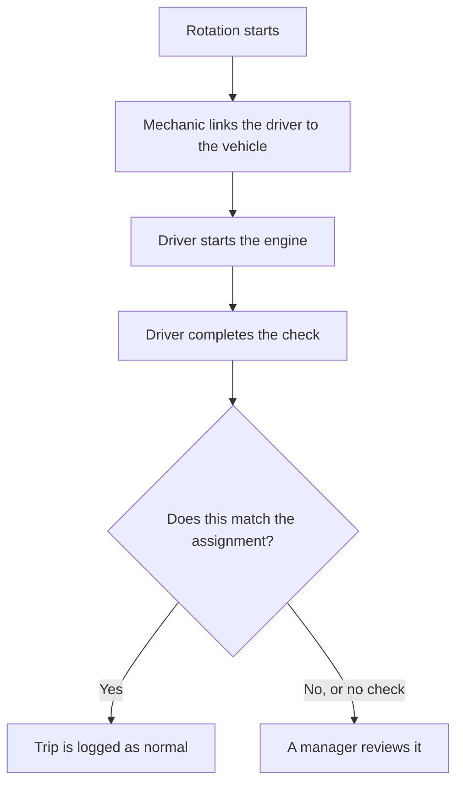
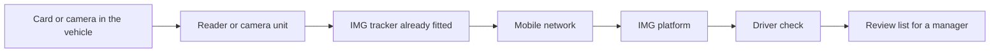

# 01 Overview

## Driver check for the Condor fleet

At the start of each two-week rotation, vehicles are handed to drivers from a paper book in the mechanics room. The driver signs a waiver. Keys are passed by hand. There is no separate record of who was actually driving a vehicle at a given time. If something goes wrong, the book is the only evidence, and it depends on the page being filled in and matching the person who drove.

Spark Technologies will replace that book with a digital record, and add one check when the engine starts. The mechanic still assigns a vehicle to a driver. The assignment is stored in a system, with the time written automatically. At ignition, the driver completes that check with a card tap or a face check. If the check matches the assignment, the trip is logged. If it does not match, or if there is no check, a manager sees it and reviews it. The system does not block the vehicle or decide the outcome on its own.

The assignment screen needs no new equipment. The only new equipment is the check inside each vehicle. Condor chooses which kind is fitted. Nothing is installed until that choice is confirmed.

:::columns
### Today
A paper book, a signed waiver, and keys handed over by hand. A change of driver during a shift is often not written down.

### With the driver check
The same handover, on a screen. One check at ignition. A short list of mismatches for a manager to review.
:::

:::callout
### What Condor receives
A record of who was assigned each vehicle, a check of who started it, and a list of exceptions for review. Each person and each vehicle uses one identity, so records line up across systems.
:::

# 02 How it works

## From the book to the screen

### Today, at handover

1. The mechanic hands the keys to the driver listed for that vehicle.
2. The driver signs a waiver in the book.
3. The mechanic writes the vehicle, the driver, and the date by hand.
4. If the keys are passed to someone else, or the vehicle breaks down, there is usually no written record.

### With the driver check

1. The mechanic opens the assignment screen and links the driver to the vehicle for the rotation.
2. The system records the time. There is no handwriting.
3. When the engine starts, the driver completes the check, by card tap or by face check.
4. The system compares that check with the assignment. A match is logged. A mismatch or a missing check is sent to a manager.

The equipment in the vehicle is planned to talk to the IMG GPS tracker already fitted. Whether that tracker can take a card reader is still an open question for the IMG vendor. That question is item 16. The tracker already sends trip data over the mobile network to the IMG platform. The driver check reads that information and adds the match and the review list. The tracker already in the vehicle does not need to be replaced for the first release.

# 03 Two ways to confirm the driver

## Card tap or face check

Both are a check when the engine starts. A card tap records which card was used. A face check compares the face in the seat with a photo taken when the driver was enrolled. Spark Technologies recommends the card tap for the whole fleet. The face check can be tried later on a small group of vehicles if Condor decides the extra check is worth the cost and the consent process.

### Card tap

Each driver carries one personal card, like an office door card. A small reader is fitted where the driver can reach it from the seat. Before starting, the driver taps the card. The reader reads a unique number on the card.

The plan is for that number to go to the IMG GPS tracker already in the vehicle, so the time and the card can be attached to the trip the tracker already sends. This works only if the tracker can read a driver card. The IMG vendor has not confirmed that yet. It is item 16 below. If the tracker cannot, Spark Technologies and Condor agree another way to record the tap before any reader is fitted.

The card has no battery. The reader is wired to the tracker, not to the engine computer, so the fit does not affect the engine. The first release records the tap and flags a missing tap. The engine still starts, so a driver is not stuck on site because of a reader. Holding the engine until a valid tap is a later choice, and only if the IMG vendor confirms the tracker can do it. That is not confirmed yet, and it is part of the same question in item 16.

This confirms that a specific card was tapped in a specific vehicle at a specific time. It does not confirm that the person holding the card is the owner. A simple process for issuing and replacing cards, and a review when the same problem repeats, covers that gap. Cards can be lost, shared, or left in another vehicle.

### Face check

A small camera faces the driver, usually on the windscreen pillar or the dashboard. It can see a face at night. A chip in the camera, not a remote server, compares the live face with a photo taken when the driver was enrolled. Only the result, match or no match, needs to leave the vehicle, unless Condor later asks to keep images for flagged events. The check can run through the start of the trip, so a change of driver during a shift can be noticed. A card tap happens once.

A face is harder to hand to someone else than a card. The check can still fail in sun glare, dust on the lens, or when the face is covered, for example in cold or dusty conditions. Every driver needs one clear photo before the check works, and a new photo if people change often.

A face image is personal data under Uzbek law. Each driver must agree in writing, and the data must stay on servers inside Uzbekistan. The camera costs more than a card reader, and the fit takes longer because the camera needs a clear, stable view of the face.

:::callout
### Recommendation
Start with the card tap across the fleet. It replaces the paper book, it does not use face photos, and it is quicker to fit. Pilot the face check on a small group of vehicles only if Condor later decides continuous checking is worth the cost and the written consent.
:::

### What is fitted in each vehicle

| Item | Face check | Card tap | Notes |
| --- | --- | --- | --- |
| What the driver carries | Nothing. The face is the check. | One card or badge per person | The card has no battery |
| Unit in the vehicle | Camera facing the driver, including a night light | Small reader near the ignition | The camera needs a clear view of the face |
| Where the check runs | A small chip in the camera | The GPS tracker, if it can read a card | No new computer in the vehicle. Item 16 asks IMG to confirm the card link |
| Wiring | Camera to the tracker or to vehicle power, plus a data link | Reader to the tracker data input, once IMG confirms that input | The wiring does not connect to the engine computer |
| Block the engine | Not normally used | Not in the first release. Later only if IMG confirms the tracker can wait for a tap | The first release records the tap and flags a missing one. The engine still starts |
| Time to fit one vehicle | 1 to 2 hours | Under 1 hour | Depends on the vehicle and the cabin |
| Personal data | A face image | A card number only | The face check needs written consent and storage inside Uzbekistan |

### What the central system needs

| Need | What it means |
| --- | --- |
| IMG access | Read trip, ignition, and driver fields, from a report file or a live connection |
| One identity each | One identity per person and per vehicle, shared with the other Condor modules |
| Where it runs | A Condor server, or a protected service inside Uzbekistan, agreed with Condor IT |
| When the link drops | The site link fails in strong wind from October. The check keeps working and sends data when the link returns |
| Review screen | A simple screen for the named reviewer to see mismatches and clear them |

# 04 What Condor provides

## Data requirements

Spark Technologies needs the 28 items below to build the driver check. Most are documents Condor already holds, or a short answer. No new equipment is required to start the work. Equipment is fitted only after Condor chooses the card tap or the face check.

On sample pages, names or identity numbers can be covered if that is easier. Spark Technologies needs to see how each record is laid out and how it is used.

Photos from a phone are enough for paper pages. Please send items by email to the Spark Technologies team.

### A. How vehicles are handed out today

| # | What Condor provides | Why it is needed |
| --- | --- | --- |
| 1 | Photos or copies of 2 or 3 filled pages from the mechanic's handover book. Names can be covered. | This is the record being replaced. The screen uses the same columns, so the mechanic's work stays familiar. |
| 2 | The steps at the start of a shift: who gives the keys, what is signed, and what is written. | So the screen follows the real steps and nothing is missed. |
| 3 | What happens today when a driver gives the keys to another person, or a vehicle breaks down during a shift. | These are the cases the system must handle. |
| 4 | The rotation dates, and which crew works when. | So an assignment opens and closes with each two-week rotation. |
| 5 | One past case where the wrong driver was blamed, for example the speeding case. Vehicle and dates only. | Used to test that the new record would have shown who was driving. |

### B. Vehicles

| # | What Condor provides | Why it is needed |
| --- | --- | --- |
| 6 | A list of all vehicles: plate number, make and model, type, and usual base. | Every vehicle needs one identity. Without a clean list, records cannot be matched. |
| 7 | Which vehicles Condor owns, which are rented, and from which company. | Rented vehicles use the contractor's GPS, not Condor's, and may need different handling. |
| 8 | The IMG tracker number fitted in each vehicle. | So a trip can be tied to the right vehicle. |
| 9 | About how many vehicles are added or returned each month. | So the vehicle list stays current. |

### C. Drivers

| # | What Condor provides | Why it is needed |
| --- | --- | --- |
| 10 | A list of everyone allowed to drive: name, staff number, job title, employee or contractor, and crew. | The check compares the person at the wheel with this list. |
| 11 | How many drivers join or leave each rotation. | This sets how often cards are issued or cancelled. |
| 12 | Whether staff already have an identity card, and if it is a photo, a barcode, or a chip. | An existing card can be reused, which saves cost and time. |
| 13 | Driving licence type and expiry for each driver. Optional. | The system can warn if a licence does not cover the vehicle. |

### D. The IMG GPS system

| # | What Condor provides | Why it is needed |
| --- | --- | --- |
| 14 | One month of trip reports from IMG, as Excel or CSV. | Spark Technologies can start from a real file before any live connection. |
| 15 | A read-only login to IMG, or the IMG vendor's contact. | So engine times and trips can be collected each day. |
| 16 | Two questions for the IMG vendor: can the trackers read a driver card and show that driver in the reports? Can a tracker hold the engine until a valid tap, or can it only record the tap? | The card reader plan depends on the first answer. If the tracker cannot read a card, another way to record the tap is agreed before anything is fitted. Holding the engine is not part of the first release, and only if the second answer is yes. |
| 17 | Whether the IMG contract allows a data export or a connection for another system. | This shows how the systems can connect, and whether a change of plan is needed. |

### E. Places and the network

Spark Technologies has the seven Condor locations: Kumli Facility, Urtakum Facility, Storm Camp, Operations Laydown Area, Drilling Laydown Area, and the future Compressor Station and Urtakum Camp.

| # | What Condor provides | Why it is needed |
| --- | --- | --- |
| 18 | Which places hand out vehicles, and where the handover book is kept. | That is where the screen will be used. |
| 19 | Where vehicles are parked overnight and between shifts. | So the system knows a normal start of day, and can notice unusual use. |
| 20 | For each place: wireless internet, mobile data, or none, and mains power or a generator. | The link fails in strong wind from October. The system must keep working and send data when the link returns. |
| 21 | When the Compressor Station and Urtakum Camp are expected to open. | So those places can be added later without rebuilding. |

### F. Decisions

These are choices, not documents. Spark Technologies can advise on each one.

| # | What Condor decides | Why it is needed |
| --- | --- | --- |
| 22 | Card tap, face check, the recommendation in this document, or a small test group first. | This decides what is fitted in each vehicle. |
| 23 | Who reviews a flag, and how soon. | A flag only helps if someone looks at it. |
| 24 | Confirmation from HR or legal that recording who drives is allowed. If the face check is chosen, written consent from each driver. | This keeps Condor inside Uzbek personal data rules. |
| 25 | Language of the screens: Uzbek, Russian, English, or a mix. | Many mechanics and drivers speak Uzbek or Tajik. The screens must be usable without help. |

### G. People and access

| # | What Condor provides | Why it is needed |
| --- | --- | --- |
| 26 | One main contact for this work, with phone and email. | One person to answer questions keeps the work moving. |
| 27 | A maintenance contact who can help fit readers or cameras later. | Condor's team knows the vehicles and approves work in the cabin. |
| 28 | Where the system should run: a Condor server or a protected service inside Uzbekistan, and an IT contact for that environment. | Data stays inside Uzbekistan and is not placed on a public cloud. |

# 05 How we move forward

## Next steps

:::steps
### 01 Share the information
Condor sends the items in this document and confirms card tap or face check.

### 02 Agree what is fitted
Spark Technologies and the Condor maintenance contact agree readers or cameras, vehicle by vehicle. Nothing is fitted before that plan is agreed.

### 03 Build and trial
The assignment screen and the driver check are built, then tried on a small group of vehicles before the rest of the fleet.
:::

:::contact
:::
