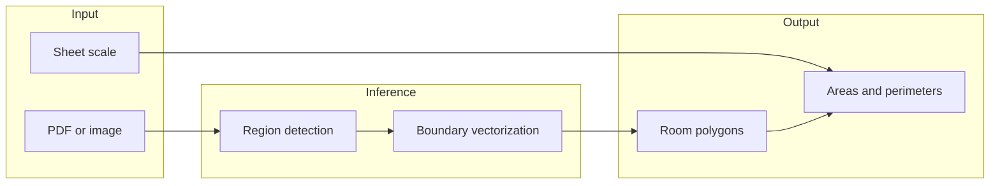
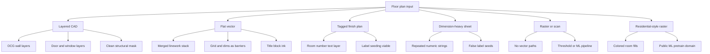
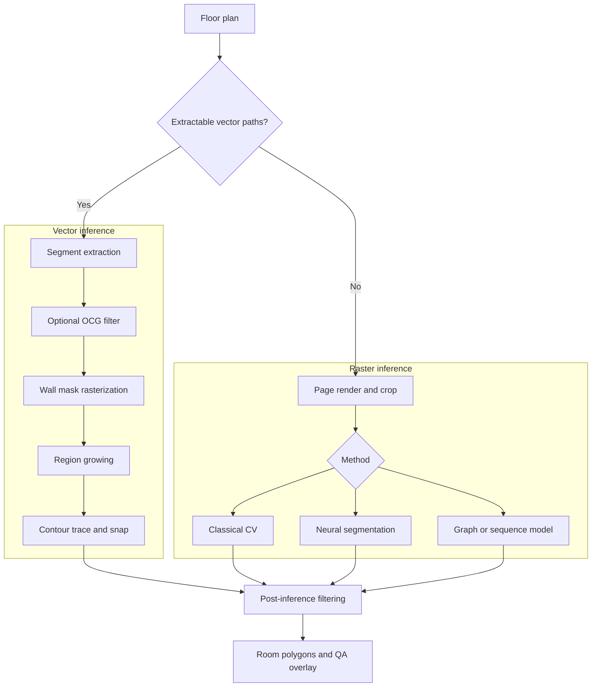
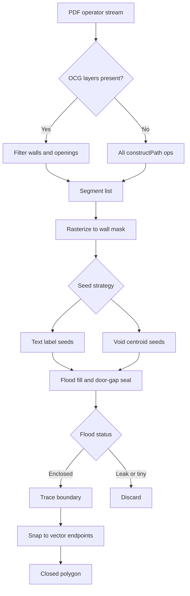
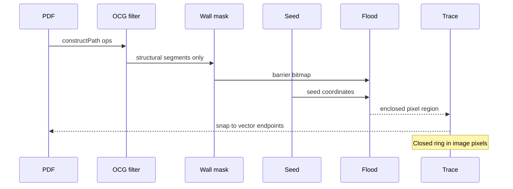
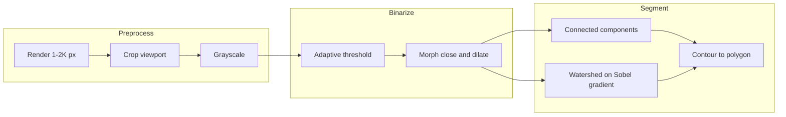
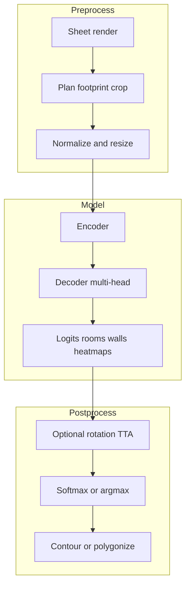
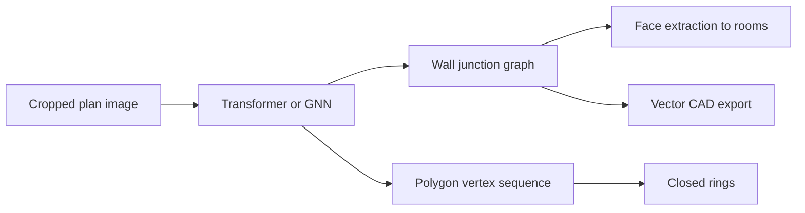
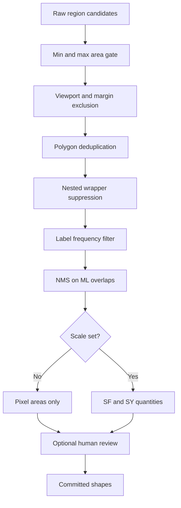
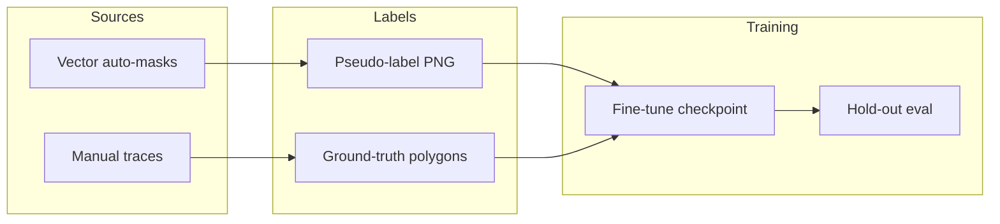

# Spark AI — Auto-Takeoff Techniques (Internal)

Reference catalog of methods for **automatic room boundary inference** and **quantity extraction** from architectural floor plans. Describes mechanisms and failure modes; does not prescribe a product pipeline.

---

## Scope & outputs

**Input:** floor-plan PDF or raster image.  
**Target output:** closed polygons per enclosed space + area (SF/SY) once scale is calibrated.

Floor plans are not semantically structured — they expose drawing primitives (paths, text, optional OCG layers), not room objects. Auto-takeoff is **inverse graphics**: classify ink as walls vs noise, recover enclosed regions, vectorize boundaries.

---

## Input modality taxonomy

Detection quality depends heavily on how the sheet was exported. Same building, different PDF structure → different viable techniques.

| Modality | Geometry | Layer metadata | Typical barrier noise |
|----------|----------|----------------|------------------------|
| **Layered CAD (OCG)** | Vector | Walls, openings named | Low — non-structural layers excludable |
| **Flat vector export** | Vector | None or ignored | High — text, grid, hatch, legends |
| **Tagged finish plan** | Vector + text | Varies | Medium — depends on tag vs dimension disambiguation |
| **Dimension-heavy sheet** | Vector + repeated numerics | Varies | High — numeric tokens mimic room IDs |
| **Scanned / image PDF** | Raster only | N/A | Medium — resolution & threshold dependent |
| **Residential-style image** | Raster | N/A | Low for ML pretrain; unlike commercial CAD |

**Layered CAD export** — PDF retains OCG groups (walls, doors, windows, annotations). A layer filter can build a mask from structural linework only.

**Flat vector export** — all primitives share one stack. Walls, dimensions, grid, hatching, and title-block graphics contribute equally to a naive mask.

**Tagged finish plans** — room identifiers in the text layer provide seed coordinates for flood-based region growing; fails when dimension strings match room-number patterns.

**Dimension-heavy sheets** — repeated numeric strings (finish codes, chain dimensions) trigger false seeds if label heuristics are too loose.

**Raster-only inputs** — require render → pixel pipeline; vector flood is unavailable.

**Residential-style imagery** — colored fills and simple topology; aligns with public datasets (CubiCasa5K) but diverges from commercial CAD linework.

---

## Approach families

Three independent families. Production systems often chain one primary detector with shared post-processing.

| Family | Data used | Training | Latency | CAD fit (general) |
|--------|-----------|----------|---------|-------------------|
| Vector geometry | PDF operators | None | Low | Strong on layered CAD; noisy on flat export |
| Classical CV | Rendered bitmap | None | Low–medium | Weak on dense partitions |
| Neural segmentation | Cropped bitmap | Pretrain + optional fine-tune | Medium–high | Domain-dependent |
| Graph / sequence | Cropped bitmap | Pretrain | High | Research-grade; vector topology output |

---

## Vector-based room inference

Operates on extracted line segments. Core pattern: **barrier mask → seed → flood fill → polygon trace**.

| Component | Mechanism | Failure mode |
|-----------|-----------|--------------|
| **Wall mask** | Rasterize segments; ink = barrier, interior = fillable | Line weight & scale affect gap width |
| **OCG layer filter** | Drop non-structural layers before mask build | No-op when layers absent |
| **Flood fill** | BFS/DFS from seed until barrier contact | Leaks through door gaps, mask breaks |
| **Label seeds** | Text position → seed point | Dimension / finish codes as false tags |
| **Void seeds** | Centroid per enclosed open component | Micro-void explosion without area gates |
| **Gap sealing** | Morphological bridge on mask (door-width) | Over-seal merges adjacent rooms |
| **Hatch transparency** | Classify hatch families; secondary flood pass | Residual hatch blocks fill |
| **Trace + snap** | Pixel contour → polygon; snap to snap grid | Jagged trace if snap sparse |
| **Polygonize** | Planar graph faces from wall edges | Requires clean junction topology |

---

## Raster CV pipelines

No learned weights. Page → bitmap → binary or gradient map → region extraction.

| Operation | Role | CAD caveat |
|-----------|------|------------|
| **Threshold** | Ink vs paper separation | Thin walls vanish at low DPI |
| **Morphological close** | Bridge wall gaps | Merges nearby parallel lines |
| **Connected components** | Label enclosed blobs | Misses rooms separated by single-pixel breaks |
| **Watershed (gradient)** | Boundaries along edge ridges | More robust than binary alone on gappy walls |
| **Viewport crop** | Remove title block / margins | Required before downscale |

Dense commercial CAD: threshold + CC often **under-segments** — interior partitions lost at render resolution.

---

## Neural segmentation

Per-pixel classification or multi-head output (rooms, walls, icons, junction heatmaps). Requires crop to model input size (~512 px) on large sheets.

| Method | Architecture | Output heads | Notes |
|--------|--------------|--------------|-------|
| **Semantic segmentation** | U-Net, SegFormer, FCN | Per-pixel class | Simplest decode path |
| **Multi-task (CubiCasa-style)** | Stacked hourglass | Heatmaps + room + icon channels | Heuristic polygonize step |
| **Test-time augmentation** | N rotations, mean logits | Same | Variable benefit on CAD |
| **Fine-tuning** | Transfer from public checkpoint | Same | Needs in-house labeled volume |
| **Pseudo-labeling** | Teacher = vector pipeline masks | Training PNG masks | Bootstraps flat-export labels |

| Pretrained family | Training domain | Untuned behaviour on commercial CAD |
|-------------------|-----------------|-------------------------------------|
| CubiCasa hourglass | ~5k residential, colored | Coarse blobs, not per-room |
| SegFormer floorplan | Simplified plan images | Near-zero usable regions |
| Light U-Net (4-class) | Generic wall/door seg | Collapse to background |
| MitUNet (transformer + U-Net) | Thin-wall focus | Research; boundary accuracy |

---

## Structural prediction (graph & sequence)

Predicts topology or ordered geometry rather than dense pixels — closer to CAD-native output.

| Paradigm | Representation | Typical use |
|----------|----------------|-------------|
| **Wall junction graph** | Nodes = corners; edges = wall segments | Raster-to-vector, 3D extrusion prep |
| **Polygon sequences** | Autoregressive corner lists | Direct room boundary decode |
| **Heatmap → polygon** | Keypoint detection + rules | CubiCasa post-process standard |

---

## Post-inference filtering

Shared cleanup stage regardless of detector family.

| Filter | Removes |
|--------|---------|
| Min area | Slivers, text bubbles, symbol boxes |
| Max area (% sheet) | Courtyard floods, exterior shells |
| Viewport clip | Title block, legend band detections |
| Dedup (ring hash) | Duplicate floods from twin seeds |
| Wrapper suppression | Parent polygon engulfing many children |
| Token frequency | Dimension strings seeded as room IDs |
| NMS | Overlapping ML masks |
| Scale gate | Premature quantity commit |
| Review gate | Low-confidence / agent-proposed regions |

---

## Training & label generation

Methods for producing supervised signal when manual masks are scarce.

| Technique | Description |
|-----------|-------------|
| **Pseudo-labeling** | Best automatic pipeline → binary room mask for training |
| **Teacher from layered CAD** | Clean OCG masks supervise flat-export fine-tune |
| **Active learning** | Label sheets with highest model error |
| **Public pretrain** | CubiCasa5K, Structured3D, Raster2Graph, WAFFLE |
| **Augmentation** | Crop, rotation, line-thickness jitter |

---

## Empirical notes

Observations from internal evaluation runs — descriptive only.

| Configuration | Observed behaviour |
|---------------|-------------------|
| Layered CAD · void seeds · no area filter | Hundreds of spurious regions |
| Layered CAD · OCG wall filter · void seeds | Order-of-magnitude reduction; plausible region count |
| Layered CAD · unfiltered label seeds | Speckle from dimension text |
| Flat vector · off-the-shelf CubiCasa / SegFormer | Zero to few blobby regions |
| Flat vector · fine-tune ~25 pseudo-labeled sheets | Still low recall |
| Flat vector · filtered vector + margin crop | Moderate recall; footprint visible in QA |
| Flat vector · void seeds · no filters | Thousands of regions |
| ML · full sheet resized to 512 px | Structural detail lost |

---

## References

| Topic | Link |
|-------|------|
| CubiCasa5K | [arXiv:1904.01920](https://arxiv.org/abs/1904.01920) |
| Raster-to-Graph | [project page](https://wutomwu.github.io/publications/2024-Raster2Graph/) |
| Raster2Seq | [arXiv:2602.09016](https://arxiv.org/html/2602.09016v2) |
| MitUNet | [arXiv:2512.02413](https://arxiv.org/html/2512.02413v3) |
| Industry CV + ML takeoff | [Kreo](https://www.kreo.net/news-2d-takeoff/floor-plan-recognition-technologies) |
| Geometry / vision separation | [planlens](https://pypi.org/project/planlens/) |
| Gradient watershed segmentation | [spatial-analysis](https://github.com/adityonugrohoid/spatial-analysis) |
| R2G + segmentation stack | [Neural Floorplan](http://daegeunkim.com/neural_floorplan.html) |

---

*Last updated: 2026-03-26*
