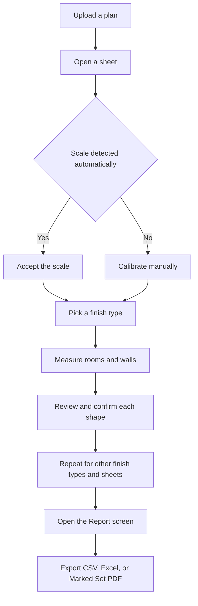
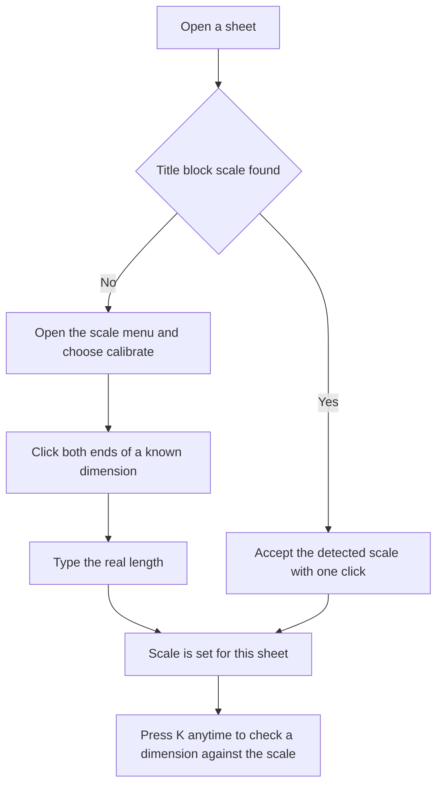
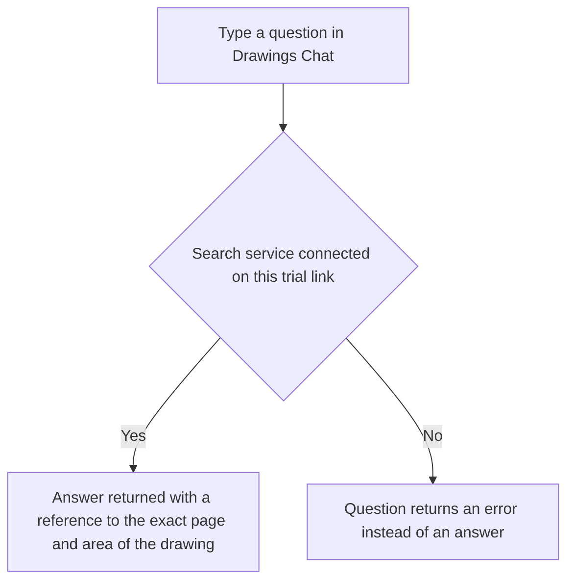
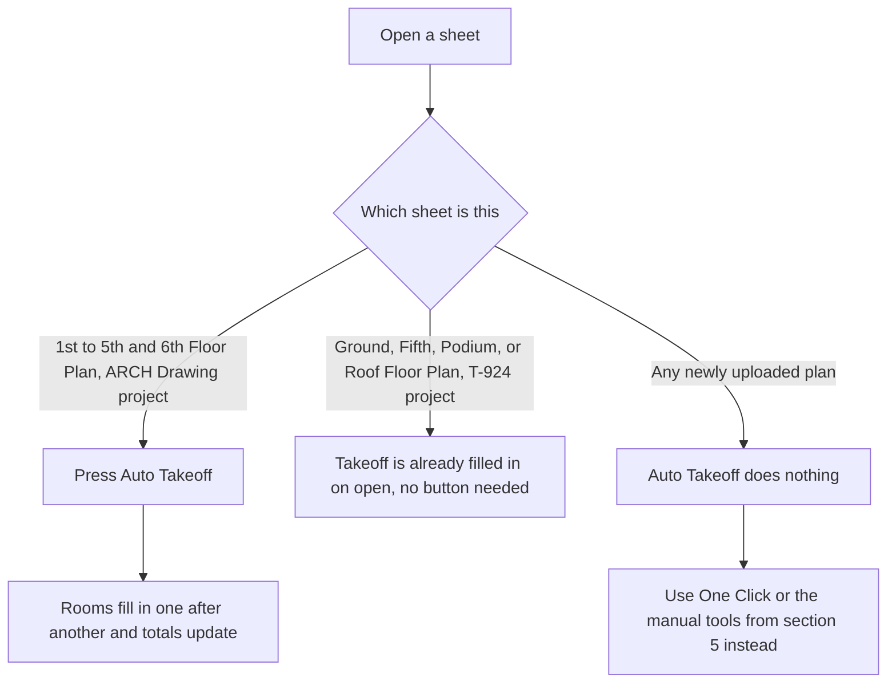
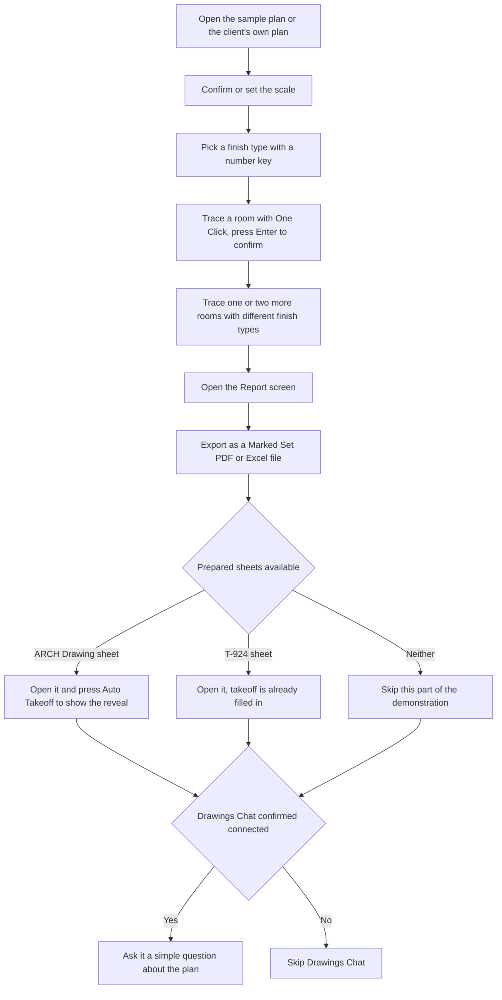

# OpenTakeoff Trial Guide

This document explains what the trial version of the app can do, how to use every tool in it, and what its real limits are. It is written so anyone on the team can hand it to a client alongside the trial link and use it as a manual.

## Table of Contents

1. How the App Works, Start to Finish
2. Getting a Plan Into the App
3. Managing Sheets
4. Setting the Scale
5. Measuring Tools
6. Selecting and Editing Shapes
7. Drafting Aids
8. Conditions, the Finish Types Being Measured
9. Materials and Supporting Costs
10. Markups and Communication Tools
11. Layers Panel
12. Reports and Exporting
13. Extra Project Panels
14. Drawings Chat
15. Automatic Floor Plan Reading
16. File and Upload Limits
17. Storage and Data
18. Browser and Device Notes
19. Suggested Walkthrough for a Client Demo

## 1. How the App Works, Start to Finish

Every project in the app follows the same basic path from an uploaded drawing to a finished report. The diagram below shows that path.

The sections below explain every step in this path in detail, plus the extra panels and tools that sit alongside it.

## 2. Getting a Plan Into the App

The app accepts several kinds of files, and handles each one differently before it can be measured on.

| File type | What happens to it |
|---|---|
| PDF | Opened directly. A multi page PDF is split into individual sheets automatically, so a twenty page drawing set becomes twenty separate sheets browsed one by one. |
| PNG, JPG, JPEG, WEBP, GIF, BMP | Wrapped into a single page PDF so it can be measured the same way as any drawing. |
| ZIP | Unpacked inside the browser, and every plan file found inside, including nested zip files, is added as its own sheet. |
| DWG | Converted into a PDF entirely inside the browser when opened. No internet connection or outside service is used for this. Very complex drawings with unusual objects may not convert perfectly and can fall back to a simpler preview image. |

There is a Load Sample Plan button on the start screen. This opens a ready made plan so anyone can see the tool working immediately without uploading anything.

## 3. Managing Sheets

Press G to open the Sheet Gallery. It shows a thumbnail of every sheet in the project, whether a scale has already been set for it, how many shapes have been measured on it, and whether it is currently open.

| Task | How to do it |
|---|---|
| Browse all sheets | Press G for the Sheet Gallery |
| Open several sheets as tabs | Select them in the gallery, then open as tabs |
| Compare sheets side by side | Select up to four sheets in the gallery and open side by side, this is a fixed maximum |
| Group sheets by floor | Use Assign Level in the gallery |
| Rename a sheet for display | Right click the sheet and rename it, this does not change the underlying file |

Sheet titles are read from the drawing's own title block when a plan is opened. Plans uploaded as a folder or zip keep their original folder structure inside the app.

## 4. Setting the Scale

Almost every measuring tool needs the sheet's scale to be known first. The only tool that works without a scale is Count, since it does not calculate distance or area.

Each sheet remembers its own scale separately, so switching between sheets does not require resetting it each time. A toggle next to the scale controls switches how numbers are displayed between feet and meters, without changing anything about how the drawing itself was measured.

## 5. Measuring Tools

Every tool below is opened either from the tool rail on the left side of the screen or by its keyboard shortcut. A shape is only added to the takeoff once it is confirmed, normally by pressing Enter or double clicking, so nothing is measured by accident.

| Tool | Key | What it does | Works on scanned images |
|---|---|---|---|
| One Click Area | O | Click once inside a room, the tool finds the boundary on its own by following the wall lines and fills it in. Holding option or alt while clicking inside a filled room carves out an island such as a column. | Yes, edges should be checked before confirming |
| Area | A | Click around the corners of any shaped room one by one, then press Enter or double click to close it | Yes |
| Rectangle | R | Click two opposite corners of a simple rectangular room | Yes |
| Linear | L | Click along a straight run to measure length, useful for trim or transition strips | Yes |
| Curved Line | Q | Same as Linear but follows a smooth curve through the points clicked | Yes |
| Surface Area | S | Traces a wall in plan view, wall area is the wall length multiplied by a height set on the finish type | Yes |
| Wall Trace | W | Click once on a wall, the tool follows the entire connected wall network on its own and works out footprint area, wall face area, and volume together | No, needs real vector line work, use Surface Area on scans instead |
| Wall Area | U | A manual version of wall tracing, click along a wall run by hand | Yes |
| Count | C | Click once on each item to be counted, such as fixtures or floor drains. Works even before a scale is set | Yes |
| Deduct shape | D | Removes an area from inside a shape, useful for columns or built in cabinets | Yes |
| Deduct rectangle | Shift D | Same as above, drawn as a rectangle with two clicks | Yes |
| Deduct curve | Shift Q | Same as above, drawn as a curve | Yes |

## 6. Selecting and Editing Shapes

Clicking a shape selects it, after which it can be dragged to resize, moved, or deleted. Shapes can be copied and pasted, including onto a different sheet, where the quantity is automatically recalculated for that sheet's scale. Shapes can also be duplicated in place.

A selected shape can be flipped horizontally or vertically from the edit menu, reassigned to a different finish type by clicking a different finish in the panel, or given a text label such as a phase name or area name for organizing purposes without creating a whole new finish type.

Undo and redo work with the usual keyboard shortcuts and remember the last one hundred actions taken on shapes. A few actions sit outside this history and cannot be undone the same way. These are deleting a finish type entirely, changing a sheet's scale, and restoring an older saved revision. Everything else, including placing, editing, moving, and deleting individual shapes, can be undone normally.

## 7. Drafting Aids

An angle lock is on by default and gently pulls new lines toward the nearest forty five or ninety degree angle while tracing, which keeps hand traced walls and borders straight. Holding the shift key while drawing forces this lock at any angle.

An endpoint snap feature, off by default, pulls the cursor toward existing corner points on the drawing while tracing, useful for lining up new shapes exactly against existing wall corners. This only works on drawings with real vector line work, the same requirement as Wall Trace, and will not do anything useful on a scanned image.

A live readout near the cursor shows the running length or area while a shape is being traced, so the numbers can be checked before confirming a shape.

## 8. Conditions, the Finish Types Being Measured

A condition is one finish type being measured, for example carpet, vinyl plank, or tile. Every shape placed on the plan is measured into whichever condition is currently active.

New conditions can be added from the takeoffs panel. Each one can be given a name, a color, a fill pattern, a waste percentage, a quantity multiplier, a height in feet for wall measurements, and a thickness in inches for border measurements taken with the Linear or Curved Line tools.

Number keys one through nine switch between the nine most recently pinned conditions while measuring, so the finish type can be changed quickly without opening a menu each time.

A library tab lets a condition be saved once and reused on future projects, and a materials tab links a condition to a specific product so its coverage rate carries over automatically.

## 9. Materials and Supporting Costs

Each condition can carry its own coverage rate, meaning how much area or length one unit of material actually covers, which the report uses to calculate order quantities rather than just the raw measured amount.

A grout calculator is built in for tile conditions, working out coverage per bag from tile size, joint width, and grout depth. Labor and subfloor notes can be typed directly against a condition as free text, and these appear alongside the material quantities in the exported report. A shared materials library allows a product set up once to be reused across every project without entering it again each time.

## 10. Markups and Communication Tools

These tools add notes and comments to a plan without affecting any measured quantities.

A highlighter for freehand strokes, a revision cloud, a callout, a text note, and a highlight box can each be placed on a sheet from the markup menu, useful for leaving review comments for a client or a site team to see directly on the drawing.

Stamps are reusable groups of markups, such as a standard note or symbol, that can be placed repeatedly with one click each time instead of being redrawn.

An RFI register can be created directly from a markup, giving each question a number, a status, and a place to record the eventual answer, all kept alongside the plan itself.

## 11. Layers Panel

The layers panel lists every shape on a sheet in a tree, similar to a layer panel in a design program. Shapes or whole groups of shapes can be hidden from view, locked so they cannot be accidentally edited, or grouped together for organization. Hiding or locking a shape does not change its measured quantity, it only affects what is shown on screen.

## 12. Reports and Exporting

The report screen totals every measured shape by area, length, or count, shown both as measured and with waste applied, broken down by finish type and by sheet. It also produces a materials buy list based on each condition's coverage rate.

| Export | What it contains |
|---|---|
| CSV | The visible totals table as a plain spreadsheet file |
| Excel | Separate tabs for the summary, the per sheet breakdown, and the materials list |
| JSON | The full report as structured data |
| Print | The report sent straight to the browser's print dialog |
| Marked Set PDF | A copy of the plan itself with every measured shape drawn on top of it, generally the clearest format to send to a client |
| RFI export | A separate CSV or JSON of every RFI raised, when any exist |

## 13. Extra Project Panels

Beyond the core takeoff tools, this build includes a few additional panels aimed at estimating.

| Panel | What it does |
|---|---|
| Summary | A running overview of total floor area, wall area, length, and item counts grouped by finish type and by floor |
| Bill of Quantities | Lists every measured room with its finish code, area, and any matching finish schedule reference found on the drawing, exports its own CSV or PDF |
| Estimate | Turns the takeoff into a cost worksheet showing material, labor, and other costs per finish type and per floor, with a grand total. Only shows meaningful numbers once rates have been entered |
| Rates | A catalog of costs per finish code that feeds the Estimate panel, can be imported from a CSV or Excel file instead of typing each rate in by hand |

## 14. Drawings Chat

Drawings Chat is a chat panel, opened from a bubble icon on the left side of the screen, where a plain English question can be typed about the plans currently loaded, for example asking what floor finish is specified in a certain room, or how many doors are on a certain floor.

This feature depends on a backend search service being connected to the specific trial deployment being used.

Please check with whoever set up the trial link whether this service is active before demonstrating this feature to a client.

## 15. Automatic Floor Plan Reading

An Auto Takeoff button on the toolbar can fill in the rooms on certain floor plan sheets on its own, without needing anyone to click through every room individually. In this trial, the takeoff for a small set of sheets has already been prepared and saved in advance, so nothing is being read fresh in real time when this is shown.

There are two groups of prepared sheets in this trial, and they behave slightly differently.

From the ARCH Drawing project, pressing Auto Takeoff on 1st Floor Plan, 2nd Floor Plan, 3rd Floor Plan, 4th Floor Plan, or 5th and 6th Floor Plan will visibly reveal the rooms one after another with the small animation described above.

From the T-924 project, Ground Floor Plan Reflected False Ceiling, Fifth Floor Plan Reflected False Ceiling, 1st Podium Floor Finishing, and Roof Floor Finishing already show their full takeoff as soon as the sheet is opened, since that data was saved directly into the project rather than being wired into the reveal button.

Uploading a new file, even a floor plan that looks similar to these, will not trigger either behavior. For any new project, plan, or building a client brings themselves, use One Click or the manual tools from section five instead, both of which genuinely work on any plan uploaded, drawn or scanned.

## 16. File and Upload Limits

| Limit | Detail |
|---|---|
| Single PDF, image, or DWG file | No fixed maximum size in the app itself, limited only by how much storage the browser allows |
| Zip upload | Capped at two gigabytes of combined uncompressed content and ten thousand files total, nested zip files are only unpacked eight levels deep |
| Supported file types | PDF, PNG, JPG, JPEG, WEBP, GIF, BMP, ZIP, and DWG. Any other file type, including TIF and TIFF, is skipped during upload |
| Pages per PDF | No fixed limit, every page becomes its own sheet automatically |
| Side by side sheets | Four sheets on screen at the same time, a fixed maximum |

Anything beyond the zip limits above is skipped quietly rather than causing an error, so a very large zip upload may leave some sheets out without a clear warning.

## 17. Storage and Data

Everything in this trial is stored locally inside the browser being used, not on an external server, unless the trial has been specifically connected to a shared cloud project. Switching to a different browser or a different computer will not carry work over, and clearing browser data will remove saved plans and takeoff work.

There is no built in warning when browser storage is getting full during normal use, with one exception, saving a named snapshot of a project will show a clear message if there is not enough space left. Outside of that, watch for any warning from the browser itself.

Because storage is local to the browser, private or incognito windows may limit or clear storage sooner than a normal browser window, so a regular, non private browser window is recommended for testing.

## 18. Browser and Device Notes

The app has been tested on recent versions of Chrome, Firefox, and Safari, and needs a reasonably current browser to work at all since it depends on browser features for storing data.

This trial runs in a single browser with no shared login and no multiple people editing the same project at the same time. There is no cross device sync in this trial by default.

## 19. Suggested Walkthrough for a Client Demo

