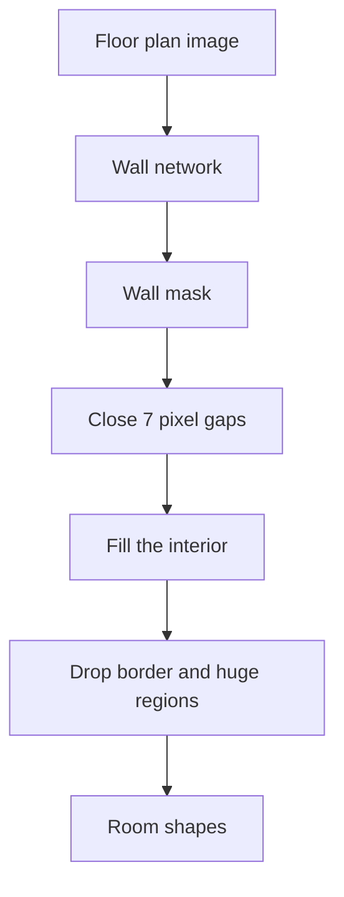

# 01 Problem and approach

## Floor-plan wall model

A floor plan is a drawing. We need the rooms as closed shapes so area can be measured. The drawing does not hand us those shapes. It hands us lines.

The method we kept is: find the wall lines, close the small gaps where doors are, and fill the space inside. Text names come later. They are not part of this report.

:::callout
### Pipeline parameters
A room counts only if the wall mask is closed. Cutoff on the wall score is **0.5**. Gaps up to **7 pixels** are bridged. A region that touches the edge of the sheet, or covers more than **12%** of the sheet, is thrown out.
:::

Label counts, when doors are treated as walls too: 12th floor 91, 17th floor 93, 8th–11th floors 91.

# 02 Data preparation

## How the drawings were marked

Two annotation packs were merged. In one pack the number 1 meant wall. In the other pack the number 1 meant opening. We matched by the class name, not the number, then cropped away the title tables and scaled the long side to 2048 pixels.

The mark we train on is the wall stroke. Openings were tried as a second class and dropped: the strokes are too thin, and that class stayed near an overlap of 0.05.

### Why not mark the rooms instead of the walls

A room-colored mask would paint the inside of each room and leave the walls blank. On these sheets that does not add information. The inside of a room and the space outside the building are both white. Furniture and notes sit in both. The only place the two regions differ is the wall line. A room label still has to stop at that line, so the network is still being asked to find the wall. If the line is too faint to predict, coloring the room on the same sheet does not make the line visible.

It also removes the barrier the fill uses. The saved model closes rooms by treating the wall mask as a fence and filling inside it. A room mask has no fence. At a door, the annotator has to decide whether the color stops or runs into the next room. If that choice is inconsistent, neighboring rooms bleed together. The 12th floor is already at 89 rooms against 91 labels, so redoing every sheet as rooms would spend the work on a result we already have.

The misses that remain, the last rooms on the 17th floor and the guest rooms on the unseen plans, are missing wall strokes. New room colors on these 69 sheets would not show the network a hairline hotel wall it has never been given. If more marking is done later, the useful version is to keep the wall polygons and paint the room underneath them, only on sheets where the fill leaks. The wall stays the fence. The room color can hold a region when one stroke is broken. Replacing the walls is the version we did not take.

# 03 Production model

## The model we keep

**Appearance fine-tune of the wall-only U-Net.** Weights: `Model Training and Data/runs/unet-appear/best.pt`.

It is a small U-Net. Class 0 is background, class 1 is wall. The base run is six epochs on 69 of our sheets. The saved base file is epoch 5, validation wall overlap 0.70. The appearance model starts from that file, then one extra epoch changes contrast, adds a light blur, tints the paper, and rotates by a few degrees. The wall thickness is not changed. Learning rate `1e-5`. One sheet at a time.

The diamond on the base chart is epoch 5, the weights the fine-tune started from. The diamond on the room chart is the appearance epoch we kept after that.

We stopped after that epoch. The next epoch lowered the loss and split the 12th floor, so those weights were not saved.

| Sheet | Labels | Saved model |
| --- | ---: | ---: |
| 12th floor | 91 | 89 |
| 17th floor | 93 | 82 |
| Unseen plan A | — | 0 |
| Unseen plan B | — | 3 |
| Unseen plan C | — | not re-scored; wall-only model scored 12 |

Unseen plans A, B, and C are public drawings. They are not in the training set or the validation set.

| Epoch | Train loss | 12th | 17th | Unseen A | Unseen B | Kept |
| --- | ---: | ---: | ---: | ---: | ---: | --- |
| Start, wall-only | — | 91 | 63 | 0 | 0 | — |
| 1 | 0.468 | 89 | 82 | 0 | 3 | yes |
| Next epoch from the save | 0.438 | 81 | 56 | 0 | 0 | no |

The green diamond, with a line to a dot, is the saved checkpoint. On the loss chart that dot is step 0, before the extra epoch. The line is every 10 steps of the epoch that was not kept. Room counts are measured only at the end of an epoch, and the diamond there is epoch 1.

Training stopped there because the next epoch fit the augmented sheets harder (loss 0.468 down to 0.438) while the clean floor plans got worse (89 and 82 rooms down to 81 and 56). That is overfitting to the contrast, blur, and rotation, not a sign that more epochs were still helping.

A more general model needs wall labels, marked the same way, on the other kinds of drawings, especially ink plans with very thin interior walls. Tens of sheets of each kind, trained together from the start, with one plan of that kind held out. These 69 sheets and the CubiCasa set do not contain those thin hotel walls, which is why the unseen plans stay open.

### Saved samples

**Appearance U-Net, saved checkpoint. 12th floor.**

**Appearance U-Net, saved checkpoint. 17th floor.**

**Appearance U-Net, saved checkpoint. Unseen plan A.**

**Appearance U-Net, saved checkpoint. Unseen plan B.**

# 04 Techniques evaluated

## Each technique we tried

### Wall-only U-Net {.module}

Our own network, not a paper model. The shape is a U-Net ([Ronneberger, Fischer, and Brox, 2015](https://arxiv.org/abs/1505.04597)). The loss is weighted cross-entropy plus Tversky, the overlap loss from [Salehi, Erdogmus, and Gholipour, 2017](https://arxiv.org/abs/1706.05721), in the same family as the Dice term in [Milletari, Navab, and Ahmadi, V-Net, 2016](https://arxiv.org/abs/1606.04797). Missed wall pixels are weighted 0.7 and extra wall pixels 0.3, so thin lines are not lost in the white page.

Six epochs. Overlap was still moving, and the saved file is the lowest validation loss, epoch 5, overlap 0.70, not the last epoch. Floods: 12th floor 91, 17th floor 63, unseen plan C 12.

**Wall-only U-Net, the base, before the appearance fine-tune. 12th floor.**

**Wall-only U-Net, the base. 17th floor.**

**Wall-only U-Net, the base. Unseen plan C.**

### Thick walls and sliding windows {.module}

From [FGSSNet](https://arxiv.org/abs/2507.10343) (arXiv HTML: [2507.10343v1](https://arxiv.org/html/2507.10343v1); the copy we read is `uploads/2507.10343v1-0.md`, not a separate PDF). That paper rescales the page so walls are about 24 pixels, trains on small crops, rotates some crops by up to 45 degrees, then slides a window at test time and averages the scores. The cutoff stays 0.5. Their loss is plain cross-entropy, which we did not copy, because plain cross-entropy already lost our thin walls.

We used the crop and rescale idea, with walls nearer 10 pixels so it would fit an 8 GB card, for 6 epochs. Crop overlap rose to 0.78. On the full sheet the walls came back as blobs. 12th floor 74, 17th floor 81, unseen plan C 7. Not kept. We did not build their five-patch feature injector. At test time that injector needs a person to pick wall samples, and a thin sample makes the model reject a thicker wall.

**Thick-wall tiled U-Net, from the FGSSNet training recipe. 12th floor.**

### CubiCasa drawings {.module}

[CubiCasa5K](https://arxiv.org/abs/1904.01920) (Kalervo, Ylioinas, Häikiö, Karhu, and Kannala, 2019) is a public set of residential plans. We turned about 4,200 of them into thin wall masks.

A wider U-Net pretrained on that set and then tuned on our sheets over-split rooms (12th floor 118). Mixing a few of those drawings into the wall-only net, at a very small step size, moved the 12th floor off 91 on the second epoch (74 rooms). A net trained only on CubiCasa, 3 epochs, reached overlap 0.71 on its own held-out drawings and closed 0 rooms on unseen plans A and B. Three epochs were enough to see that. The loss was still falling, and the unseen room count stayed at 0.

**CubiCasa-only U-Net. Unseen plan A.**

**CubiCasa-only U-Net. Unseen plan B.**

The original CubiCasa hourglass, with a new 3-class head, stayed near wall overlap 0.05. That head is built for room types and icons, not for our wall mask.

### CAGE {.module}

[CAGE](https://arxiv.org/abs/2509.15459) (Yiyi Liu et al., 2025) predicts wall endpoints from a point-cloud density image and trains them with an L1 distance. The full text was pasted into the working session. It was not stored as a PDF. Our network predicts a wall pixel, not an endpoint, so that loss does not attach. A simpler version, snapping the mask to straight lines, was tried and made the floods worse. The full CAGE network was not trained. It expects scan density, a 24 GB card, and room edges labeled as ordered endpoints.

### SegFormer {.module}

[SegFormer](https://arxiv.org/abs/2105.15203) (Xie et al., 2021), starting from a public floor-plan checkpoint ([Patnev71/segformer-b0-finetuned-floorplan](https://huggingface.co/Patnev71/segformer-b0-finetuned-floorplan)). Wall overlap reached about 0.64 and the opening class about 0.16, with false red speckles. Room counts stayed under the labels. Not kept.

### YOLO-seg {.module}

Ultralytics YOLOv8n-seg, 40 epochs at 1280 pixels, on our wall and opening polygons. Mask mAP50 ended at 0.373. Counts were sometimes close and the masks were not. A public CAD checkpoint, FloorCAD ([Fan et al., FloorPlanCAD, ICCV 2021](https://openaccess.thecvf.com/content/ICCV2021/html/Fan_FloorPlanCAD_A_Large-Scale_CAD_Drawing_Dataset_for_Panoptic_Symbol_Spotting_ICCV_2021_paper.html); weights [mudasir13cs/floorcad-yolov8n-seg](https://huggingface.co/mudasir13cs/floorcad-yolov8n-seg)), was tried with no extra training. At 1280 it closed 10 and 5 rooms on the 12th and 17th floors. Its wall class is a symbol among furniture, not a continuous barrier.

**FloorCAD YOLOv8n-seg, no extra training. 12th floor.**

### RMBG and Mask2Former {.module}

[RMBG-1.4](https://huggingface.co/briaai/RMBG-1.4) fine-tuned on CubiCasa walls ([phungpx/RMBG-1.4-wall-segmentation-cubicassa](https://huggingface.co/phungpx/RMBG-1.4-wall-segmentation-cubicassa)) and [Mask2Former](https://arxiv.org/abs/2112.01527) (Cheng, Misra, Schwing, Kirillov, and Girdhar, 2021; weights [phungpx/mask2former-swin-base-cubicassa](https://huggingface.co/phungpx/mask2former-swin-base-cubicassa)). With no extra training, RMBG closed 10 and 0 rooms, Mask2Former 9 and 6, and Mask2Former closed 11 regions on unseen plan A, mostly large halls.

We then fine-tuned RMBG on our sheets for 6 epochs at 1024 pixels. Overlap moved from 0.19 to 0.26 and stopped. Floods stayed at 6 and 5. Six epochs were enough to see the plateau.

**RMBG fine-tuned on our sheets. 12th floor.**

**Mask2Former, CubiCasa checkpoint, no extra training. 12th floor.**

**Mask2Former, CubiCasa checkpoint, no extra training. Unseen plan A.**

### Room head {.module}

A second head on the wall U-Net, trained to paint the interiors already implied by our wall and opening masks. No new drawing. The full second decoder did not fit in 8 GB, so a shallow head was trained for 4 epochs. Room overlap stayed at 0.11. No new room crossed the cutoff. Four epochs were enough: the loss fell a little and the flood did not change (91 and 63).

**Wall-only U-Net plus the room head. 12th floor. The head added no rooms.**

### Cleanup after the mask {.module}

Straightening the mask with line fits, and closing gaps in one direction only, comes from the same wish as CAGE: make walls meet. Both were run on the wall-only mask. Replacing the mask with fitted lines dropped the 12th floor from 91 to 14. Keeping the original walls and adding the lines did not change the count. A lower cutoff (0.35) added only a few rooms and was not adopted.

# 05 Results

## Comparison

| Model | 12th | 17th | Unseen A | Unseen B | Unseen C |
| --- | ---: | ---: | ---: | ---: | ---: |
| Labels | 91 | 93 | — | — | — |
| **Appearance U-Net, saved** | **89** | **82** | **0** | **3** | — |
| Wall-only U-Net | 91 | 63 | 0 | 0 | 12 |
| Thick-wall tiles | 74 | 81 | — | — | 7 |
| Mask2Former, no extra training | 9 | 6 | 11 | — | — |
| FloorCAD, no extra training | 10 | 5 | 2 | — | — |
| RMBG fine-tune | 6 | 5 | 2 | — | — |
| Room head | 91 | 63 | 0 | — | — |
| CubiCasa-only U-Net | — | — | 0 | 0 | — |

:::callout
### Conclusion
The saved model is the appearance U-Net. It is the one that closed the missing side of the 17th floor without giving up the 12th floor. None of the public models, and none of the CubiCasa-only training, closed the guest rooms on the unseen plans.
:::

**Appearance U-Net, saved checkpoint. 12th floor. 89 rooms.**

**Appearance U-Net, saved checkpoint. 17th floor. 82 rooms.**

**Appearance U-Net, saved checkpoint. Unseen plan A. 0 rooms.**

**Appearance U-Net, saved checkpoint. Unseen plan B. 3 rooms.**

**Wall-only U-Net, the base. Unseen plan C. 12 rooms. The appearance model was not run on this sheet.**

# 06 Future data requirements

## What more data would be required

The saved model is fit to one kind of drawing: our construction sheets, dark lines on a white page, walls a few pixels wide. Unseen plans A and B are a different kind. The interior walls there are hairlines. Neither our 69 sheets nor the 4,200 CubiCasa plans taught the network that stroke, so those rooms stay open. Another epoch on the sheets we already have will not draw a line the labels never showed.

To make one model that works on more than this project, the missing piece is wall labels of those other drawings, marked the same way we mark walls now.

- **Ink and scanned plans** with thin interior walls, the kind unseen plans A, B, and C are. This is the gap. CubiCasa is clean residential linework, and a network trained only on it still closed 0 rooms on unseen plans A and B.
- **Other CAD conventions**, if we care about them: different line weight, heavy hatching, or dimension text drawn through the rooms. Only the kinds we actually want the model to read.
- **Tens of sheets of each kind**, on the order of the 69 we already have, not another few thousand of a style we already tried.
- **Wall polygons only**, same rules as now: the stroke is the fence. Openings can stay unmarked. Room colors are not a substitute. If a sheet leaks because one stroke is broken, the room can be painted underneath the wall on that sheet. Do not replace the walls with room masks.
- **One training run from the start** on the combined set, each kind of drawing shown every epoch, at the real stroke width. Do not pretrain on CubiCasa and then fine-tune on our sheets. That order erased one set or the other.
- **A held-out sheet of each kind**, never used in training. The run counts only if the 12th floor stays near 91 and the held-out ink plan actually closes rooms. Cutoff stays 0.5. The door close stays 7 pixels.

# 07 References

## References

- U-Net: https://arxiv.org/abs/1505.04597
- V-Net (Dice loss): https://arxiv.org/abs/1606.04797
- Tversky loss: https://arxiv.org/abs/1706.05721
- CubiCasa5K: https://arxiv.org/abs/1904.01920
- SegFormer: https://arxiv.org/abs/2105.15203
- Mask2Former: https://arxiv.org/abs/2112.01527
- FloorPlanCAD: https://openaccess.thecvf.com/content/ICCV2021/html/Fan_FloorPlanCAD_A_Large-Scale_CAD_Drawing_Dataset_for_Panoptic_Symbol_Spotting_ICCV_2021_paper.html
- FGSSNet: https://arxiv.org/abs/2507.10343 (HTML copy read in session: `uploads/2507.10343v1-0.md`)
- CAGE: https://arxiv.org/abs/2509.15459 (full text pasted in the session, not saved as a PDF)
- RMBG-1.4: https://huggingface.co/briaai/RMBG-1.4
- RMBG wall checkpoint: https://huggingface.co/phungpx/RMBG-1.4-wall-segmentation-cubicassa
- Mask2Former wall checkpoint: https://huggingface.co/phungpx/mask2former-swin-base-cubicassa
- SegFormer floor-plan checkpoint: https://huggingface.co/Patnev71/segformer-b0-finetuned-floorplan
- FloorCAD YOLO checkpoint: https://huggingface.co/mudasir13cs/floorcad-yolov8n-seg
