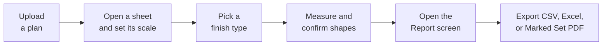

# 01 Overview

## ADICC Trial Guide

This guide covers what the trial version of ADICC can do, how its tools are used, and where its current limits are. Every project follows the same path, from an uploaded drawing to a finished report.

# 02 Plans, Sheets, and Scale

## Loading Plans and Setting the Scale

| File type | How it is handled |
| --- | --- |
| PDF | Opened directly; each page becomes its own sheet, so a twenty-page set becomes twenty sheets |
| PNG, JPG, JPEG, WEBP, GIF, BMP | Wrapped into a single-page PDF and measured like any drawing |
| ZIP | Unpacked in the browser; every plan found inside, including nested zips, is added as a sheet |
| DWG | Converted to PDF entirely in the browser, with no internet connection or outside service. Very complex drawings may fall back to a simpler preview image |

**Sheets.** A **Load Sample Plan** button on the start screen opens a ready-made plan without uploading anything. Press **G** for the Sheet Gallery, which shows every sheet with its scale status and shape count, and lets sheets be opened as tabs, compared side by side (four at once, a fixed maximum), grouped by floor with **Assign Level**, or renamed for display. Sheet titles are read from the drawing's title block, and folder or zip uploads keep their original structure.

**Scale.** Almost every tool needs the sheet scale first — only **Count** works without it. A scale found in the title block can be accepted with one click; otherwise choose calibrate, click both ends of a known dimension, and type its real length. Each sheet keeps its own scale, **K** checks any dimension against it, and a toggle switches the display between feet and meters without affecting measurements.

# 03 Measuring, Editing, and Conditions

## Measuring Tools and Finish Types

Tools open from the left tool rail or by shortcut. A shape only joins the takeoff once confirmed, normally with **Enter** or a double-click, so nothing is measured by accident.

| Tool | Key | What it does | Scans |
| --- | --- | --- | --- |
| One Click Area | O | Click inside a room and the boundary is found automatically by following the wall lines. Alt or option click carves out an island such as a column | Check edges |
| Area / Rectangle | A / R | Click room corners one by one, or two opposite corners for a simple rectangle | Yes |
| Linear / Curved Line | L / Q | Measure a straight or smoothly curved run, useful for trim and transition strips | Yes |
| Surface Area | S | Traces a wall in plan; wall area is length × the height set on the finish type | Yes |
| Wall Trace | W | Click one wall and the whole connected network is followed, returning footprint area, wall face area, and volume together | No — use Surface Area |
| Wall Area | U | Manual wall tracing, clicked along a run by hand | Yes |
| Count | C | Click each item to count, such as fixtures or floor drains. Works before a scale is set | Yes |
| Deducts | D / Shift D / Shift Q | Remove an area from inside a shape as a traced shape, rectangle, or curve — for columns or built-in cabinets | Yes |

**Editing.** Selected shapes can be resized, moved, deleted, duplicated, flipped, labelled with a phase or area name, or reassigned to another finish type. Copying a shape onto a different sheet recalculates its quantity for that sheet's scale. Undo and redo cover the last **one hundred** shape actions; deleting a finish type, changing a sheet's scale, and restoring an older revision sit outside that history.

**Drafting aids.** Angle lock is on by default and pulls new lines to the nearest 45° or 90° (hold **Shift** to force it at any angle). Endpoint snap, off by default, pulls the cursor onto existing corner points, and like Wall Trace needs real vector line work. A live readout by the cursor shows running length or area before a shape is confirmed.

**Conditions.** A condition is one finish type being measured, such as carpet, vinyl plank, or tile, and every shape is measured into whichever condition is active. Each carries a name, colour, fill pattern, waste percentage, quantity multiplier, wall height, and border thickness for Linear and Curved Line work. Number keys **1–9** switch between the nine most recently pinned conditions, and a library tab saves a condition for reuse on future projects.

**Materials.** Each condition can hold a coverage rate, so the report calculates order quantities rather than raw measured amounts. A grout calculator works out coverage per bag from tile size, joint width, and grout depth; labour and subfloor notes typed against a condition carry into the report; and a shared materials library lets a product set up once be reused on every project.

**Markups and layers.** Highlighter strokes, revision clouds, callouts, text notes, and highlight boxes can be placed without affecting quantities, and stamps place reusable groups of markups in one click. An RFI register can be created from a markup, giving each question a number, status, and recorded answer alongside the plan. The layers panel lists every shape as a tree that can be hidden, locked, or grouped, which changes only what is shown on screen.

# 04 Reports, Limits, and Getting Started

## Totals, Exports, and Practical Limits

The report screen totals every shape by area, length, or count — as measured and with waste applied — broken down by finish type and by sheet, plus a materials buy list based on each condition's coverage rate.

| Export | What it contains |
| --- | --- |
| CSV / JSON | The visible totals table as a spreadsheet file, or the full report as structured data |
| Excel | Separate tabs for the summary, per-sheet breakdown, and materials list |
| Marked Set PDF | The plan itself with every measured shape drawn on top — usually the clearest format to share |
| Print / RFI export | The report sent to the browser print dialog, and a CSV or JSON of every RFI raised |

**Estimating panels.** *Summary* totals floor area, wall area, length, and counts by finish type and floor. *Bill of Quantities* lists each measured room with its finish code, area, and any matching schedule reference, and exports its own CSV or PDF. *Estimate* turns the takeoff into a cost worksheet once rates exist, fed by the *Rates* catalog, which can be imported from CSV or Excel.

**Drawings Chat.** A chat panel opens from the bubble icon on the left, where plain English questions can be asked about the loaded plans — which floor finish a room specifies, how many doors are on a floor — with answers citing the exact page and area. It depends on a backend search service being connected to the trial deployment in use, so please confirm with your Spark Technologies contact whether it is active on your link; without it, questions return an error.

**Auto Takeoff.** An **Auto Takeoff** button fills in the rooms on a small set of prepared sheets, saved in advance rather than read fresh in real time. On the ARCH Drawing project, pressing it on the 1st to 5th and 6th Floor Plans reveals rooms one after another as totals update; on the T-924 project, the false ceiling, podium, and roof finishing sheets already show their takeoff when opened. Newly uploaded plans trigger neither behaviour — use **One Click** or the manual tools, which work on any plan, drawn or scanned.

| Limit | Detail |
| --- | --- |
| Single PDF, image, or DWG | No fixed size limit in the app, only what browser storage allows |
| Zip upload | 2 GB uncompressed, 10,000 files, nested zips unpacked eight levels deep |
| Supported types | PDF, PNG, JPG, JPEG, WEBP, GIF, BMP, ZIP, DWG — anything else, including TIF, is skipped |
| Pages and sheets | No page limit per PDF; four sheets side by side on screen, a fixed maximum |

Content beyond the zip limits is skipped quietly rather than reported, so a very large upload may leave some sheets out without a clear warning.

**Storage and browsers.** Work is stored locally in the browser, not on a server, unless the trial is connected to a shared cloud project. Changing browser or computer will not carry work over, and clearing browser data removes saved plans and takeoffs. Only named snapshots warn about low space, and private browsing may clear storage sooner, so a regular window is recommended. The app is tested on recent Chrome, Firefox, and Safari, and runs in a single browser with no shared login, simultaneous editing, or cross-device sync.

**A suggested first session.** Open the sample plan or your own drawing, confirm or set the scale, pick a finish type with a number key, then trace a room with **One Click** and press Enter to confirm. Add one or two more rooms on different finish types, open the Report screen, and export a Marked Set PDF or Excel file. The prepared Auto Takeoff sheets and Drawings Chat can then be reviewed as well.
