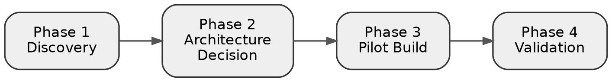
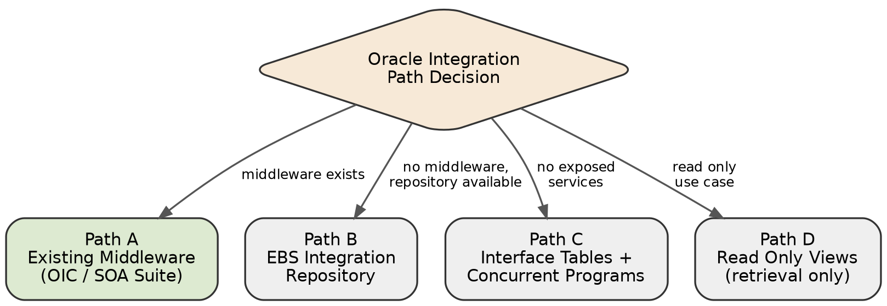
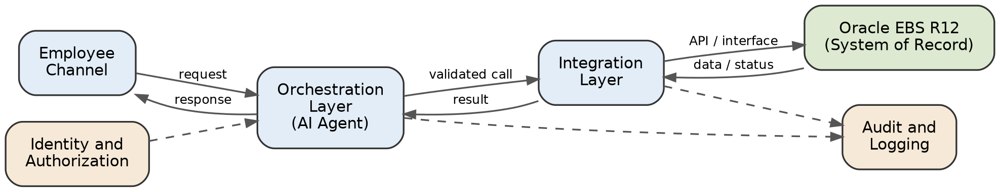

# 01 Objective

## Objective

This document defines the execution plan for moving the Bank of Riyadh Employee Self Service AI Agent from proposal stage to a validated pilot. The plan is organized into four phases: Discovery, Architecture Decision, Pilot Build, and Validation.

# 02 Phase 1 Discovery

## Phase 1: Discovery

Project scope cannot be finalized until the Oracle integration path is confirmed. This phase consists of information gathering activities to be completed jointly with Bank of Riyadh's technical stakeholders before development begins.

### Tasks

- **Establish working access** to Bank of Riyadh's Enterprise Applications and Oracle technical team.
- **Identify the EBS R12 modules in scope**, including self service HR, OTL for leave, payroll for payslips, and iRecruitment where relevant.
- **Determine whether Oracle Integration Cloud, SOA Suite, or any existing middleware** sits in front of EBS.
- **Determine the identity provider** used for employee authentication, such as Azure AD, ADFS, or an equivalent SSO system.
- **Secure access to a non production EBS environment** with representative test data.
- **Define data classification rules**, specifically which employee data may be included in AI prompts and which data must be masked or excluded.
- **Confirm the first three to five employee journeys** for prioritization, based on the use case ranking in the proposal (leave balance, leave request, payslip retrieval, HR policy Q&A, request tracking).

:::callout
### Deliverable
A discovery document consolidating the above findings, serving as the input to Phase 2.
:::

# 03 Phase 2 Architecture Decision

## Phase 2: Architecture Decision

Following discovery, the integration approach is selected from four realistic paths. The applicable path depends on the findings of Phase 1.

:::cards
### Path A: Oracle Integration Cloud or existing middleware
Where OIC, SOA Suite, or an equivalent layer already exposes EBS functions as REST or SOAP endpoints, the agent integrates directly against those endpoints. This is the fastest and lowest risk path.

### Path B: EBS Integration Repository
EBS R12 includes a built in Integration Repository capable of exposing PL/SQL APIs and open interfaces as web services. Where no middleware exists, this repository is activated and wrapped, requiring coordination between the Bank's Oracle administration team and Spark's integration team.

### Path C: Interface tables with concurrent programs
Where no exposed services exist, data is written to Oracle's open interface staging tables and processed into live EBS tables through a concurrent program. This approach operates closer to batch processing than real time.

### Path D: Read only views for retrieval
For read only operations such as leave balance checks, a reporting view may be queried directly without passing through the application layer. This is a fallback rather than the target design.
:::

:::callout
### Deliverable
A confirmed integration path, documented and agreed with the Bank's technical team, together with a mapping of specific EBS functions to each pilot use case.
:::

# 04 Phase 3 Pilot Build

## Phase 3: Pilot Build

Scope the pilot to a small, provable set of use cases rather than the full list in the proposal. This limits risk and gives a working end to end demonstration.

### Recommended pilot scope

- **HR policy question and answer**, built as a retrieval augmented generation system over approved policy documents.
- **Leave balance and status lookup**, a read only call through the integration layer.
- **Payslip retrieval**, a read only call through the integration layer.
- **Leave request submission**, the one transactional flow in the pilot, requiring explicit user confirmation before submission.
- **Request status tracking** after submission.

### Components to build

- **Channel layer** — a chat interface, either standalone web or embedded into an existing portal.
- **Orchestration layer** — the agent itself, handling intent detection, tool calling, and conversation state, including a mandatory confirmation step before any write action.
- **Integration layer** — the service calls into Oracle EBS R12 through whichever path was confirmed in Phase 2.
- **Identity and authorization layer** — SSO based authentication and role based checks before any data is retrieved or any action is submitted.
- **Audit and logging layer** — every request, decision, integration call, and result logged for traceability.

### Guardrails to build in from the start

- **Fallback and confidence handling** for the RAG based policy answers, so the agent does not answer with unsupported information.
- **Idempotency handling** on the leave submission call, to prevent duplicate submissions if a request is retried.
- **Arabic and English support**, including right to left layout handling and testing across formal Arabic and common workplace phrasing.

# 05 Phase 4 Validation

## Phase 4: Validation

Before presenting the pilot as complete, validate against the demo storyline already defined in the proposal: ask, retrieve, request, confirm, submit and track, plus one comparison style question such as performance versus the prior year.

### Tasks

- **Run the full demo script** end to end in the non production environment.
- **Clearly document** which parts of the demo are live, which are simulated, and which are mocked, and share this with the Bank before presenting.
- **Test failure paths**, including integration timeouts, authentication failures, and duplicate submission attempts.
- **Collect baseline metrics** defined in the proposal, such as self service completion rate and grounded answer accuracy, before proposing any target numbers.

# 06 Immediate Next Step

## Immediate Next Step

:::callout
### Blocking dependency
The single blocking dependency for this project is confirmation, jointly with Bank of Riyadh's Oracle and Enterprise Applications team, of which integration path defined in Phase 2 applies. Timeline and effort estimates for all subsequent phases are dependent on this confirmation.
:::
