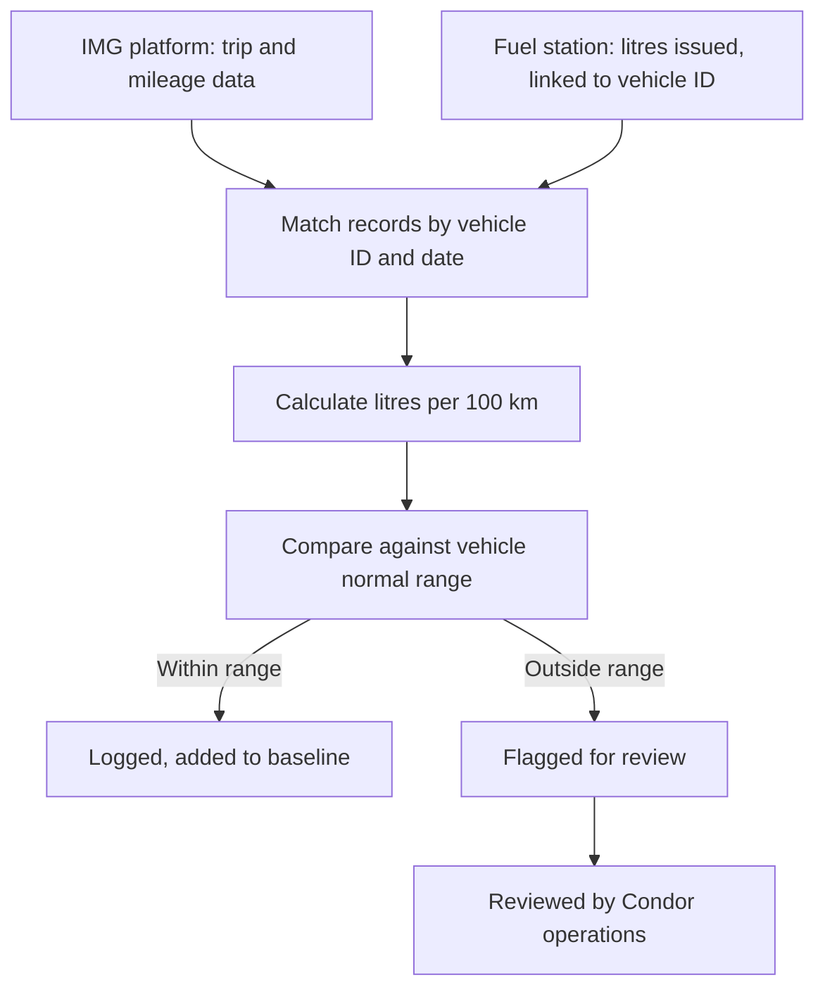
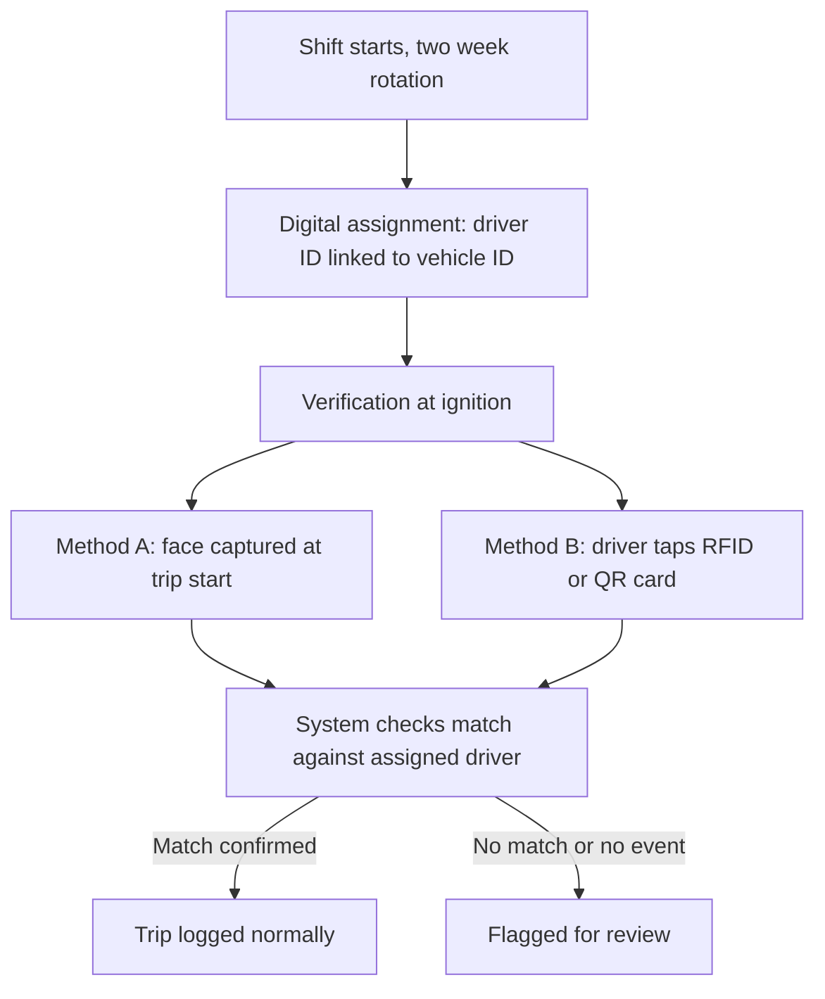
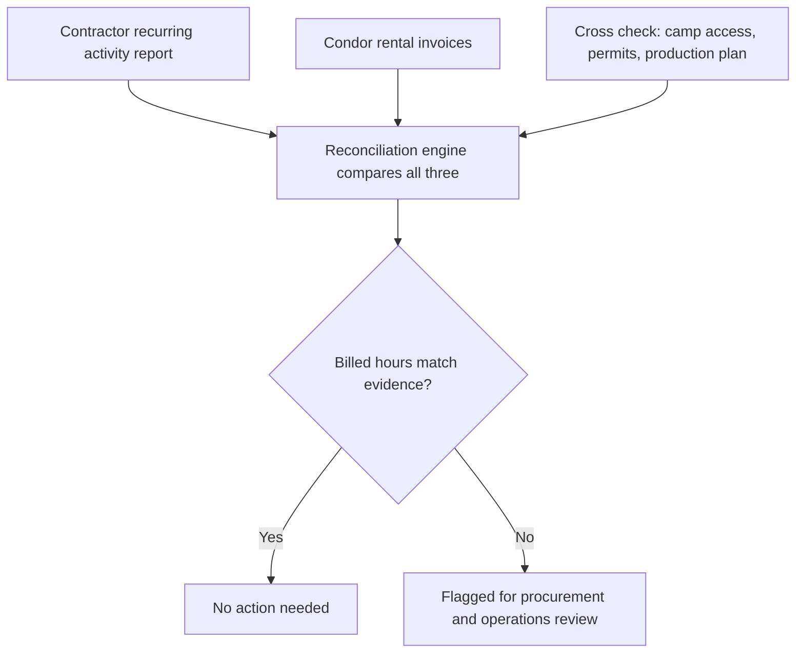

# 01 Document Summary

## Requirements Overview

:::columns
### The Challenge
Condor operates fleet and rented equipment across a remote site where fuel usage, driver identity, and contractor billing are tracked through separate systems: IMG telematics, paper logbooks, and ad hoc contractor reports. Without a shared reconciliation layer, mismatches between kilometres driven, litres issued, assigned drivers, and billed rental hours are difficult to detect until they become cost or compliance issues.

### The Opportunity
Three focused build modules can connect existing data sources rather than replace them. Fuel reconciliation against IMG trip data, digital vehicle assignment with driver verification at ignition, and rental cost monitoring against independent site records can each reach a first working version without waiting for optional hardware extensions.
:::

:::callout
### Our Approach
Spark Technologies will deliver three reconciliation and verification modules that sit on top of systems Condor already uses. Each module ingests data from agreed sources, applies rules and baselines defined with Condor operations, and surfaces exceptions for human review rather than making automated enforcement decisions. Stage one for each module prioritises software and data integration; optional hardware layers are documented separately and are not prerequisites for a working first release.
:::

:::callout
### Intended Outcome
Condor receives operational visibility across fuel consumption per vehicle, verified driver to vehicle assignment per shift, and rental billed hours compared against contractor reports and independent site evidence. All three modules share consistent entity IDs, offline capable sync, and an audit trail suitable for operations and procurement review.
:::

# 02 Our Assessment

## Our Assessment

Spark Technologies has reviewed the three modules confirmed for build. The assessment evaluated each against technical feasibility on site, fit with existing IMG and contractor workflows, regulatory constraints in Uzbekistan, and what Condor can supply without a live integration on day one.

### Module 1: IMG Platform and Fuel Monitoring {.module}

The IMG platform reports location, speed, engine status, and distance travelled, but fuel is not in the live feed today. Fuel monitoring on trackers is available from the vendor but has not been activated. Reconciliation in stage one is feasible using trip and mileage reports plus fuel station dispensing records, provided Condor introduces a vehicle link at the point of fuelling. Stage two tank sensors are optional and require a separate calibration period before they are reliable enough for enforcement use.

### Module 2: Fleet Assignment and Driver Verification {.module}

Paper logbooks create a gap between assigned driver and actual use. Digital assignment is straightforward once vehicle and person IDs exist. Verification at ignition requires new hardware. Method B (RFID or QR tap in) carries lower regulatory risk under Uzbek biometric data rules than Method A (in cabin face recognition). IMG may already support driver binding through card readers, which would reduce custom integration work if confirmed.

### Module 3: Rental Equipment Tracking {.module}

Direct access to the contractor GPS platform is not viable because it would expose other clients data. Recurring contractor reports cross checked against camp access, work permits, and production plan data can surface billing gaps without new hardware. A retrospective first version using last month invoices and activity reports is feasible before any live feed is agreed. Manufacturer telematics may be available for some equipment brands and should be confirmed per asset.

## Summary of Recommendations

| Module | Problem to solve | Recommended approach |
| --- | --- | --- |
| Module 1: IMG and fuel monitoring | Compare kilometres driven with litres issued; flag abnormal consumption | Stage one: IMG trip reports plus fuel station records and vehicle link at dispenser; stage two optional tank sensors |
| Module 2: Fleet assignment and verification | Replace paper handover; confirm who drove at ignition | Digital assignment record plus Method B RFID or QR tap in as default; Method A only for targeted use if needed later |
| Module 3: Rental equipment tracking | Compare billed rental hours with evidence of use | Recurring contractor report reconciled against invoices and site records; manufacturer telematics where available |

# 03 Scope of Work

## Scope of Work

This section defines what will be built for each module: functional scope, technical workflow, and boundaries. All modules share a common entity ID model and offline sync behaviour described in the Client Requirements section.

### Module 1: IMG Platform and Fuel Monitoring {.module}

**What will be built**

A reconciliation layer connecting IMG trip and mileage data with fuel issued at the station, comparing litres per 100 km per vehicle and per period, and flagging consumption outside an agreed normal range.

**How it works**

Stage one requires no new hardware. Trip and mileage data is pulled from the IMG reporting interface. Fuel issued is pulled from station records. A baseline of litres per 100 km is built per vehicle over an agreed calibration window. Readings outside range are flagged for manual review.

Stage two, if Condor approves later, adds in tank fuel level sensors on a pilot vehicle group. Sensors require installation, calibration, and approximately one month of tuning before readings are reliable enough for operational use. Stage two is optional and not required for stage one go live.

Fuel station capture must link each fuelling event to a vehicle ID, via plate recognition at the dispenser or a card tap at the point of fuelling. Without this link, stage one reconciliation has no fuel side match key.

**Workflow**

**Scope includes**

- **IMG data ingest:** scheduled pull from reporting or API interface for trip and mileage fields
- **Fuel data ingest:** import from station dispensing records once vehicle link exists
- **Baseline engine:** per vehicle litres per 100 km range from calibration period
- **Exception queue:** flagged vehicles and periods for operations review with audit log
- **Optional stage two hook:** data model ready for tank sensor readings if activated later

### Module 2: Fleet Assignment and Driver Verification {.module}

**What will be built**

A digital assignment record linking driver ID to vehicle ID at shift handover, plus a verification event at ignition compared against the assigned driver, with exceptions routed to review.

**How it works**

At the start of a two week rotation, an assignment entry replaces the paper handover. At ignition, the driver verifies identity by the method Condor selects. The system logs match, mismatch, or missing verification for audit.

**Workflow**

**Driver identification: method comparison**

### Method A: In cabin camera with face recognition

**Requirements:** inward facing camera per vehicle; processing for face matching; enrollment of every driver and contractor; local storage and processing inside Uzbekistan; written consent before face data is processed.

**Pros:** verification through the trip; not defeated by card handover; can extend to PPE or cabin monitoring later.

**Cons:** glare, dust, and low light affect accuracy; higher legal burden under Uzbek biometric rules; hardware in every vehicle; re enrollment on staff change; false rejections need a fallback process.

### Method B: RFID or QR tap in {.accent}

**Requirements:** card or tag per person; in vehicle reader wired to GPS tracker if supported; card to person ID registry; optional seat occupancy sensor.

**Pros:** simpler hardware; no biometric data; IMG may support binding already; clear audit trail.

**Cons:** confirms card use not identity; seat sensor can be bypassed; reader install in every vehicle; card replacement process needed.

:::callout
### Recommendation
Given Uzbek biometric storage and consent requirements, and because the core need is proving who drove rather than continuous cabin monitoring, **Method B is the lower risk starting point**. Method A can be considered later for specific vehicles or incidents only.
:::

**Scope includes**

- **Assignment module:** create, view, and close driver to vehicle assignments by shift
- **Verification capture:** ingest ignition events from chosen hardware method
- **Match logic:** compare verification event to active assignment; flag exceptions
- **Review queue:** operations view of unmatched or missing verification events
- **Audit log:** immutable record of assignment and verification history per vehicle

### Module 3: Rental Equipment Tracking {.module}

**What will be built**

A monitoring layer comparing rental invoices and contractor activity reports against independent site evidence, flagging billed hours that lack supporting records.

**How it works**

Condor receives recurring activity reports from the rental contractor on an agreed schedule. The engine compares billed hours from invoices, hours in the contractor report, and cross check signals from camp access, work permits, and production plan data. Disagreements are flagged for procurement and operations review, not auto rejected.

Manufacturer telematics subscription may supplement contractor reports for eligible assets. A retrospective first version can run on last month invoices and last month contractor report before live scheduling is in place.

**Workflow**

**Scope includes**

- **Report ingest:** import contractor activity reports on agreed format and schedule
- **Invoice ingest:** import rental invoice line items with billed hours definition applied
- **Cross check ingest:** camp access, permit, or plan data as independent evidence sources
- **Reconciliation rules:** configurable match logic and tolerance thresholds with Condor
- **Exception queue:** flagged periods and assets for procurement review with audit trail

# 04 Client Requirements

## Client Requirements

Delivery depends on access, decisions, and reference data from Condor. Items below are grouped by module plus shared technical prerequisites.

### Module 1: IMG and fuel monitoring

- **IMG platform access** through reporting or API, plus confirmation of platform version
- **Historical trip and mileage reports** for a representative fleet period
- **Fuel station dispensing records** and current logging practice
- **Tracker fuel monitoring option** confirmed if Condor chooses vendor activation
- **Vehicle link at fuelling** decision: plate camera or card tap at dispenser

### Module 2: Fleet assignment and verification

- **GPS platform confirmation** and card reader support if available on IMG
- **Verification method decision:** Method A, Method B, or pilot group
- **Driver and contractor enrollment list** including expected turnover
- **Installation access** in each vehicle and maintenance contact for wiring
- **Current logbook process** documented so digital record replaces paper directly

### Module 3: Rental equipment tracking

- **Rental contracts** with billing terms and paid hour definition
- **Recent invoices** and sample contractor activity reports
- **Equipment list** with make and model for telematics eligibility check
- **Contractor agreement** to provide reports on recurring schedule
- **Cross check data access:** camp access, permits, or production plan
- **Shared definitions** of paid hour vs working time across procurement and operations

### Common to all modules

:::cards
### Unique IDs
Every person, vehicle, and rented asset needs one consistent identifier across systems. All modules join data on these IDs. Inconsistent references will break reconciliation.

### Offline operation
The site connectivity link is reported to fail during high wind from October onward. Each module must operate locally during outage and sync when connection returns.

### Signed NDA
No documents, sample data, or system access can be shared until the NDA is signed. Early work uses synthetic or placeholder data only until then.
:::

# 05 How We Move Forward

## How We Move Forward

The steps below follow the same sequence as the ADICC engagement model: review the document, run technical discovery, confirm access and identifiers, then kick off the build once prerequisites are in place.

:::cards
### 01 Document review
Condor reviews this requirements document and confirms module priorities, verification method preference, and fuel station vehicle link approach.

### 02 Technical discovery
Spark validates IMG access, sample trip and fuel exports, and contractor report formats using synthetic or placeholder data until the NDA is signed.

### 03 Access and ID setup
Condor executes the NDA, agrees the entity ID scheme for people, vehicles, and rented assets, and provisions system access for Spark.

### 04 Build kickoff
Module 1 historical reconciliation begins once IMG access, entity IDs, and fuel match keys are confirmed. Modules 2 and 3 follow agreed dependencies.
:::

:::contact
:::
