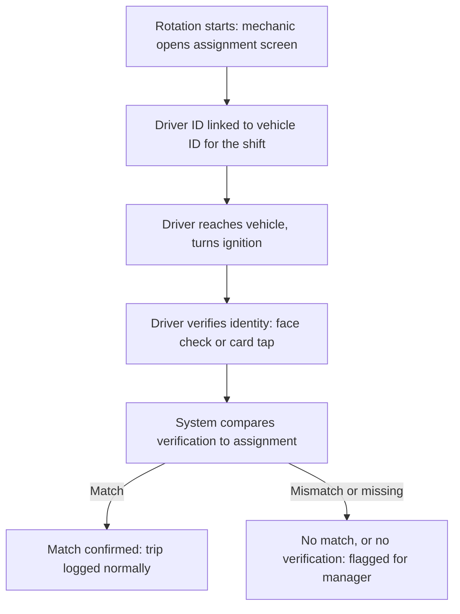
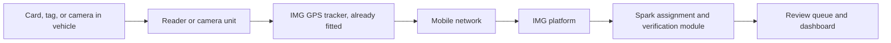

# 01 Document Summary

## Module 2 Overview

:::columns
### Today: Paper Handover
At the start of each two week rotation, vehicles are handed to drivers from a paper logbook kept in the mechanics room. The driver signs a waiver, keys are handed over by hand, and there is no independent record of who was actually driving a given vehicle at a given time. When something goes wrong, the paper trail is the only evidence, and it depends on the log being filled in correctly and matching who was actually driving.

### Tomorrow: Digital Assignment and Verification
Module 2 replaces the paper book with a simple digital record. The mechanic still assigns a vehicle to a driver for the shift, but the assignment now lives in a system instead of a notebook. At the moment the engine starts, the driver confirms who they are with a face check or, more simply, a quick card tap. If the person driving does not match the person assigned, a manager sees it and can look into it.
:::

:::callout
### Our Approach
Spark will digitise the vehicle handover Condor already runs, and add one verification step at ignition. The assignment record itself needs no new hardware. The only new hardware is the verification device inside each vehicle, and Condor chooses which type is fitted based on the comparison in this document.
:::

:::callout
### Intended Outcome
Condor receives a digital record of who was assigned each vehicle, a verification event confirming who actually drove it, and an exception list of mismatches for a manager to review. Every vehicle, driver, and rented asset uses one consistent ID so records line up across systems.
:::

# 02 How It Works

## From Paper Book to Digital Record

### Today, at shift handover

1. The mechanic hands physical keys to the driver rostered for that vehicle.
2. The driver signs a paper waiver in the handover book.
3. The mechanic writes the vehicle, driver, and date in the book by hand.
4. If the vehicle is handed to someone else mid shift, or breaks down, there is usually no written record of the change.

### With Module 2, at shift handover

1. The mechanic opens the assignment screen and links the driver's ID to the vehicle's ID for the rotation.
2. The system timestamps the assignment automatically. No handwriting, no paper.
3. At ignition, the driver confirms their identity using the method Condor selects, see Section 03.
4. The system compares the verification to the assignment. A match is logged. A mismatch or missing check is flagged for a manager.

### Workflow

### System architecture

Hardware inside the vehicle talks to the IMG GPS tracker already fitted, which sends data over the mobile network to the IMG platform. Spark's assignment and verification module reads from IMG and layers the match logic and review queue on top, so nothing about the existing tracker installation needs to change for stage one.

# 03 Driver Verification Methods

## Two Ways to Confirm Who Is Driving

Both methods answer the same question, who is at the wheel right now, but they work in very different ways. Method A is covered first below, followed by Method B, which is the default recommendation. Method A can be added later for specific vehicles if Condor decides continuous face verification is worth the extra cost.

### Method A: In Cabin Camera with Face Recognition

**How it works, in plain terms:** a small camera is mounted facing the driver, usually on the windscreen pillar or dashboard. It uses an infrared light that is invisible to the eye, so it can see the driver's face clearly even at night or with the cabin light off. A processor built into the camera unit, not a remote server, compares the live image against a reference photo taken when the driver was enrolled in the system. If the two match closely enough, the driver is verified. This comparison happens inside the vehicle, only the result, match or no match, needs to leave the vehicle in normal operation.

**What the hardware actually does:** the camera has its own small onboard chip designed for this exact task, so it does not need an internet connection to check a face. It checks continuously through the start of the trip, not just once, so it can catch a driver swap partway through a shift in a way a one time card tap cannot. Because processing happens on the device, no photo needs to be uploaded anywhere unless Condor specifically wants footage kept for flagged events.

**What it confirms, and what it does not:** the system confirms that the face in front of the camera resembles the enrolled photo closely enough to pass an agreed threshold. It is a stronger check than a card tap because a face is harder to hand to someone else than a card. It can still be fooled by poor image quality, and every driver needs to be enrolled with a clear reference photo before it works for them.

**Limitations to plan for:** sun glare, dust on the lens, low light without the infrared illuminator working, and full face coverings such as balaclavas in cold or dusty conditions can all reduce accuracy. Every driver and contractor needs to be enrolled once, and re-enrolled if staff turnover is frequent. Storing and processing a face image is regulated as biometric data under Uzbek personal data law, which requires written consent from each driver and requires the data to stay on servers inside Uzbekistan. One camera unit per vehicle costs more than one card reader, and the install is slightly more involved because the camera needs a clear, stable view of the driver's face.

### Method B: RFID or QR Card Tap In {.accent}

**How it works, in plain terms:** every driver and contractor carries one personal card or tag, similar to an office access card. A small reader is fitted near the ignition. Before starting the engine, the driver taps the card against the reader. The reader reads a unique number stored on the card and passes it to the GPS tracker already fitted in the vehicle, over a short wired connection called 1-Wire, the same wiring pattern used for card readers on many trackers, including IMG compatible units. The tracker checks the number against the list of authorised drivers, stamps the exact time, and attaches the driver ID to every trip, speed, and location record it already sends for that shift.

**What the hardware actually does:** the card itself has no battery, it is a passive RFID tag that only responds when it is close to the reader. The reader is a small unit, usually the size of a matchbox, mounted where the driver can reach it from the seat. It is wired into the tracker's data input, not into the vehicle's main computer, so fitting it does not affect the engine or other electronics. Optionally, the tracker can hold the ignition circuit open until a valid tap is read, so the vehicle simply will not start without one. Condor can choose to enable this or just record and flag mismatches without blocking the engine.

**What it confirms, and what it does not:** the system confirms that a specific card was presented to a specific vehicle at a specific time. It does not confirm that the person holding the card is the person the card belongs to, someone could hand their card to a colleague. This is a known limitation, and it is mitigated with a clear card issuance process and a review process for repeated mismatches.

**Limitations to plan for:** cards can be lost, shared, or left in another vehicle, so Condor needs a simple replacement process. The reader must be reachable from the driver's seat, which is a small install job per vehicle. If the IMG tracker already supports a card reader input, wiring is simpler and cheaper, this should be confirmed with the IMG vendor, item 16 in Section 05.

:::callout
### Recommendation
Method A is a stronger check but carries more cost, more install work, and a real consent and data residency requirement under Uzbek law. Method B is the lower risk starting point: no biometric data, simpler and cheaper hardware, and it directly replaces what the paper book already tracks. Spark recommends starting with Method B fleet wide, and piloting Method A only on a small group of vehicles later if Condor decides continuous verification is worth the extra cost and consent process.
:::

# 04 Hardware Requirements

## What Gets Fitted, Per Vehicle

The table below lists what is physically added to a vehicle for each method. Items marked shared apply regardless of which method Condor chooses.

| Item | Method A: face recognition | Method B: card / QR tap | Notes |
| --- | --- | --- | --- |
| Driver credential | Not applicable, the face is the credential | One RFID card or QR badge per person | Cards are passive, no battery |
| In vehicle unit | Inward facing camera with infrared illuminator | Compact card or QR reader near ignition | Camera needs a clear, stable view of the driver's face |
| Processing | Small onboard chip built into the camera unit | Handled by the existing GPS tracker | Neither method needs a new server in the vehicle |
| Wiring | Camera wired to tracker or vehicle power, plus data link | Reader wired to tracker's data input, 1-Wire or similar | Wiring does not connect to engine control systems |
| Optional immobiliser | Not typically used to block ignition | Tracker can hold ignition until a valid tap, if enabled | Condor decides whether to block or only flag |
| Approximate install time per vehicle | 1 to 2 hours | Under 1 hour | Depends on vehicle type and cabin layout |
| Data sensitivity | Facial image, classified as biometric data | Card ID only, no personal biometric data | Method A needs written consent and Uzbekistan based storage |

### Central system requirements

| Requirement | Detail |
| --- | --- |
| IMG platform access | Read access to trip, ignition, and driver ID fields, by report export or API |
| Driver and vehicle ID registry | One consistent ID per person and per vehicle, shared across all build modules |
| Hosting | Condor server or a protected cloud environment inside Uzbekistan, confirmed before the NDA data transfer |
| Connectivity | Each vehicle unit and the central system must tolerate the site's known connectivity outages during high wind from October, syncing once the link returns |
| Review interface | A simple screen for the nominated reviewer to see flagged mismatches and clear them |

# 05 Information We Need from Condor Energy

## Why We Are Asking

To build Module 2, Spark needs 28 items from Condor. Most are documents Condor already has, or short answers. No new equipment is needed to start the work itself, only to fit the verification hardware once a method is chosen. Items marked After NDA can wait until the NDA is signed. Where a document contains personal details such as names or ID numbers, those can be covered before sharing, Spark only needs to see the structure of the data and how it moves.

### A. How vehicles are handed out today

| # | What we need | Why we need it |
| --- | --- | --- |
| 1 | Photos or copies of 2 to 3 filled pages of the mechanic's vehicle handover book. Names can be covered. | This is the paper record being replaced. The digital form uses the same columns, so the mechanic's work does not change much. |
| 2 | A short step by step of the handover at the start of a shift: who gives the keys, what is signed, what is written. | So the digital steps follow the real steps, and nothing is missed. |
| 3 | What happens today when a driver gives keys to another person, or a vehicle breaks down mid shift. | These are the cases the system must catch or handle. |
| 4 | The shift calendar: rotation start and end dates, and which crew works when. | So assignments open and close automatically with each two week rotation. |
| 5 | One real past example where the wrong driver was blamed, for example the speeding case. Dates and vehicle only. | Used to test that the new system would have caught it. |

### B. Vehicles

| # | What we need | Why we need it |
| --- | --- | --- |
| 6 | A list of all vehicles: plate number, make and model, type, and usual base location. | Every vehicle needs one ID in the system. Without a clean list, records cannot be matched. |
| 7 | Which vehicles are Condor owned and which are rented, and from which company. | Rented vehicles use the contractor's GPS, not Condor's, and may need different handling. |
| 8 | The IMG tracker number fitted in each vehicle. | So IMG trip and engine data can be linked to the right vehicle. |
| 9 | Roughly how many vehicles are added or returned each month. | So the vehicle list can be kept up to date without extra work. |

### C. Drivers

| # | What we need | Why we need it |
| --- | --- | --- |
| 10 | A list of everyone allowed to drive: name, staff number, job title, employee or contractor, and crew. After NDA. | Every driver needs one ID. The system checks the person at the wheel against this list. |
| 11 | How many drivers join or leave each rotation. | Tells us how often cards must be issued or cancelled, and how much setup work this is. |
| 12 | Do staff already have an ID card or badge? If yes, what kind: photo only, barcode, or chip. | If a card already exists, it can be reused instead of making a new one, saving cost and time. |
| 13 | Optional: driving licence type and expiry date for each driver. | The system could warn if someone drives a vehicle their licence does not cover. |

### D. IMG GPS system

| # | What we need | Why we need it |
| --- | --- | --- |
| 14 | One month of trip reports exported from IMG, Excel or CSV. | Checks the format and lets Spark start building with real data before any live connection. |
| 15 | Read only login to IMG, or the IMG vendor's contact person. After NDA. | So engine on times and trips can be pulled automatically every day. |
| 16 | A question for the IMG vendor: can the trackers read a driver card, RFID or similar, and show the driver in reports? | If yes, card readers plug into the trackers already fitted, which is cheaper and simpler than adding new hardware. |
| 17 | Condor's IMG contract or plan: does it allow data export or an API? | Tells us how the systems can connect, and whether an upgrade is needed. |

### E. Locations and connectivity

Spark has the list of seven Condor locations: Kumli Facility, Urtakum Facility, Storm Camp, Operations Laydown Area, Drilling Laydown Area, and the future Compressor Station and Urtakum Camp. For each, a little more detail is needed.

| # | What we need | Why we need it |
| --- | --- | --- |
| 18 | Which locations hand out vehicles, and where the mechanic keeps the handover book. | This is where the digital handover screen will be placed. |
| 19 | Where vehicles are parked overnight and between shifts. | So the system knows where vehicles usually start the day, and can spot unusual use. |
| 20 | For each location: is there Wi-Fi, 4G, or no internet? Is there mains power or a generator? | The site link is known to fail in strong winds from October. The system must keep working offline and sync later. |
| 21 | When the Compressor Station and Urtakum Camp are expected to open. | So the system is set up to add these sites easily later. |

### F. Decisions from Condor

These are choices, not documents. Spark can advise on each one.

| # | What we need | Why we need it |
| --- | --- | --- |
| 22 | How drivers confirm who they are at ignition: camera with face check, card or QR tap, Spark's suggestion, or a small test group first. | This decides what equipment is needed in each vehicle, per Sections 03 and 04 above. |
| 23 | Who checks flagged cases, wrong driver or no tap, and how quickly. | A flag is only useful if someone looks at it. |
| 24 | Confirmation from HR or legal that recording who drives each vehicle is allowed. If face check is chosen, written consent from drivers. | Uzbek personal data law applies. Condor should be fully protected. |
| 25 | Language of the screens: Uzbek, Russian, English, or a mix. | Many mechanics and drivers speak Uzbek or Tajik. The screens must be easy for them to use. |

### G. People and access

| # | What we need | Why we need it |
| --- | --- | --- |
| 26 | One main contact person for Module 2, phone and email. | One person to answer questions keeps the work moving quickly. |
| 27 | A contact in the maintenance team who can help fit readers or cameras in vehicles later. | This hardware is wired into vehicles. Condor's team knows the vehicles and can approve the work. |
| 28 | The signed NDA, and where the system should run: a Condor server or a protected cloud inside Uzbekistan, plus an IT contact. | Needed before receiving private data. Data stays inside Uzbekistan and never goes to public cloud. |

### Checklist

:::columns
### Needed to start
Can be shared before the NDA, with names covered.

- Item 1: pages of the handover book
- Item 2: handover steps
- Item 3: key sharing and breakdown cases
- Item 4: shift calendar
- Item 6: vehicle list
- Item 7: owned vs rented vehicles
- Item 12: existing staff ID cards
- Item 14: one month of IMG trip reports
- Item 16: IMG driver card question
- Items 18 to 20: locations, parking, internet, and power
- Item 22: verification method choice
- Item 25: screen language
- Item 26: main contact person

### Needed after the NDA
Follows once the NDA is signed.

- Item 5: past wrong driver example
- Item 8: IMG tracker numbers
- Item 9: monthly vehicle changes
- Item 10: driver list
- Item 11: driver turnover
- Item 13: licence details, optional
- Item 15: IMG login or vendor contact
- Item 17: IMG contract terms
- Item 21: future site dates
- Item 23: who reviews flags
- Item 24: HR or legal confirmation
- Item 27: maintenance contact
- Item 28: hosting choice and IT contact, the NDA itself should be signed as early as possible
:::

Please send items by email to the Spark team. Photos taken on a phone are fine for paper documents.

# 06 How We Move Forward

## Next Steps for Module 2

:::cards
### 01 Share what you have
Condor sends the items marked needed to start, with names covered where needed, and confirms the verification method preference.

### 02 Sign the NDA
Once signed, Spark receives the remaining items and full driver and vehicle detail to begin real data validation.

### 03 Confirm hardware plan
Spark and Condor's maintenance contact agree the install plan for readers or cameras, vehicle by vehicle.

### 04 Build and pilot
Spark builds the digital assignment and verification module, and pilots it on a small group of vehicles before fleet wide rollout.
:::
