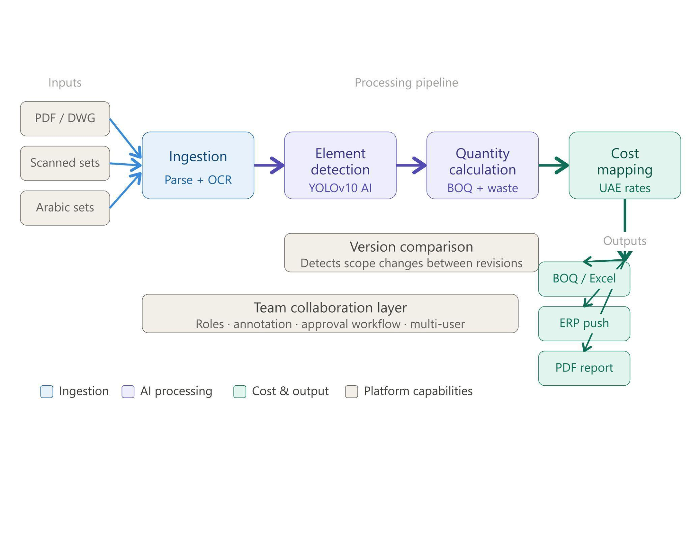
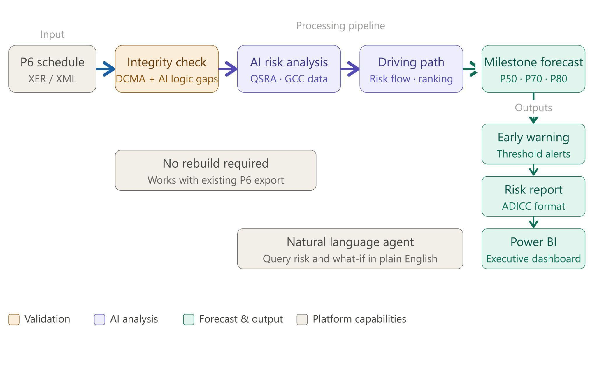
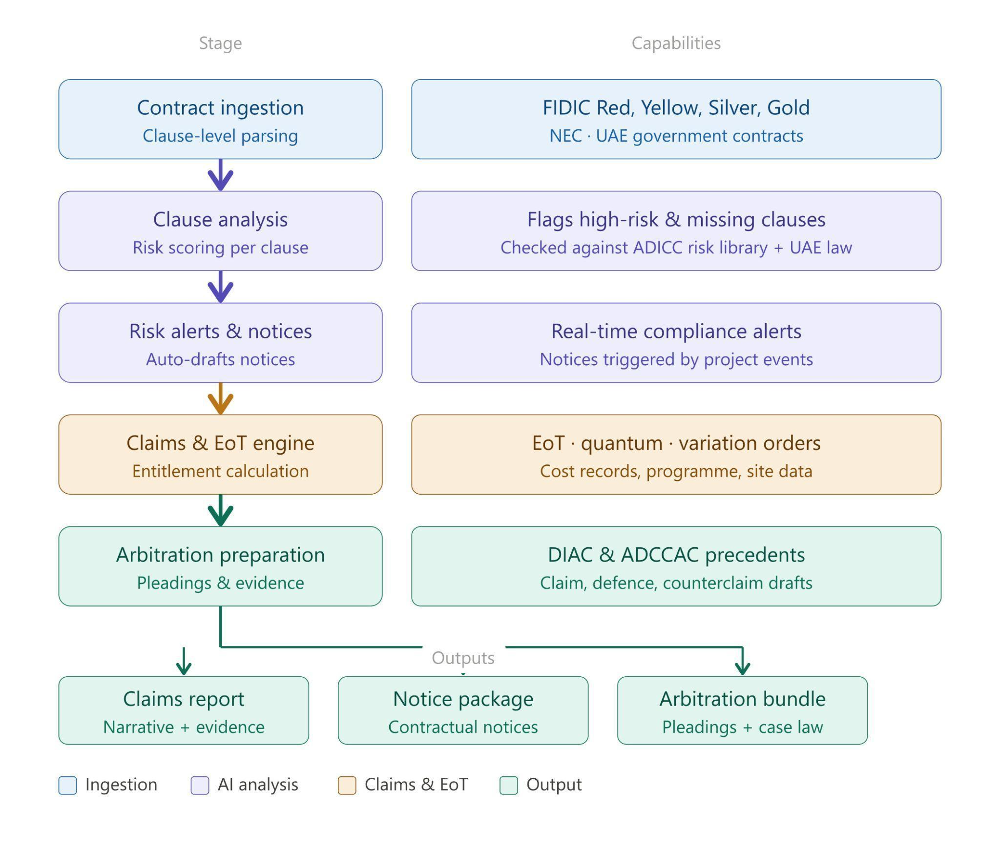
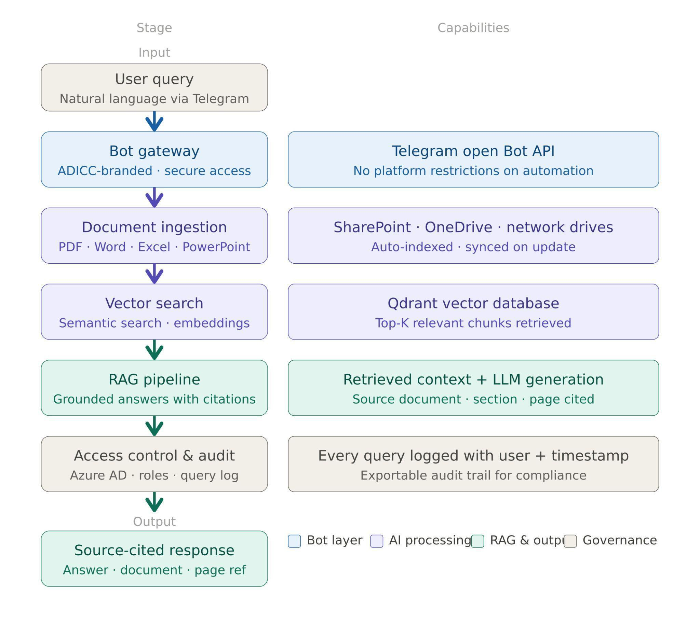
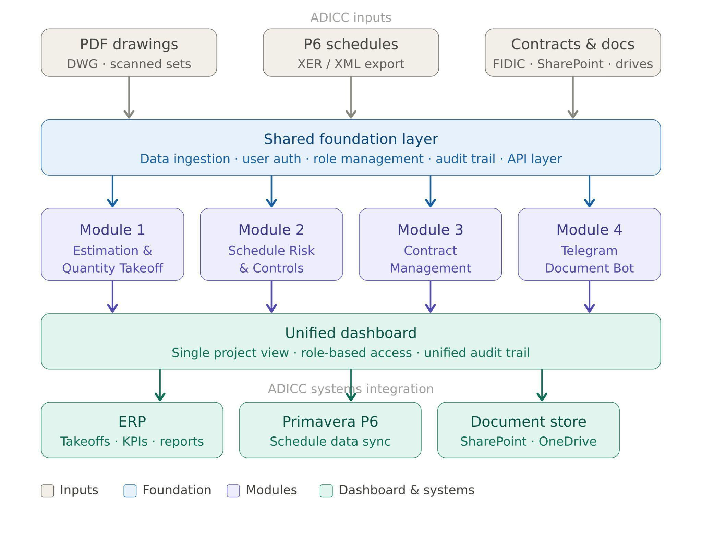
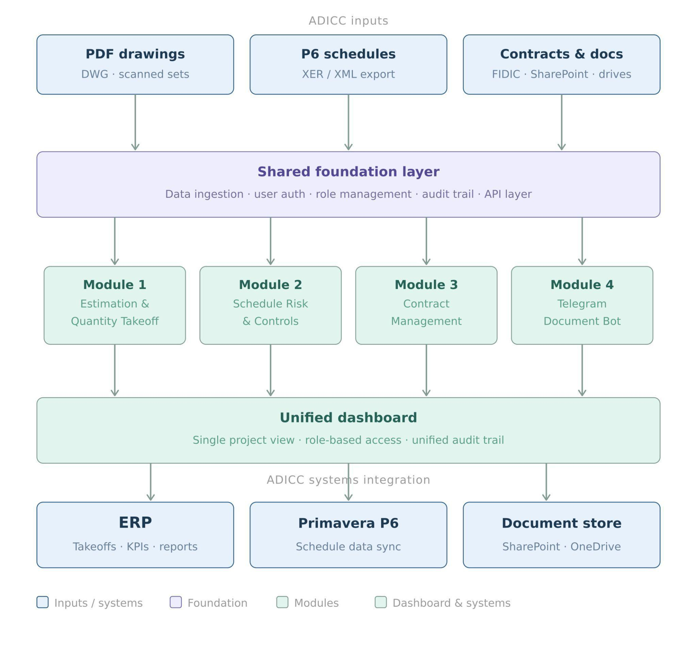
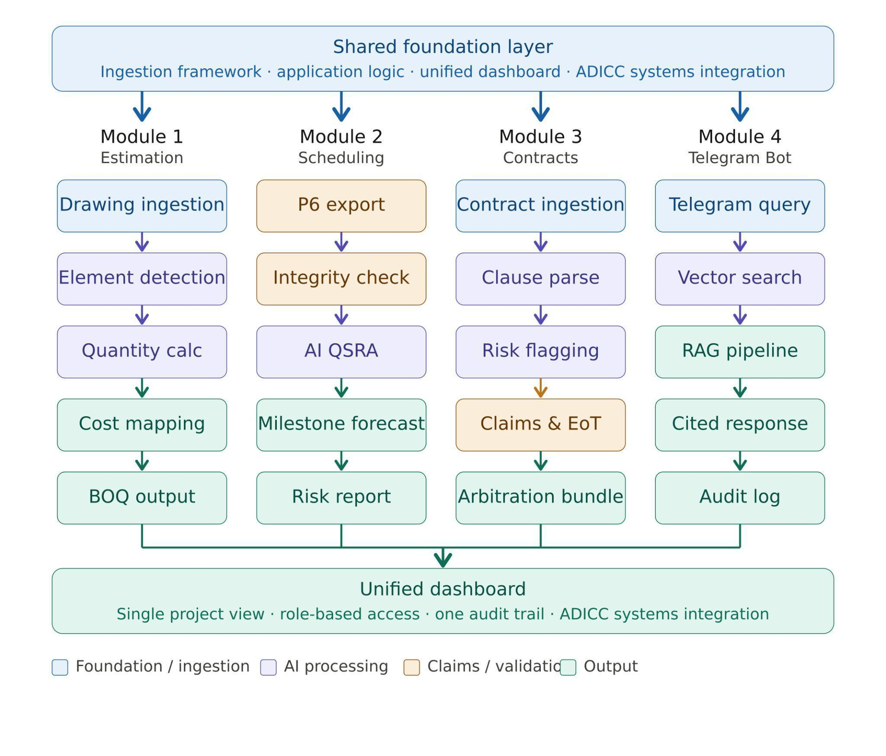

# 01 Executive Summary

## Proposal Overview

:::columns
### The Challenge
ADICC operates across multiple construction projects in the UAE and currently relies on a combination of market-leading tools and manual processes for estimation, scheduling, contract management, and document access. The absence of a single, integrated platform creates duplication of effort, data silos between departments, and a lack of real-time visibility across projects. Each tool operates independently with no unified layer connecting them. Internal document access depends on manual searches, creating delays in decision-making and increasing the risk of working from outdated information.

### The Opportunity
By consolidating all four capability areas into a single AI-powered platform purpose-built for the UAE construction context, ADICC can eliminate tool fragmentation, reduce duplication, and unlock a unified operational view across estimation, scheduling, contracts, and knowledge management. The platform augments the expertise of ADICC's teams — automating time-intensive tasks and surfacing the intelligence needed to make faster, better-informed decisions.
:::

:::callout
### Our Approach
Spark Technologies has reviewed all four capability requirements submitted by ADICC and proposes a single unified platform delivered across all four modules simultaneously. The platform is built from the ground up for the UAE construction context — trained on UAE authority drawing conventions, FIDIC contract standards, GCC schedule risk profiles, and UAE construction law. All four modules share one foundation, one dashboard, and one integration layer into ADICC's existing systems.
:::

:::callout
### The Outcome
ADICC receives a single AI-powered platform covering automated quantity takeoffs from PDF drawings, schedule risk analysis integrated with Primavera P6, clause-level contract intelligence and claims management, and a Telegram-based document access bot connected to ADICC's internal file repository. All modules operate under a unified interface, a single audit trail, and one integration path into ADICC's existing systems.
:::

# 02 About Spark Technologies

## Who We Are

We are a Dubai-based Full Spectrum AI technology company specialising in enterprise-grade AI solutions for the construction, infrastructure, and industrial sectors.

:::tight
Headquartered in Dubai, UAE

10+ years in software development and technology delivery

1.5+ years focused exclusively on Enterprise AI solutions

Deep expertise in UAE regulatory environments, FIDIC contracts, and GCC construction operations

We combine advanced AI engineering with practical domain knowledge to solve high-impact, real-world problems across the full construction project lifecycle.
:::

## Our Solution Areas

:::cards
### SME Outcome as a Service
AI training, consultation, automation, and custom development for SMEs looking to turn AI into measurable business outcomes.

### Enterprise Solutions
Advanced AI and deep learning solutions for enterprise operations, inspections, prediction, automation, and secure system integration.

### Custom AI App Development
Custom AI apps for enterprises, internal workflow automation, AI-powered document systems, CRM and operations apps.

### In-House AI Products
Ready-to-deploy AI products built for specific industry verticals. Spark Hire, Leadsreach, CircleVoice, and Funnel Flow.
:::

# 03 Solution Overview

## Our Assessment

Spark Technologies has reviewed all four capability requirements submitted by ADICC. Our assessment evaluated each requirement against three criteria: technical feasibility, UAE construction context fit, and alignment with ADICC's existing systems and workflows.

### Module 1 — Estimation & Quantity Takeoff

ADICC currently evaluates Togal.AI as a benchmark for AI-powered estimation. Togal.AI uses deep learning to analyse PDF drawings and automatically generate quantity takeoffs with team collaboration on a single project. While effective in its current form, it does not natively support UAE trade rate structures, authority submission formats, or Arabic-language drawing sets.

Our proposed solution is a custom-built AI Estimation Engine that ingests PDF and CAD drawing sets, automatically detects and classifies building elements by type, and generates itemised quantity takeoffs mapped to ADICC's preferred cost database and UAE trade rates. The system supports full team collaboration, version comparison across drawing revisions, and direct export to ADICC's estimating and ERP workflows. The AI is trained on drawing conventions common across UAE projects, including authority-standard drawing formats and Arabic-language annotation.

### Module 2 — Scheduling & Project Controls

ADICC currently evaluates nPlan as a benchmark for schedule risk analytics. nPlan integrates with Primavera P6 and automates Quantitative Schedule Risk Analysis using machine learning trained on historical schedule data. The core gap for ADICC is the absence of UAE-specific project data in existing platforms and the lack of native alignment with ADICC's specific P6 environment and reporting workflows.

Our proposed solution is a custom AI Schedule Risk platform that connects directly to ADICC's existing Primavera P6 environment via native XER/XML export — no schedule rebuild required. The platform runs automated QSRA using a risk model trained on historical construction schedule data from the UAE and GCC region, identifies at-risk milestones, flags logic issues, and generates early-warning reports in formats aligned to ADICC's project controls standards. A natural language agent allows planners and project managers to interrogate schedule risk in plain English.

### Module 3 — Contract Management & Claims

ADICC currently evaluates Masin.AI as a benchmark for contract and claims management. Masin.AI reviews contracts clause by clause, flags risks, drafts claims, calculates entitlements, and prepares arbitration pleadings, trained on real arbitration cases across FIDIC and GCC construction disputes.

Our proposed solution is a custom AI Contract Intelligence platform trained specifically on ADICC's own contract portfolio, UAE construction law, FIDIC Red/Yellow/Silver Book standards, DIAC and ADCCAC arbitration precedents, and GCC-specific claims protocols. The platform reviews new contracts clause by clause against a risk library built from ADICC's historical claims experience, drafts notices and extension of time submissions, calculates financial entitlements, and prepares structured arbitration pleadings with evidence organisation. It is designed to operate from the contract seeding stage onward as a prevention tool, not just a reactive claims instrument.

### Module 4 — Telegram Document Access Bot

ADICC requires a tool enabling stakeholders to access internal company documents through natural language queries. The original requirement specified WhatsApp as the interface. However, WhatsApp's Business API imposes restrictions that make it unsuitable for this use case: a mandatory 24-hour messaging window, strict Meta-approved message template requirements, severe limitations on automated bot responses, and no support for file retrieval within automated flows.

We recommend Telegram as the interface for this module. Telegram's fully open Bot API supports unlimited automated messaging, file delivery, natural language query handling, and role-based access controls with no platform restrictions on automation. The Telegram bot connects to ADICC's internal document repository via a Retrieval-Augmented Generation pipeline — users send natural language queries, the system searches the document library using vector-based semantic search, and returns accurate, source-cited responses within seconds. Integration with ADICC's existing file repository is included in scope.

## Summary of Recommendations

:::table widths=120.0,131.2,200.3
| Module | What ADICC Wants to Solve | Our Approach |
| --- | --- | --- |
| Module 1 — Estimation & Quantity Takeoff | AI analysis of PDF drawings to auto-generate quantity takeoffs, material schedules, and cost estimates tailored to UAE trade rates and ADICC's cost database. | Deep learning drawing parser, quantity calculation engine, UAE rate database, drawing version comparison, team collaboration layer, ERP export |
| Module 2 — Scheduling & Project Controls | Automated QSRA integrated with existing Primavera P6 schedules. Early warning on at-risk milestones, schedule integrity checks, and delay forecasting. | AI schedule risk engine, P6 XER/XML integration, Monte Carlo simulation, milestone tracker, driving path analysis, Power BI connector |
| Module 3 — Contract Management & Claims | Clause-by-clause contract review, risk flagging, notice drafting, entitlement calculation, claims report generation, and arbitration preparation. | FIDIC-trained NLP engine, UAE law corpus, EoT calculator, quantum engine, claims drafter, arbitration module, DIAC/ADCCAC precedents |
| Module 4 — Telegram Document Access Bot | Natural-language queries via Telegram to retrieve documents and information from ADICC's internal document repository with source-cited responses. | Telegram Bot API, RAG pipeline, vector search, SharePoint/OneDrive connector, role-based access control, query audit log |
:::

# 04 Scope of Work

## Scope of Work

Spark Technologies proposes delivery of all four platform modules as a single unified engagement. All modules share one platform foundation, one unified dashboard, and one integration path into ADICC's existing systems.

### Module 1 — AI Estimation & Quantity Takeoff Engine

This module delivers an AI-powered estimation layer that ingests PDF drawing sets and automatically generates itemised quantity takeoffs, material schedules, and preliminary cost estimates mapped to UAE trade rates and ADICC's preferred cost database.

**Scope includes:**

- Drawing ingestion pipeline — accepts PDF, DWG, and scanned drawing sets in standard UAE authority submission formats
- AI element detection engine — identifies and classifies structural, architectural, MEP, and civil elements from drawing sets
- Automatic quantity calculation — generates itemised takeoff schedules with units, quantities, and UAE-standard waste factors
- UAE trade rate database integration — maps quantities to ADICC's preferred rate schedule and current UAE market rates
- Drawing version comparison — detects and quantifies changes between drawing revisions for change order management
- Team collaboration layer — multi-user access with role-based permissions, annotation, and approval workflow
- Export to Excel, PDF, and ADICC's ERP and estimating system
- Arabic drawing set support — element detection trained on Arabic-language annotation and UAE authority drawing conventions

{width=432.0}

:::table widths=110.2,191.3,150.0
| AI Use Case | Description | Expected Output |
| --- | --- | --- |
| Drawing Element Detection | Deep learning model detects and classifies structural, architectural, MEP, and civil elements directly from PDF drawing pages | Classified element schedule with quantities and dimensions per drawing |
| Quantity Takeoff Generation | AI engine calculates net and gross quantities per element type, applying UAE-standard waste factors and coverage rates | Itemised BOQ-format takeoff schedule exportable to Excel and ERP |
| Cost Estimation | Quantities mapped against ADICC cost database and live UAE trade rates to produce preliminary cost estimates | Preliminary cost plan with line-item breakdown and total project estimate |
| Drawing Version Delta | Comparison engine analyses two drawing revisions and identifies added, removed, and modified elements with quantity impact | Change log with scope delta and cost impact per revision |
| Collaboration & Approval | Multi-user workspace with annotation, comment threads, and approval workflow for takeoff validation | Audit trail of all takeoff decisions with approver identity and timestamp |
:::

<!-- pagebreak -->

### Module 2 — AI Schedule Risk & Project Controls Platform

This module delivers automated schedule risk analysis and early-warning intelligence integrated directly with ADICC's existing Primavera P6 environment. No schedule rebuild is required — the platform ingests P6 XER/XML exports and returns risk forecasts, milestone alerts, and schedule integrity reports.

**Scope includes:**

- Primavera P6 integration via native XER/XML export — no schedule rebuild or P6 configuration changes required
- AI-powered Quantitative Schedule Risk Analysis (QSRA) — activity duration uncertainty modelled from historical GCC construction data
- Schedule integrity checker — automated DCMA 14-point check plus AI-identified logic gaps and constraint issues
- At-risk milestone identification — probabilistic forecasting of milestone completion dates with confidence intervals
- Driving path analysis — visualisation of risk flow through the schedule from activity to milestone
- Early warning system — automated alerts when risk thresholds are breached, delivered to project managers via platform dashboard
- Natural language schedule agent — planners can query schedule risk and what-if scenarios in plain English
- Auto-generated schedule risk reports in ADICC's project controls report format
- Power BI integration for executive dashboard reporting

{width=432.0}

:::table widths=110.2,191.3,150.0
| AI Use Case | Description | Expected Output |
| --- | --- | --- |
| Schedule Integrity Check | Automated DCMA 14-point analysis plus AI-identified logic gaps, missing relationships, and open ends across the full schedule | Integrity report with severity-ranked issues and recommended fixes |
| AI-Powered QSRA | Machine learning model trained on GCC construction schedule data forecasts activity duration distributions without manual risk workshops | Probabilistic milestone completion dates with P50, P70, P80 confidence levels |
| At-Risk Milestone Alerts | Early warning engine monitors schedule updates and triggers alerts when milestone slippage probability exceeds configured thresholds | Real-time alert feed with milestone risk dashboard and trend history |
| Driving Path Analysis | Visual mapping of risk flow through the schedule — identifies which activities have greatest influence on key milestone outcomes | Driving path diagram with ranked risk contributors per milestone |
| Natural Language Query Agent | Plain English interface for planners and project managers to interrogate schedule risk without specialist risk software knowledge | Instant risk summaries, what-if scenario outputs, and schedule comparisons in plain English |
:::

<!-- pagebreak -->

### Module 3 — AI Contract Management & Claims Platform

This module delivers an AI-powered contract intelligence platform trained specifically on ADICC's contract portfolio and UAE construction law. It reviews new contracts clause by clause, flags risks, drafts notices and claims, calculates entitlements, and prepares structured arbitration pleadings.

**Scope includes:**

- Contract ingestion and clause-level parsing — FIDIC Red, Yellow, Silver, and Gold Book; NEC; bespoke UAE government contracts
- Clause-by-clause risk review — flags non-standard, high-risk, and missing clauses against ADICC's risk library and UAE law requirements
- Risk alert system — real-time compliance alerts triggered by project events mapped to contract clause obligations
- Notice drafting engine — auto-drafts contractual notices, early warnings, and instructions aligned to contract requirements
- Extension of Time (EoT) engine — calculates delay entitlement, critical path impact, and compensation events from programme and site records
- Quantum calculation engine — computes financial entitlements from cost records, preliminaries, and variation orders
- Claims report generation — produces structured claims reports with narrative, programme analysis, and supporting evidence organiser
- Arbitration pleading preparation — drafts statement of claim, defence, and counterclaim with case law references from DIAC and ADCCAC precedents
- ADICC contract corpus training — platform trained on ADICC's historical contracts and claims for institutional knowledge capture

{width=369.0}

:::table widths=110.2,191.3,150.0
| AI Use Case | Description | Expected Output |
| --- | --- | --- |
| Clause-by-Clause Risk Review | AI parses every clause against ADICC's risk library, UAE law requirements, and FIDIC standards, flagging deviations and high-risk provisions | Risk-scored contract report with flagged clauses, risk level, and recommended amendments |
| Contractual Notice Drafting | Platform monitors project events and auto-drafts required contractual notices within required timeframes, preventing time-bar loss | Draft notice ready for review within minutes of triggering event; timestamp and clause reference included |
| EoT Entitlement Calculation | Delay analysis engine calculates extension of time entitlement from programme records, site logs, and compensation event data | EoT calculation report with critical path analysis, delay periods, and entitlement quantum |
| Claims Report Generation | Structured claims report generated with narrative argument, programme analysis, cost breakdown, and supporting document index | Submission-ready claims document with evidence organiser and cross-references |
| Arbitration Pleading Preparation | AI drafts arbitration pleadings with reference to DIAC/ADCCAC precedents, UAE construction law, and case-specific facts and evidence | Structured pleading document with legal citations, evidence index, and cross-examination questions |
:::

<!-- pagebreak -->

### Module 4 — Telegram Document Access Bot

This module deploys a Telegram-based AI bot enabling ADICC stakeholders to query internal company documents using natural language. The bot connects to ADICC's existing file repository and returns accurate, source-cited answers within seconds. WhatsApp is not recommended due to Meta's Business API restrictions on automated responses and file retrieval — Telegram's fully open Bot API provides all required functionality without platform limitations.

**Scope includes:**

- Telegram Bot deployment with ADICC-branded bot identity and secure access credentials
- Integration with ADICC's existing document repository — SharePoint, OneDrive, network drives, or equivalent file storage
- Document ingestion pipeline — automated indexing and embedding of all supported document types (PDF, Word, Excel, PowerPoint)
- Vector search engine — semantic search across ADICC's full document library using natural language queries
- RAG pipeline — retrieved document context fed to AI to generate accurate, grounded answers with source citations
- Role-based access control — user access governed by ADICC's existing Active Directory / Azure AD directory
- Query logging and audit trail — all queries and responses logged with user identity and timestamp
- Document update sync — new documents automatically ingested and indexed within a configurable sync interval

{width=402.0}

:::table widths=110.2,191.3,150.0
| AI Use Case | Description | Expected Output |
| --- | --- | --- |
| Natural Language Document Query | User sends a plain-language question via Telegram; the bot searches ADICC's document library and returns a concise, accurate answer | Cited answer with source document, section, and page reference returned within seconds |
| Document Retrieval | Bot identifies and returns the most relevant document or section, including file download links where applicable | Relevant document excerpt or direct file link delivered in the Telegram chat |
| Role-Based Access Control | Access to document categories governed by user role — site engineers cannot access board-level financial documents | User-specific document access boundaries enforced at query time |
| Query Audit Log | All bot queries and responses logged with user identity, timestamp, and document sources for compliance purposes | Exportable query log available to Platform Administrators |
| Document Index Sync | New documents added to ADICC's repository are automatically detected, ingested, and indexed within the configured sync interval | Document library always current; no manual re-indexing required |
:::

<!-- pagebreak -->

## Unified Platform

All four modules are delivered as a single software platform sharing one foundation layer, one unified dashboard, and one integration path into ADICC's existing systems. Modules are accessible based on user role and licence. All four modules feed into one unified project view and one audit trail across all project activity.

{width=475.5}

# 05 Client Responsibilities

## Client Responsibilities

To support successful delivery of the AI-Powered Unified Construction Platform, ADICC will be responsible for providing the following inputs, access, and approvals across all four modules. These responsibilities are required prior to or during the relevant delivery phase. Spark Technologies will confirm specific timelines and requirements for each item during the Technical Discovery session.

:::large
### Data and System Access

- Access to Primavera P6 environment for XER/XML export testing and integration validation
- Sample PDF drawing sets covering the range of UAE authority formats in use
- Access to ADICC’s document repository (SharePoint, OneDrive, or equivalent) for integration configuration
- Representative sample of ADICC’s historical contracts and claims portfolio for Contract Intelligence model training
- ADICC cost database and preferred UAE trade rate schedule for Estimation module configuration

### Subject Matter Expert and Validation Support

- Nominated ADICC project lead and primary point of contact for the duration of delivery
- Quantity surveying and estimation team available to validate Estimation module outputs and confirm rate schedules
- Planning team available to validate Schedule Risk outputs and confirm P6 export formats
- Commercial and legal team available to validate Contract Intelligence outputs and confirm risk library requirements
- Agreement on KPI validation method and acceptance criteria before go-live

### IT, Hosting, and Security

- Confirmation of preferred hosting model: cloud, on-premise, or hybrid
- User authentication method: Active Directory, SSO, or platform-managed credentials
- Network access approvals including firewall, VPN, or whitelisting requirements
- Internal IT and security approvals for platform deployment and data access
:::

### AI Model Training Data

- Minimum 100–200 sample PDF drawing sets across structural, architectural, MEP, and civil disciplines in UAE authority submission formats, including Arabic-language drawing sets where applicable, for Estimation module element detection model training
- Sample of ADICC's historical Primavera P6 schedule exports (XER/XML) covering a range of project types and sizes, for Schedule Risk model calibration against GCC construction data
- Minimum 40–50 historical contracts from ADICC's portfolio covering FIDIC Red, Yellow, and Silver Book engagements, plus any bespoke UAE government contract formats, for Contract Intelligence model training
- Historical claims files, notices, and EoT submissions where available, to build ADICC-specific risk library and entitlement calculation baseline
- Sample document library from ADICC's repository (minimum 200–500 documents across project types) for Telegram bot vector index construction and query accuracy validation

# 06 Implementation Timeline & KPIs

## Project Roadmap

All four platform modules are delivered as a single unified engagement. The timeline below reflects the structured delivery phases from initial configuration through to full operational handover. Specific milestone dates will be confirmed during the Technical Discovery session and formalised in the Statement of Work.

:::roadmap widths=348.0,120.0
| Deliverables | Duration |
| --- | --- |
| Technical discovery session with ADICC teams across all four modules | Week 1-2 |
| P6 export format confirmed, sample drawing sets reviewed, document repository access established | Week 2-3 |
| Platform infrastructure configured; AI model training initiated on ADICC data | Week 3-4 |
| All four modules built and integrated into the unified platform foundation | Week 5-7 |
| P6 integration live, drawing detection engine calibrated, contract corpus ingested, Telegram bot deployed | Week 6-8 |
| Unified dashboard live with role-based access configured for all agreed user groups | Week 9-10 |
| KPI validation completed with ADICC teams against agreed acceptance criteria | Week 11-12 |
| User training delivered across all stakeholder groups | Week 12-13 |
| Final sign-off and operational handover completed | Week 13-14 |
:::

## KPIs {.ruled .large}

:::kpis
### Module 1
- Quantity takeoff generation time reduced vs. manual baseline, validated by QS team
- Drawing version delta detection accuracy confirmed against manual change log review
- Export to ERP confirmed live with manual re-entry reduced by ≥90% vs. baseline

### Module 2 — Schedule Risk
- DCMA 14-point integrity check running on all P6 exports within agreed processing time
- P50/P70/P80 milestone forecasts delivered within agreed turnaround after each P6 export
- Early warning alerts triggered within configured thresholds, validated against schedule updates

### Module 3 — Contract Intelligence
- Notice drafting turnaround: draft contractual notice generated within 24 hours of triggering event
- EoT calculation output validated against manual quantum review by ADICC commercial team
- Risk-scored contract report delivered within agreed turnaround of contract ingestion

### Module 4 — Telegram Bot
- Document query response time under 10 seconds for 95% of queries
- Role-based access control validated — users cannot access documents outside their permission level
- Document index sync confirmed: new documents indexed within configured sync interval
:::

# 07 Commercial Proposal

## Investment & Commercial Terms

Spark Technologies operates a structured commercial framework for all enterprise platform engagements. Initial deployment is structured around a POC mobilisation fee to cover discovery, configuration, and pilot validation. Full deployment commercials are provided following the Technical Discovery session, once scope, integration requirements, and platform KPIs have been confirmed with ADICC’s technical and commercial teams.

### Commercial Framework

:::commercial widths=152.2,219.8,97.5
| Solution / Deliverable | Description | Investment (AED) |
| --- | --- | --- |
| Module 1 — AI Estimation & Quantity Takeoff | Drawing ingestion pipeline, element detection engine, quantity calculation, UAE rate database, ERP export, team collaboration layer | AED TBD |
| Module 2 — AI Schedule Risk & Project Controls | P6 XER/XML integration, QSRA engine, Monte Carlo simulation, milestone tracker, driving path analysis, Power BI connector | AED TBD |
| Module 3 — AI Contract Management & Claims | FIDIC-trained NLP engine, clause risk review, notice drafting, EoT calculator, quantum engine, arbitration module | AED TBD |
| Module 4 — Telegram Document Access Bot | Telegram Bot API, RAG pipeline, vector search, SharePoint/OneDrive connector, role-based access control, query audit log | AED TBD |
| Unified Platform Foundation | Shared dashboard, single integration layer, unified audit trail, role-based access across all four modules | AED TBD |
| Ongoing Support & Maintenance | Annual support, model retraining, platform updates — structured as a separate support agreement | AED TBD |
| TOTAL INVESTMENT |  | AED TBD |
:::

### Commercial Assumptions

- This proposal is valid for 30 days from the date of issue
- Any changes to scope following contract execution are governed by a formal change request process
- Quoted pricing excludes applicable taxes, third-party infrastructure costs, and any client-side IT or civil works

# 08 Conclusion

## The Path Forward

ADICC has identified four real and addressable operational requirements. Spark Technologies has evaluated all four against the available technology landscape, the UAE construction context, and ADICC's specific operational environment. Our assessment confirms that a custom-built unified platform delivers greater long-term value than integrating existing third-party tools: it can be trained on ADICC's own data, aligned to UAE regulatory and contractual frameworks, and extended as ADICC's requirements evolve.

The AI Estimation Engine accepts ADICC's existing PDF drawing sets. The Schedule Risk platform connects to existing P6 XER exports. The Contract Intelligence module ingests ADICC's current contract portfolio. The Telegram bot connects to ADICC's existing document repository. No significant infrastructure change is required to begin.

Spark Technologies is ready to begin the moment ADICC confirms direction. The recommended next step is a scoping session to confirm integration requirements for Primavera P6 and the document repository, agree platform KPIs, and align on the delivery timeline.

# 09 Next Steps & Sign-off

## How We Move Forward

:::steps
### Proposal Review
Client reviews this proposal and raises any questions or clarifications required.

### Technical Discovery
Joint session to validate scope, integration requirements, and platform KPIs with ADICC technical teams.

### Contract Execution
Finalise and sign the Statement of Work. POC mobilisation fee invoiced upon execution.

### Project Kickoff
Delivery team onboarded within 3 business days of payment receipt. Discovery begins immediately.
:::

:::contact
:::

:::addendum
label: ADDENDUM A
title: ADICC
subtitle: Technical Architecture & Implementation Guide
prepared_for: ADICC
prepared_by: Spark Technologies
date: June 2025
note: This addendum provides the technical architecture and implementation detail for the ADICC AI-Powered Unified Construction Platform. It is intended for the technical teams of both parties and should be read alongside the main proposal document.
:::

# A1 Document Purpose & Scope

## Purpose & Scope

This document provides the technical architecture, stack decisions, AI pipeline design, security model, infrastructure approach, and risk assessment for the ADICC AI-Powered Unified Construction Platform.

It complements the main proposal and covers all four solution modules — AI Estimation & Quantity Takeoff, AI Schedule Risk & Project Controls, AI Contract Management & Claims, and the Telegram Document Access Bot — with a shared platform foundation and separate pipeline tracks for each. The architecture is designed so that all modules run on the same infrastructure, share the same dashboard and integration layer, and can be configured independently based on ADICC's operational requirements.

## Intended Audience

:::table widths=150.0,301.5
| Audience | Purpose |
| --- | --- |
| ADICC Technical Team | Architecture review and technical validation |
| ADICC IT & Security | Infrastructure, hosting, and access control review |
| ADICC Project Controls | P6 integration and data flow validation |
| Spark Engineering Team | Internal implementation reference |
:::

# A2 System Architecture Overview

## Architectural Principles

:::table widths=120.0,331.5 bold_first
| Principle | Detail |
| --- | --- |
| Existing Infrastructure First | All data enters through what ADICC already has — Primavera P6 schedules, PDF drawing sets, existing document repositories, and contract files. No infrastructure replacement is required. |
| Human-in-the-Loop | Every AI-generated output — takeoff, risk forecast, contract flag, or document answer — is presented for human review before action. AI augments professional judgment; it does not replace it. |
| Modular & Extensible | Each module is independently configurable. Adding new drawing types, schedule formats, contract standards, or document categories does not require rebuilding the platform. |
| UAE Construction Context | All AI models are trained and calibrated for the UAE construction environment — UAE authority drawing formats, FIDIC contract standards, GCC schedule risk profiles, and UAE construction law. |
| Data Sovereignty Compliant | All project data, contract information, and document content can be hosted entirely within ADICC's own infrastructure. No mandatory data sharing with external platforms. |
| Continuous Improvement | Operator feedback, corrections, and confirmations feed back into AI models — improving detection accuracy, risk calibration, and answer quality with every operational cycle. |
| Role-Based Access | All platform features and data views are governed by a permission matrix aligned to ADICC's operational roles and security requirements. |
:::

<!-- pagebreak -->

## High-Level Architecture Diagram

{width=475.5}

# A3 Technology Stack

## Technology Stack

The technology choices below apply across all four modules. The stack is selected for production readiness, AI/ML ecosystem compatibility, construction domain fit, and delivery speed.

#### A3.1 Frontend

:::table widths=99.8,99.7,251.2
| Technology | Role | Justification |
| --- | --- | --- |
| React 18 + TypeScript | Core UI Framework | Component-based, type-safe. Supports role-based routing and real-time dashboard updates across all four modules. |
| TanStack Query | Server State Management | Efficient API data fetching, caching, and synchronisation for live schedule risk, takeoff progress, and document query views. |
| Recharts / D3.js | Data Visualisation | Schedule risk waterfall charts, quantity takeoff summaries, contract risk heat maps, and milestone probability distributions. |
| Shadcn/ui + Tailwind CSS | UI Component Library | Accessible, customisable components with utility-first CSS — rapid, consistent UI delivery across all platform modules. |
:::

#### A3.2 Backend

:::table widths=99.8,99.7,251.2
| Technology | Role | Justification |
| --- | --- | --- |
| Python 3.12 | Primary Language | Best ecosystem for AI/ML, NLP, document processing, schedule analysis, and construction data pipelines. |
| FastAPI | API Framework | Async, high-performance REST API. Handles real-time alerts, Telegram bot webhooks, and ERP integration endpoints. |
| Celery + Redis | Task Queue | Async drawing processing, schedule risk inference, document indexing, and scheduled repository sync jobs. |
| PostgreSQL 16 | Primary Database | Structured records for projects, takeoffs, schedule exports, contract clauses, audit trails, and user management. |
| Qdrant / Weaviate | Vector Database | High-throughput semantic search across ADICC's document library for the Telegram RAG pipeline. |
| MinIO / Local Storage | Object Storage | Drawing files, PDF contracts, exported reports, and AI output artefacts — stored on-premise within ADICC's infrastructure. |
:::

#### A3.4 AI & Machine Learning

:::table widths=99.8,99.7,251.2
| Technology | Role | Justification |
| --- | --- | --- |
| YOLOv10 / RT-DETR | Drawing Element Detection | Real-time multi-class detection of structural, architectural, MEP, and civil elements from PDF drawing pages. Fine-tuned on UAE drawing conventions. |
| Transformer NLP (LLaMA 3 / Mistral) | Contract & Document Intelligence | Clause-level contract parsing, risk classification, notice drafting, and document query answering. Fine-tuned on FIDIC and UAE law corpus. |
| Sentence Transformers | Semantic Document Embedding | Converts ADICC's document library into dense vector representations for semantic search in the Telegram RAG pipeline. |
| Monte Carlo + ML Risk Model | Schedule Risk Analysis | Probabilistic QSRA engine combining Monte Carlo simulation with ML-calibrated duration uncertainty from GCC schedule history. |
| RAG Pipeline (LangChain) | Document Query Engine | Retrieval-Augmented Generation pipeline connecting Telegram queries to ADICC's document vector store with source citation. |
| TensorRT (NVIDIA) | Inference Optimisation | FP16 quantisation for GPU-accelerated inference across drawing detection and NLP models. |
:::

#### A3.5 Integrations

:::table widths=99.8,99.7,251.2
| Technology | Role | Justification |
| --- | --- | --- |
| Primavera P6 XER/XML | Schedule Integration | Native P6 export format ingestion — no P6 configuration changes or API access required. Compatible with all P6 versions. |
| Telegram Bot API | Document Access Bot | Fully open bot API supporting unlimited automated messaging, file delivery, inline keyboards, and webhook-based message handling. |
| SharePoint / OneDrive API | Document Repository | Microsoft Graph API integration for document indexing, sync, and access control aligned to ADICC's existing Azure AD permissions. |
| REST / GraphQL ERP API | ERP Integration | Takeoff quantities and project KPIs pushed to ADICC's ERP system via REST or GraphQL API depending on platform. |
| Power BI Connector | Reporting & Dashboards | Live data connector for schedule risk and project performance dashboards in Power BI for executive reporting. |
:::

# A4 AI Processing Pipeline

## Four-Module Pipeline Design

The AI processing pipeline is built around a shared platform foundation with four module-specific processing tracks. The shared foundation — ingestion framework, application logic, unified dashboard, and ADICC systems integration — is deployed once and shared across all modules.

{width=475.5}

<!-- pagebreak -->

### Module 1 Pipeline — AI Estimation & Quantity Takeoff

:::tight
Step 1 — Drawing ingestion pipeline accepts PDF, DWG, and scanned drawing sets. OCR and layout analysis extract text, dimensions, and spatial relationships from each page.

Step 2 — Page classification model identifies drawing type (floor plan, elevation, section, structural, MEP) and routes to the appropriate detection model.

Step 3 — YOLOv10-based element detection model identifies and classifies all building elements per drawing page with bounding boxes, labels, and confidence scores.

Step 4 — Quantity calculation engine computes net and gross quantities per element type, applying UAE-standard waste factors, coverage rates, and measurement rules.

Step 5 — Cost mapping engine assigns unit rates from ADICC's rate database and UAE market rates to produce preliminary cost estimates per element and per trade.

Step 6 — Output layer generates itemised BOQ, drawing markup, and cost plan. Data pushed to ERP. Version delta report generated if a previous drawing revision exists.
:::

### Module 2 Pipeline — AI Schedule Risk & Project Controls

:::tight
Step 1 — P6 XER/XML export ingested. Schedule parsed into activity network with logic relationships, constraints, calendars, and resource assignments.

Step 2 — Schedule integrity engine runs automated DCMA 14-point check plus AI-identified logic issues, open ends, and constraint density analysis.

Step 3 — AI risk model assigns duration uncertainty distributions to every activity based on activity type, sector, and GCC historical schedule performance data.

Step 4 — Monte Carlo simulation runs probabilistic forecast for every milestone. P50, P70, and P80 completion dates calculated with confidence intervals.

Step 5 — Driving path analysis identifies activities most influential on each key milestone. Risk ranking produced for project team prioritisation.

Step 6 — Dashboard and reports published. Milestone alert engine monitors subsequent schedule updates and triggers notifications when risk thresholds are breached.
:::

### Module 3 Pipeline — AI Contract Management & Claims

:::tight
Step 1 — Contract document ingested and parsed at clause level. FIDIC book type, bespoke amendments, and UAE-specific provisions identified and tagged.

Step 2 — Clause risk engine reviews every clause against ADICC's risk library, UAE law requirements, and FIDIC standard provisions. Risk score assigned per clause.

Step 3 — Risk alert engine monitors project event feed (delays, instructions, variations) and maps events to contract clause obligations, triggering notice drafting.

Step 4 — Notice and claims drafting engine auto-generates contractual notices, EoT submissions, and claims narratives. Entitlement calculation engine runs financial quantum.

Step 5 — Arbitration preparation module assembles structured pleading with legal arguments, evidence index, case law citations, and cross-examination questions.

Step 6 — All contract actions, notices, and claims logged to audit trail. Document version history maintained. Reports generated for commercial management review.
:::

<!-- pagebreak -->

### Module 4 Pipeline — Telegram Document Access Bot

:::tight
Step 1 — Document indexing pipeline connects to ADICC's file repository via SharePoint/OneDrive API or network drive connector. All supported document types ingested and chunked.

Step 2 — Sentence transformer model converts document chunks into dense vector embeddings stored in the Qdrant vector database with metadata tags.

Step 3 — User sends natural language query via Telegram. Bot receives the query via webhook and passes it to the RAG query engine.

Step 4 — Query embedded using the same sentence transformer. Qdrant performs semantic search across document embeddings. Top-K relevant chunks retrieved.

Step 5 — Retrieved chunks passed as context to the LLM alongside the user query. LLM generates a grounded, accurate answer citing source documents.

Step 6 — Answer and source citations delivered to the user in Telegram. Query and response logged to audit trail with user identity and timestamp.
:::

# A5 Security & Access Control

## Security & Access Control

## A5.1 Authentication & Encryption

:::tight
Primary authentication via OAuth 2.0 with short-lived JWT access tokens (15-minute expiry) and secure refresh token rotation

Multi-factor authentication enforced for all accounts with alert management or admin permissions

AES-256 encryption at rest for all stored files, project records, contract documents, and database fields

TLS 1.3 encryption in transit for all API communications, Telegram bot traffic, P6 data ingestion, and browser sessions

All takeoff approvals, contract actions, schedule updates, and admin actions logged with timestamp and user identity for full audit trail

Cross-module data access requires explicit role permission — no automatic data sharing between project environments
:::

## A5.2 Role-Based Access Control

:::table widths=131.2,69.8,69.8,69.7,110.2
| Permission | Platform Admin | Project Manager | Commercial / QS | Senior Management |
| --- | --- | --- | --- | --- |
| View unified platform dashboard | Yes | Yes | Yes | Yes |
| Run quantity takeoffs | Yes | Yes | Yes | — |
| View schedule risk reports | Yes | Yes | Yes | Yes |
| Create / submit claims | Yes | — | Yes | — |
| Query document bot (Telegram) | Yes | Yes | Yes | Yes |
| Configure AI model settings | Yes | — | — | — |
| Approve cross-module data sync | Yes | — | — | Yes |
| Manage users and permissions | Yes | — | — | Admin |
:::

<!-- pagebreak -->

## A5.3 Deployment Options

Spark Technologies supports three deployment models. On-premise or hybrid options are recommended for ADICC given the sensitivity of contract, project, and document data.

:::table widths=90.0,181.5,180.0
| Option | Description | Recommended For |
| --- | --- | --- |
| On-Premise | All components deployed on ADICC-owned servers. Full data sovereignty. Recommended for contract and claims modules. | Primary recommendation |
| Cloud (AWS / Azure) | Fully managed cloud deployment. Fastest delivery. Suitable for estimation and scheduling modules. | Available on request |
| Hybrid | AI inference on-premise; dashboard and reporting via cloud. Balances data control with accessibility. | Preferred long-term architecture |
:::

# A6 Technical Risks & Mitigations

## Technical Risks & Mitigations

The following risk assessment covers the primary technical risks across platform delivery. Risks are assessed based on likelihood and potential impact on delivery timeline and KPI achievement.

:::table widths=151.5,54.0,246.0
| Risk | Level | Mitigation |
| --- | --- | --- |
| PDF drawing quality insufficient for element detection accuracy | High | Drawing quality audit conducted in Week 1. Minimum resolution and format requirements defined upfront. Pre-processing pipeline applied — deskew, contrast normalisation, OCR correction — before detection model inference. |
| Primavera P6 export format incompatibility | High | P6 version and XER/XML export format confirmed at project kickoff. Parser tested against ADICC's actual schedule exports before build begins. CSV fallback configured if XER ingestion issues arise. |
| ADICC document repository access and format variability | High | Repository audit in Week 1. Supported file types and access credentials confirmed. Ingestion pipeline handles PDF, Word, Excel, PowerPoint, and scanned documents with OCR fallback. |
| Element detection accuracy below KPI threshold on initial deployment | Medium | Confidence scoring flags low-accuracy detections for human review. Model fine-tuned against ADICC-specific drawing sets during the calibration period. KPIs measured at agreed milestones, not day one. |
| ADICC contract corpus insufficient for model training | Medium | Corpus assessment conducted at project kickoff. Minimum corpus size defined. Synthetic augmentation and transfer learning from the FIDIC public corpus used where ADICC data is sparse. |
| Schedule risk model calibration to UAE/GCC conditions | Medium | GCC-specific training data collected from Spark's existing project dataset. Model calibration validated against a sample of ADICC's historical schedule outcomes during the calibration period. |
| Telegram bot response accuracy below stakeholder expectations | Medium | Answer quality evaluated against a test set of representative queries drawn from ADICC's document library before go-live. Threshold accuracy agreed with ADICC before deployment. |
| Operator resistance to new platform workflows | Low | UX validated with ADICC users during testing. Training sessions delivered before go-live. Platform designed to reduce workload, not add to it — adoption case built into onboarding. |
| On-premise deployment complexity | Low | Docker containers and environment-agnostic configuration. Deployment scripts tested against a clean server environment before ADICC deployment. IT team walkthrough included in delivery scope. |
:::

# A7 Technical Conclusion

## Technical Conclusion

The platform is designed to work with what ADICC already has. The shared foundation is identical across all four modules, and the architecture is built so that each module can be validated and refined independently without affecting the others.

Every technology choice in this document is made with three priorities in mind: fit for the UAE construction context, compatibility with ADICC's existing systems, and the ability to improve continuously as ADICC's data and operational feedback is incorporated over time.

The Telegram Document Access Bot replaces the originally requested WhatsApp tool on technical grounds. Telegram's open Bot API delivers all required functionality — natural language queries, file retrieval, source-cited responses, and role-based access — without the platform restrictions that make WhatsApp unsuitable for automated document retrieval at scale. The capability and user experience are equivalent; the technical constraints are not.

Spark Technologies is ready to begin the moment ADICC confirms direction.

# 10 Why Spark Technologies

## Why Choose Us {.compact}

:::cards
### UAE Construction Expertise
Deep understanding of UAE regulatory frameworks, FIDIC contract standards, authority submission requirements, and local construction market dynamics.

### End-to-End Delivery
We own the full delivery lifecycle from discovery and build through to implementation, training, and ongoing support — with no dependency on third-party vendors.

### AI Built for Construction
Purpose-built AI systems trained on construction-specific data. Not generic tools repurposed — every model is designed for the domain.

### Speed to Value
Structured delivery with clear milestones. ADICC sees measurable results at every stage before committing to the next.

### Outcome Guarantee
We back our delivery with measurable KPIs. If outcomes are not met, we keep working until they are.

### Data Security & Sovereignty
All data remains within ADICC's infrastructure. Role-based access controls, encryption at rest and in transit, and full audit trails as standard.
:::

:::contact
:::
